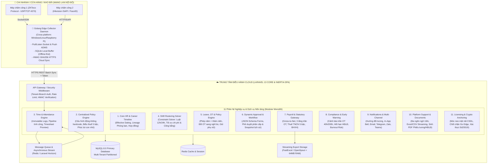

# TÀI LIỆU ĐẶC TẢ THIẾT KẾ KỸ THUẬT: NỀN TẢNG QUẢN TRỊ NGUỒN NHÂN LỰC THÔNG MINH SMART-HR

## Hệ sinh thái Quản trị Nhân sự Đa Chi nhánh & Chuỗi Doanh nghiệp (Enterprise Modular HRMS)

Tài liệu này xác định kiến trúc toàn diện từ mô hình dữ liệu, cơ chế phi tập trung (Edge IoT), các động cơ tính toán nghiệp vụ (Calculation Pipelines, Constraint Solvers) và hệ thống biểu mẫu động cho **Smart-HR**. Hệ thống xây dựng trên nền tảng **Laravel 13+ (PHP 8.4+)**, **Golang Edge Collector Daemon**, kiến trúc frontend **Inertia.js v2 + Vue 3 Composition API + PrimeVue** và cơ sở dữ liệu **MySQL 8.0** chuẩn hóa, bám sát các chuẩn mực quản trị hiện đại và **Bộ luật Lao động Việt Nam 2019 (BLLĐ 2019)** cùng các chính sách thuế, bảo hiểm xã hội mới nhất (bao gồm biểu thuế TNCN 5 bậc hiệu lực từ năm 2026).

---

## 1. TỔNG QUAN KIẾN TRÚC HỆ THỐNG (SYSTEM ARCHITECTURE)

### 1.1 Sơ đồ Phân tầng Kiến trúc Tổng thể (High-Level Architecture)



---

## 2. PHÂN HỆ IOT EDGE COLLECTOR (GOLANG DAEMON TRÊN MẠNG LAN)

### 2.1 Thách thức Vận hành Mạng LAN & Giải pháp
- **Thách thức**: Các cửa hàng bán lẻ và kho bãi thường sử dụng đường truyền mạng dân dụng (IP động, sau NAT, không mở port public). Máy chấm công chỉ hiện diện trong mạng nội bộ (IP Private `192.168.x.x`). Khi đứt cáp quang hoặc mất Internet, dữ liệu quẹt thẻ có nguy cơ bị thất thoát.
- **Giải pháp**: Ứng dụng Go Daemon đóng gói binary duy nhất (single executable), khởi chạy như một Windows Service hoặc Linux Systemd Daemon trên máy thu ngân/máy chủ kho.
  1. *Giao thức đa dạng*: Hỗ trợ socket UDP/TCP `4370` chuẩn ZKTeco, HTTP ISAPI Hikvision, và đóng vai trò máy chủ ADMS Push Server nhận dữ liệu khi nhân viên quét vân tay/khuôn mặt.
  2. *Bộ đệm ngoại tuyến (Offline-First SQLite)*: Khi mất mạng WAN, toàn bộ quẹt thẻ được ghi nhận ngay lập tức vào file SQLite cục bộ với trạng thái `synced = 0`.
  3. *Đồng bộ bảo mật theo lô (HMAC Batch Sync)*: Định kỳ mỗi 30-60 giây (hoặc ngay lập tức khi có mạng), quét các bản ghi chưa đồng bộ, đóng gói thành Batch JSON kèm chữ ký số HMAC-SHA256 đẩy lên Cloud API.

```go
// Cấu trúc Payload đồng bộ từ Golang Edge lên Cloud
type SyncAttendancePayload struct {
    TenantID     string            `json:"tenant_id"`
    BranchID     string            `json:"branch_id"`
    DeviceSerial string            `json:"device_serial"`
    Timestamp    int64             `json:"timestamp"`
    BatchID      string            `json:"batch_id"`
    Logs         []AttendancePunch `json:"logs"`
    Signature    string            `json:"signature"`
}

type AttendancePunch struct {
    DeviceUserCode string `json:"device_user_code"` // Mã ID trên máy chấm công
    PunchTime      string `json:"punch_time"`       // Format: "2026-09-04 17:30:15"
    VerifyType     int    `json:"verify_type"`      // 1: Vân tay, 2: FaceID, 3: Thẻ từ
    PunchState     int    `json:"punch_state"`     // 0: Check In, 1: Check Out, 255: Auto
}
```

---

## 3. THIẾT KẾ CƠ SỞ DỮ LIỆU CHUẨN HÓA (MYSQL 8.0 SCHEMA DESIGN)

Toàn bộ hệ thống áp dụng nguyên tắc **Multi-Tenant** (`tenant_id`), kết hợp mô hình dữ liệu **Effective Dating** và **Immutable Audit Trail**.

### 3.1 Phân hệ Tổ chức & Cây Timeline Nhân sự (Org Chart & Career Timeline)

```sql
-- 1. Bảng doanh nghiệp / Tổ chức thuê hệ thống
CREATE TABLE `tenants` (
    `id` BIGINT UNSIGNED AUTO_INCREMENT PRIMARY KEY,
    `code` VARCHAR(50) NOT NULL UNIQUE,
    `name` VARCHAR(255) NOT NULL,
    `tax_code` VARCHAR(50) NULL,
    `address` VARCHAR(255) NULL,
    `is_active` BOOLEAN DEFAULT TRUE,
    `created_at` TIMESTAMP NULL,
    `updated_at` TIMESTAMP NULL
) ENGINE=InnoDB DEFAULT CHARSET=utf8mb4 COLLATE=utf8mb4_unicode_ci;

-- 2. Bảng chi nhánh / Cửa hàng / Kho bãi
CREATE TABLE `branches` (
    `id` BIGINT UNSIGNED AUTO_INCREMENT PRIMARY KEY,
    `tenant_id` BIGINT UNSIGNED NOT NULL,
    `code` VARCHAR(50) NOT NULL,
    `name` VARCHAR(255) NOT NULL,
    `address` VARCHAR(255) NULL,
    `is_remote_or_island` BOOLEAN DEFAULT FALSE COMMENT 'Chi nhánh thuộc vùng cao, vùng sâu, vùng xa, biên giới, hải đảo (áp dụng Đ.137 Khoản 1 Điểm a BLLĐ)',
    `secret_key` VARCHAR(100) NOT NULL COMMENT 'Secret key dùng để ký HMAC cho Edge Daemon',
    `is_active` BOOLEAN DEFAULT TRUE,
    `created_at` TIMESTAMP NULL,
    `updated_at` TIMESTAMP NULL,
    UNIQUE KEY `uk_tenant_branch_code` (`tenant_id`, `code`),
    CONSTRAINT `fk_branches_tenant` FOREIGN KEY (`tenant_id`) REFERENCES `tenants` (`id`) ON DELETE CASCADE
) ENGINE=InnoDB DEFAULT CHARSET=utf8mb4 COLLATE=utf8mb4_unicode_ci;

-- 3. Bảng phòng ban danh mục gốc (Cây phân cấp phòng ban)
CREATE TABLE `departments` (
    `id` BIGINT UNSIGNED AUTO_INCREMENT PRIMARY KEY,
    `tenant_id` BIGINT UNSIGNED NOT NULL,
    `branch_id` BIGINT UNSIGNED NOT NULL,
    `code` VARCHAR(50) NOT NULL COMMENT 'Mã phòng ban cố định (ví dụ: DEPT_SALE, DEPT_IT)',
    `parent_id` BIGINT UNSIGNED NULL COMMENT 'Phòng ban cấp trên (cấu trúc Tree)',
    `status` ENUM('ACTIVE', 'INACTIVE', 'ARCHIVED') DEFAULT 'ACTIVE',
    `created_at` TIMESTAMP NULL,
    `updated_at` TIMESTAMP NULL,
    UNIQUE KEY `uk_tenant_dept_code` (`tenant_id`, `code`),
    INDEX `idx_parent` (`parent_id`),
    CONSTRAINT `fk_dept_tenant` FOREIGN KEY (`tenant_id`) REFERENCES `tenants` (`id`) ON DELETE CASCADE,
    CONSTRAINT `fk_dept_branch` FOREIGN KEY (`branch_id`) REFERENCES `branches` (`id`) ON DELETE CASCADE
) ENGINE=InnoDB DEFAULT CHARSET=utf8mb4 COLLATE=utf8mb4_unicode_ci;

-- 4. Bảng phiên bản thông tin phòng ban (Lưu vết lịch sử đổi tên, thay đổi chức năng nhiệm vụ)
CREATE TABLE `department_versions` (
    `id` BIGINT UNSIGNED AUTO_INCREMENT PRIMARY KEY,
    `department_id` BIGINT UNSIGNED NOT NULL,
    `name` VARCHAR(255) NOT NULL COMMENT 'Tên phòng ban tại thời kỳ này',
    `mission_function` TEXT NULL COMMENT 'Mô tả chức năng, nhiệm vụ và quyền hạn của phòng ban',
    `manager_id` BIGINT UNSIGNED NULL COMMENT 'Trưởng bộ phận tại thời kỳ này',
    `effective_date` DATE NOT NULL COMMENT 'Ngày bắt đầu áp dụng tên/chức năng mới',
    `end_date` DATE NULL COMMENT 'Ngày kết thúc áp dụng (NULL nếu là phiên bản hiện tại)',
    `change_reason` VARCHAR(255) NULL COMMENT 'Lý do đổi tên hoặc tái cấu trúc',
    `created_at` TIMESTAMP NULL,
    INDEX `idx_dept_effective` (`department_id`, `effective_date`, `end_date`),
    CONSTRAINT `fk_dept_ver_dept` FOREIGN KEY (`department_id`) REFERENCES `departments` (`id`) ON DELETE CASCADE
) ENGINE=InnoDB DEFAULT CHARSET=utf8mb4 COLLATE=utf8mb4_unicode_ci;

-- 5. Bảng hồ sơ nhân viên gốc
CREATE TABLE `employees` (
    `id` BIGINT UNSIGNED AUTO_INCREMENT PRIMARY KEY,
    `tenant_id` BIGINT UNSIGNED NOT NULL,
    `user_code` VARCHAR(50) NOT NULL COMMENT 'Mã nhân viên (EMP001...)',
    `full_name` VARCHAR(255) NOT NULL,
    `gender` ENUM('MALE', 'FEMALE', 'OTHER') NOT NULL,
    `birth_date` DATE NOT NULL,
    `citizen_id` VARCHAR(50) NULL COMMENT 'Số CCCD/Hộ chiếu',
    `email` VARCHAR(255) NOT NULL,
    `phone` VARCHAR(20) NULL,
    `join_date` DATE NOT NULL COMMENT 'Ngày bắt đầu làm việc tại công ty',
    `official_date` DATE NULL COMMENT 'Ngày ký hợp đồng chính thức sau thử việc',
    `child_birth_date` DATE NULL COMMENT 'Ngày sinh của con nhỏ (dùng cho chính sách thai sản)',
    `status` ENUM('PROBATION', 'OFFICIAL', 'ON_LEAVE', 'TERMINATED') DEFAULT 'PROBATION',
    `created_at` TIMESTAMP NULL,
    `updated_at` TIMESTAMP NULL,
    UNIQUE KEY `uk_emp_tenant_code` (`tenant_id`, `user_code`),
    CONSTRAINT `fk_emp_tenant` FOREIGN KEY (`tenant_id`) REFERENCES `tenants` (`id`) ON DELETE CASCADE
) ENGINE=InnoDB DEFAULT CHARSET=utf8mb4 COLLATE=utf8mb4_unicode_ci;

-- 6. Bảng Timeline Nghề nghiệp & Biến động Nhân sự (Career Timeline - Effective Dating)
CREATE TABLE `employee_career_timelines` (
    `id` BIGINT UNSIGNED AUTO_INCREMENT PRIMARY KEY,
    `employee_id` BIGINT UNSIGNED NOT NULL,
    `event_type` ENUM('ONBOARDING', 'TRANSFER', 'PROMOTION', 'ROLE_CHANGE', 'SALARY_ADJUSTMENT', 'OFFBOARDING') NOT NULL,
    `department_id` BIGINT UNSIGNED NOT NULL COMMENT 'Phòng ban được phân bổ trong giai đoạn này',
    `position_id` BIGINT UNSIGNED NOT NULL COMMENT 'Vị trí chức danh',
    `job_title` VARCHAR(150) NOT NULL COMMENT 'Tên chức danh hiển thị',
    `manager_id` BIGINT UNSIGNED NULL COMMENT 'Người quản lý trực tiếp tại giai đoạn này',
    `effective_date` DATE NOT NULL COMMENT 'Ngày bắt đầu áp dụng',
    `end_date` DATE NULL COMMENT 'Ngày kết thúc (NULL nếu đang là hiện tại)',
    `decision_number` VARCHAR(100) NULL COMMENT 'Số quyết định điều chuyển/bổ nhiệm/tăng lương',
    `decision_date` DATE NULL COMMENT 'Ngày ký quyết định',
    `notes` TEXT NULL COMMENT 'Ghi chú lý do điều chuyển',
    `created_at` TIMESTAMP NULL,
    INDEX `idx_timeline_emp` (`employee_id`, `effective_date`, `end_date`),
    INDEX `idx_timeline_dept` (`department_id`, `effective_date`),
    CONSTRAINT `fk_timeline_emp` FOREIGN KEY (`employee_id`) REFERENCES `employees` (`id`) ON DELETE CASCADE,
    CONSTRAINT `fk_timeline_dept` FOREIGN KEY (`department_id`) REFERENCES `departments` (`id`) ON DELETE RESTRICT
) ENGINE=InnoDB DEFAULT CHARSET=utf8mb4 COLLATE=utf8mb4_unicode_ci;

-- 7. Bảng hợp đồng lao động
CREATE TABLE `employee_contracts` (
    `id` BIGINT UNSIGNED AUTO_INCREMENT PRIMARY KEY,
    `employee_id` BIGINT UNSIGNED NOT NULL,
    `contract_number` VARCHAR(100) NOT NULL,
    `contract_type` ENUM('PROBATION', 'DEFINITE_TERM', 'INDEFINITE_TERM', 'SEASONAL') NOT NULL,
    `start_date` DATE NOT NULL,
    `end_date` DATE NULL COMMENT 'NULL nếu là hợp đồng không xác định thời hạn',
    `base_salary` DECIMAL(15,2) NOT NULL COMMENT 'Lương cơ bản ghi trên hợp đồng',
    `insurance_salary` DECIMAL(15,2) NOT NULL COMMENT 'Mức lương làm căn cứ đóng BHXH',
    `is_active` BOOLEAN DEFAULT TRUE,
    `created_at` TIMESTAMP NULL,
    `updated_at` TIMESTAMP NULL,
    INDEX `idx_contract_emp` (`employee_id`, `start_date`, `end_date`),
    CONSTRAINT `fk_contract_emp` FOREIGN KEY (`employee_id`) REFERENCES `employees` (`id`) ON DELETE CASCADE
) ENGINE=InnoDB DEFAULT CHARSET=utf8mb4 COLLATE=utf8mb4_unicode_ci;
```

---

### 3.2 Phân hệ Trung tâm Cấu hình Quy chế Động (Unified Policy Engine - Zero Hardcode)

```sql
-- 8. Bảng phiên bản chính sách doanh nghiệp
CREATE TABLE `policy_versions` (
    `id` BIGINT UNSIGNED AUTO_INCREMENT PRIMARY KEY,
    `tenant_id` BIGINT UNSIGNED NOT NULL,
    `code` VARCHAR(50) NOT NULL,
    `name` VARCHAR(255) NOT NULL,
    `effective_from` DATE NOT NULL COMMENT 'Ngày bắt đầu có hiệu lực tính toán',
    `effective_to` DATE NULL COMMENT 'Ngày hết hiệu lực (NULL nếu đang là chính sách hiện hành)',
    `is_active` BOOLEAN DEFAULT TRUE,
    `created_at` TIMESTAMP NULL,
    `updated_at` TIMESTAMP NULL,
    INDEX `idx_policy_effective` (`tenant_id`, `effective_from`, `effective_to`),
    CONSTRAINT `fk_policy_tenant` FOREIGN KEY (`tenant_id`) REFERENCES `tenants` (`id`) ON DELETE CASCADE
) ENGINE=InnoDB DEFAULT CHARSET=utf8mb4 COLLATE=utf8mb4_unicode_ci;

-- 9. Cấu hình quy chế chấm công, đi muộn, làm thêm giờ và xếp ca
CREATE TABLE `attendance_policy_configs` (
    `id` BIGINT UNSIGNED AUTO_INCREMENT PRIMARY KEY,
    `policy_version_id` BIGINT UNSIGNED NOT NULL,
    `grace_period_late_minutes` INT DEFAULT 0 COMMENT 'Số phút đi muộn cho phép không bị phạt',
    `grace_period_early_minutes` INT DEFAULT 0 COMMENT 'Số phút về sớm cho phép không bị phạt',
    `leave_unit_hours` DECIMAL(4,2) DEFAULT 4.00 COMMENT 'Đơn vị tính nghỉ phép (4h = nửa ngày, 8h = 1 ngày)',
    `early_leave_unit_hours` DECIMAL(4,2) DEFAULT 0.25 COMMENT 'Đơn vị làm tròn muộn/sớm (0.25h = 15p)',
    `min_rest_hours_between_shifts` INT DEFAULT 12 COMMENT 'Nghỉ tối thiểu giữa 2 ca liên tiếp (Điều 110 BLLĐ)',
    `min_weekly_rest_hours` INT DEFAULT 24 COMMENT 'Nghỉ hàng tuần liên tục (Điều 111 BLLĐ)',
    `max_weekly_standard_hours` INT DEFAULT 48 COMMENT 'Giờ làm việc tiêu chuẩn tối đa/tuần (Điều 105 BLLĐ)',
    `ot_rate_weekday` DECIMAL(4,2) DEFAULT 1.50 COMMENT 'Hệ số OT ngày thường (Điều 98 BLLĐ: 150%)',
    `ot_rate_weekend` DECIMAL(4,2) DEFAULT 2.00 COMMENT 'Hệ số OT cuối tuần (Điều 98 BLLĐ: 200%)',
    `ot_rate_holiday` DECIMAL(4,2) DEFAULT 3.00 COMMENT 'Hệ số OT ngày lễ (Điều 98 BLLĐ: 300%)',
    `night_shift_bonus_rate` DECIMAL(4,2) DEFAULT 0.30 COMMENT 'Phụ cấp làm ca đêm (ít nhất 30% theo Điều 98)',
    `compensation_rate` DECIMAL(4,2) DEFAULT 8.00 COMMENT 'Số giờ OT tương đương quy đổi 1 ngày nghỉ bù',
    `penalty_tiers_json` JSON NOT NULL COMMENT 'Nấc phạt theo phút: [{"min":1,"max":15,"fine":50000},{"min":16,"max":30,"fine":100000}]',
    `frequency_penalty_json` JSON NOT NULL COMMENT 'Hệ số phạt theo số lần trong tháng: [{"count":3,"mult":1.0},{"count":5,"mult":2.0}]',
    CONSTRAINT `fk_att_cfg_policy` FOREIGN KEY (`policy_version_id`) REFERENCES `policy_versions` (`id`) ON DELETE CASCADE
) ENGINE=InnoDB DEFAULT CHARSET=utf8mb4 COLLATE=utf8mb4_unicode_ci;

-- 10. Cấu hình chính sách phúc lợi Con nhỏ & Gia đình (Doanh nghiệp tự thiết lập)
CREATE TABLE `child_welfare_policies` (
    `id` BIGINT UNSIGNED AUTO_INCREMENT PRIMARY KEY,
    `policy_version_id` BIGINT UNSIGNED NOT NULL,
    `name` VARCHAR(150) NOT NULL COMMENT 'Tên chế độ (Con dưới 1 tuổi, Con 1-11 tuổi...)',
    `min_age_months` INT NOT NULL COMMENT 'Độ tuổi bắt đầu (tháng)',
    `max_age_months` INT NOT NULL COMMENT 'Độ tuổi kết thúc (tháng)',
    `daily_exemption_minutes` INT NOT NULL COMMENT 'Số phút được miễn giảm mỗi ngày làm việc',
    `pay_type` ENUM('PAID', 'UNPAID', 'PARTIAL') NOT NULL COMMENT 'Hưởng lương hay không hưởng lương',
    `prohibit_night_shift` BOOLEAN DEFAULT FALSE COMMENT 'Nghiêm cấm phân ca đêm',
    `prohibit_overtime` BOOLEAN DEFAULT FALSE COMMENT 'Nghiêm cấm phân làm thêm giờ',
    `is_statutory` BOOLEAN DEFAULT FALSE COMMENT 'TRUE nếu là quy định bắt buộc theo Điều 137 BLLĐ',
    `is_active` BOOLEAN DEFAULT TRUE COMMENT 'Doanh nghiệp có bật áp dụng chế độ này không',
    CONSTRAINT `fk_child_cfg_policy` FOREIGN KEY (`policy_version_id`) REFERENCES `policy_versions` (`id`) ON DELETE CASCADE
) ENGINE=InnoDB DEFAULT CHARSET=utf8mb4 COLLATE=utf8mb4_unicode_ci;

-- 11. Biểu thuế Thu nhập Cá nhân Lũy tiến (5 Bậc hiệu lực từ tháng 01/2026)
CREATE TABLE `pit_tax_brackets` (
    `id` BIGINT UNSIGNED AUTO_INCREMENT PRIMARY KEY,
    `policy_version_id` BIGINT UNSIGNED NOT NULL,
    `tier` INT NOT NULL COMMENT 'Bậc thuế (1, 2, 3, 4, 5)',
    `min_income` DECIMAL(15,2) NOT NULL COMMENT 'Thu nhập tính thuế từ (VND)',
    `max_income` DECIMAL(15,2) NULL COMMENT 'Thu nhập tính thuế đến (NULL nếu không giới hạn)',
    `tax_rate` DECIMAL(5,2) NOT NULL COMMENT 'Thuế suất (%)',
    `quick_subtraction` DECIMAL(15,2) DEFAULT 0.00 COMMENT 'Số tiền trừ nhanh (VND)',
    INDEX `idx_pit_tier` (`policy_version_id`, `tier`),
    CONSTRAINT `fk_pit_cfg_policy` FOREIGN KEY (`policy_version_id`) REFERENCES `policy_versions` (`id`) ON DELETE CASCADE
) ENGINE=InnoDB DEFAULT CHARSET=utf8mb4 COLLATE=utf8mb4_unicode_ci;
```

---

### 3.3 Phân hệ Chấm công & Phân ca (Time & Attendance & Rostering)

```sql
-- 12. Bảng máy chấm công tại chi nhánh
CREATE TABLE `devices` (
    `id` BIGINT UNSIGNED AUTO_INCREMENT PRIMARY KEY,
    `branch_id` BIGINT UNSIGNED NOT NULL,
    `device_name` VARCHAR(150) NOT NULL,
    `serial_number` VARCHAR(100) NOT NULL UNIQUE,
    `ip_address` VARCHAR(50) NOT NULL,
    `port` INT DEFAULT 4370,
    `device_type` ENUM('ZKTECO', 'HIKVISION', 'FACE_ID', 'VIRTUAL') NOT NULL,
    `last_heartbeat_at` TIMESTAMP NULL,
    `status` ENUM('ONLINE', 'OFFLINE', 'ERROR') DEFAULT 'OFFLINE',
    CONSTRAINT `fk_dev_branch` FOREIGN KEY (`branch_id`) REFERENCES `branches` (`id`) ON DELETE CASCADE
) ENGINE=InnoDB DEFAULT CHARSET=utf8mb4 COLLATE=utf8mb4_unicode_ci;

-- 13. Bảng log quẹt thẻ thô BẤT BIẾN (Immutable Audit Trail)
CREATE TABLE `raw_attendance_logs` (
    `id` BIGINT UNSIGNED AUTO_INCREMENT PRIMARY KEY,
    `tenant_id` BIGINT UNSIGNED NOT NULL,
    `branch_id` BIGINT UNSIGNED NOT NULL,
    `device_id` BIGINT UNSIGNED NOT NULL,
    `device_user_code` VARCHAR(50) NOT NULL COMMENT 'Mã ID nhân viên trên máy chấm công',
    `employee_id` BIGINT UNSIGNED NULL COMMENT 'Khớp với id bảng employees sau khi phân giải',
    `punch_time` DATETIME NOT NULL COMMENT 'Thời điểm quẹt thẻ ghi nhận từ thiết bị',
    `punch_state` TINYINT DEFAULT 255 COMMENT '0: CheckIn, 1: CheckOut, 255: Auto',
    `verify_type` TINYINT DEFAULT 1 COMMENT '1: Vân tay, 2: Khuôn mặt, 3: Thẻ từ',
    `sync_batch_id` VARCHAR(100) NOT NULL COMMENT 'ID lô đồng bộ từ Edge Daemon',
    `created_at` TIMESTAMP DEFAULT CURRENT_TIMESTAMP,
    INDEX `idx_raw_emp_punch` (`employee_id`, `punch_time`),
    INDEX `idx_raw_device_user` (`device_id`, `device_user_code`, `punch_time`),
    INDEX `idx_raw_batch` (`sync_batch_id`)
) ENGINE=InnoDB DEFAULT CHARSET=utf8mb4 COLLATE=utf8mb4_unicode_ci;

-- 14. Bảng danh mục ca làm việc chuẩn
CREATE TABLE `work_shifts` (
    `id` BIGINT UNSIGNED AUTO_INCREMENT PRIMARY KEY,
    `tenant_id` BIGINT UNSIGNED NOT NULL,
    `code` VARCHAR(50) NOT NULL,
    `name` VARCHAR(150) NOT NULL,
    `start_time` TIME NOT NULL,
    `end_time` TIME NOT NULL,
    `break_start` TIME NULL,
    `break_end` TIME NULL,
    `work_hours` DECIMAL(4,2) NOT NULL DEFAULT 8.00,
    `is_night_shift` BOOLEAN DEFAULT FALSE,
    `is_flexible` BOOLEAN DEFAULT FALSE,
    `is_active` BOOLEAN DEFAULT TRUE,
    CONSTRAINT `fk_ws_tenant` FOREIGN KEY (`tenant_id`) REFERENCES `tenants` (`id`) ON DELETE CASCADE
) ENGINE=InnoDB DEFAULT CHARSET=utf8mb4 COLLATE=utf8mb4_unicode_ci;

-- 15. Bảng phân ca chi tiết từng ngày (Rosters)
CREATE TABLE `rosters` (
    `id` BIGINT UNSIGNED AUTO_INCREMENT PRIMARY KEY,
    `tenant_id` BIGINT UNSIGNED NOT NULL,
    `branch_id` BIGINT UNSIGNED NOT NULL,
    `employee_id` BIGINT UNSIGNED NOT NULL,
    `date` DATE NOT NULL,
    `work_shift_id` BIGINT UNSIGNED NOT NULL,
    `status` ENUM('SCHEDULED', 'PUBLISHED', 'SWAP_PENDING', 'CANCELLED') DEFAULT 'SCHEDULED',
    `created_at` TIMESTAMP NULL,
    `updated_at` TIMESTAMP NULL,
    UNIQUE KEY `uk_emp_roster_date` (`employee_id`, `date`),
    INDEX `idx_roster_branch_date` (`branch_id`, `date`),
    CONSTRAINT `fk_roster_emp` FOREIGN KEY (`employee_id`) REFERENCES `employees` (`id`) ON DELETE CASCADE,
    CONSTRAINT `fk_roster_ws` FOREIGN KEY (`work_shift_id`) REFERENCES `work_shifts` (`id`) ON DELETE RESTRICT
) ENGINE=InnoDB DEFAULT CHARSET=utf8mb4 COLLATE=utf8mb4_unicode_ci;

-- 16. Bảng kết quả chấm công theo ngày (Daily Attendances)
CREATE TABLE `daily_attendances` (
    `id` BIGINT UNSIGNED AUTO_INCREMENT PRIMARY KEY,
    `tenant_id` BIGINT UNSIGNED NOT NULL,
    `employee_id` BIGINT UNSIGNED NOT NULL,
    `date` DATE NOT NULL,
    `work_shift_id` BIGINT UNSIGNED NULL,
    `check_in` DATETIME NULL,
    `check_out` DATETIME NULL,
    `standard_hours` DECIMAL(4,2) DEFAULT 0.00 COMMENT 'Số giờ làm việc chuẩn trong ca',
    `late_minutes` INT DEFAULT 0 COMMENT 'Số phút đi muộn thực tế sau khi trừ miễn giảm',
    `early_minutes` INT DEFAULT 0 COMMENT 'Số phút về sớm thực tế sau khi trừ miễn giảm',
    `ot_weekday_hours` DECIMAL(4,2) DEFAULT 0.00,
    `ot_weekend_hours` DECIMAL(4,2) DEFAULT 0.00,
    `ot_holiday_hours` DECIMAL(4,2) DEFAULT 0.00,
    `night_shift_hours` DECIMAL(4,2) DEFAULT 0.00,
    `child_policy_paid_hours` DECIMAL(4,2) DEFAULT 0.00 COMMENT 'Giờ miễn giảm có hưởng lương',
    `child_policy_unpaid_hours` DECIMAL(4,2) DEFAULT 0.00 COMMENT 'Giờ miễn giảm không hưởng lương',
    `late_early_penalty_amount` DECIMAL(15,2) DEFAULT 0.00 COMMENT 'Tiền phạt muộn/sớm tính được',
    `status` ENUM('NORMAL', 'LATE_EARLY', 'ABSENT', 'LEAVE_PAID', 'LEAVE_UNPAID', 'HOLIDAY') NOT NULL,
    `is_manually_edited` BOOLEAN DEFAULT FALSE,
    `created_at` TIMESTAMP NULL,
    `updated_at` TIMESTAMP NULL,
    UNIQUE KEY `uk_daily_att` (`employee_id`, `date`),
    INDEX `idx_att_tenant_date` (`tenant_id`, `date`),
    CONSTRAINT `fk_daily_att_emp` FOREIGN KEY (`employee_id`) REFERENCES `employees` (`id`) ON DELETE CASCADE
) ENGINE=InnoDB DEFAULT CHARSET=utf8mb4 COLLATE=utf8mb4_unicode_ci;

-- 17. Bảng tổng hợp công tháng (Monthly Attendances)
CREATE TABLE `monthly_attendances` (
    `id` BIGINT UNSIGNED AUTO_INCREMENT PRIMARY KEY,
    `tenant_id` BIGINT UNSIGNED NOT NULL,
    `employee_id` BIGINT UNSIGNED NOT NULL,
    `month_year` VARCHAR(7) NOT NULL COMMENT 'Format: "2026-09"',
    `total_standard_days` DECIMAL(5,2) DEFAULT 0.00,
    `total_actual_days` DECIMAL(5,2) DEFAULT 0.00,
    `total_standard_hours` DECIMAL(6,2) DEFAULT 0.00,
    `total_ot_hours` DECIMAL(6,2) DEFAULT 0.00,
    `total_night_hours` DECIMAL(6,2) DEFAULT 0.00,
    `total_paid_leave_days` DECIMAL(4,2) DEFAULT 0.00,
    `total_unpaid_leave_days` DECIMAL(4,2) DEFAULT 0.00,
    `total_late_early_penalties` DECIMAL(15,2) DEFAULT 0.00,
    `is_locked` BOOLEAN DEFAULT FALSE COMMENT 'TRUE: Khóa tháng, ngăn chặn sửa đổi',
    `locked_at` TIMESTAMP NULL,
    `locked_by` BIGINT UNSIGNED NULL,
    `created_at` TIMESTAMP NULL,
    `updated_at` TIMESTAMP NULL,
    UNIQUE KEY `uk_monthly_att` (`employee_id`, `month_year`),
    CONSTRAINT `fk_monthly_att_emp` FOREIGN KEY (`employee_id`) REFERENCES `employees` (`id`) ON DELETE CASCADE
) ENGINE=InnoDB DEFAULT CHARSET=utf8mb4 COLLATE=utf8mb4_unicode_ci;
```

---

### 3.4 Phân hệ Đơn từ & Luồng Duyệt Đa cấp (Requests & Dynamic Approval)

```sql
-- 18. Bảng đơn từ chung (Đơn nghỉ phép, OT, Sửa công, Tạm ứng...)
CREATE TABLE `requests` (
    `id` BIGINT UNSIGNED AUTO_INCREMENT PRIMARY KEY,
    `tenant_id` BIGINT UNSIGNED NOT NULL,
    `employee_id` BIGINT UNSIGNED NOT NULL,
    `request_type` ENUM('EDIT_TIMESHEET', 'OVERTIME', 'LEAVE_ANNUAL', 'LEAVE_COMPENSATION', 'LEAVE_UNPAID', 'LEAVE_SPECIAL', 'LEAVE_SI', 'WOMEN_BREAK', 'DEVICE_BORROW') NOT NULL,
    `start_time` DATETIME NOT NULL,
    `end_time` DATETIME NOT NULL,
    `duration_hours` DECIMAL(5,2) NOT NULL,
    `reason` TEXT NOT NULL,
    `form_data_json` JSON NULL COMMENT 'Dữ liệu động theo form JSON Schema',
    `status` ENUM('DRAFT', 'PENDING', 'APPROVED', 'REJECTED', 'CANCELLED') DEFAULT 'DRAFT',
    `current_approval_level` INT DEFAULT 1,
    `created_at` TIMESTAMP NULL,
    `updated_at` TIMESTAMP NULL,
    INDEX `idx_req_emp_status` (`employee_id`, `status`),
    INDEX `idx_req_time` (`start_time`, `end_time`),
    CONSTRAINT `fk_req_emp` FOREIGN KEY (`employee_id`) REFERENCES `employees` (`id`) ON DELETE CASCADE
) ENGINE=InnoDB DEFAULT CHARSET=utf8mb4 COLLATE=utf8mb4_unicode_ci;

-- 19. Bảng chi tiết đề xuất sửa công (Tách riêng cho loại đơn EDIT_TIMESHEET)
CREATE TABLE `request_timesheet_edits` (
    `id` BIGINT UNSIGNED AUTO_INCREMENT PRIMARY KEY,
    `request_id` BIGINT UNSIGNED NOT NULL,
    `daily_attendance_id` BIGINT UNSIGNED NOT NULL,
    `proposed_check_in` DATETIME NULL,
    `proposed_check_out` DATETIME NULL,
    `original_check_in` DATETIME NULL,
    `original_check_out` DATETIME NULL,
    `reason` VARCHAR(255) NOT NULL,
    CONSTRAINT `fk_ts_edit_req` FOREIGN KEY (`request_id`) REFERENCES `requests` (`id`) ON DELETE CASCADE,
    CONSTRAINT `fk_ts_edit_daily` FOREIGN KEY (`daily_attendance_id`) REFERENCES `daily_attendances` (`id`) ON DELETE CASCADE
) ENGINE=InnoDB DEFAULT CHARSET=utf8mb4 COLLATE=utf8mb4_unicode_ci;

-- 20. Bảng nhật ký lịch sử phê duyệt (Snapshot người duyệt tại thời điểm duyệt)
CREATE TABLE `approval_histories` (
    `id` BIGINT UNSIGNED AUTO_INCREMENT PRIMARY KEY,
    `request_id` BIGINT UNSIGNED NOT NULL,
    `approver_id` BIGINT UNSIGNED NOT NULL,
    `approval_level` INT NOT NULL,
    `action` ENUM('APPROVE', 'REJECT', 'DELEGATE', 'CANCEL') NOT NULL,
    `comment` TEXT NULL,
    `acted_at` TIMESTAMP DEFAULT CURRENT_TIMESTAMP,
    INDEX `idx_appr_req` (`request_id`, `approval_level`),
    CONSTRAINT `fk_appr_req` FOREIGN KEY (`request_id`) REFERENCES `requests` (`id`) ON DELETE CASCADE,
    CONSTRAINT `fk_appr_user` FOREIGN KEY (`approver_id`) REFERENCES `employees` (`id`) ON DELETE RESTRICT
) ENGINE=InnoDB DEFAULT CHARSET=utf8mb4 COLLATE=utf8mb4_unicode_ci;
```

---

### 3.5 Phân hệ Lương & Thuế (Payroll & Statutory Records)

```sql
-- 21. Bảng bảng lương tổng hợp của nhân viên
CREATE TABLE `payroll_records` (
    `id` BIGINT UNSIGNED AUTO_INCREMENT PRIMARY KEY,
    `tenant_id` BIGINT UNSIGNED NOT NULL,
    `employee_id` BIGINT UNSIGNED NOT NULL,
    `monthly_attendance_id` BIGINT UNSIGNED NOT NULL,
    `month_year` VARCHAR(7) NOT NULL,
    `base_salary` DECIMAL(15,2) NOT NULL,
    `actual_standard_salary` DECIMAL(15,2) NOT NULL,
    `allowances_taxable` DECIMAL(15,2) DEFAULT 0.00,
    `allowances_non_taxable` DECIMAL(15,2) DEFAULT 0.00,
    `attendance_allowance` DECIMAL(15,2) DEFAULT 0.00,
    `overtime_pay_total` DECIMAL(15,2) DEFAULT 0.00,
    `overtime_pay_tax_exempt` DECIMAL(15,2) DEFAULT 0.00 COMMENT 'Tiền OT được miễn thuế TNCN',
    `gross_salary` DECIMAL(15,2) NOT NULL,
    `employee_si_amount` DECIMAL(15,2) DEFAULT 0.00 COMMENT 'BHXH 8%',
    `employee_hi_amount` DECIMAL(15,2) DEFAULT 0.00 COMMENT 'BHYT 1.5%',
    `employee_ui_amount` DECIMAL(15,2) DEFAULT 0.00 COMMENT 'BHTN 1%',
    `total_statutory_deductions` DECIMAL(15,2) DEFAULT 0.00,
    `self_deduction_amount` DECIMAL(15,2) DEFAULT 11000000.00 COMMENT 'Giảm trừ bản thân',
    `dependent_deduction_amount` DECIMAL(15,2) DEFAULT 0.00 COMMENT 'Giảm trừ người phụ thuộc',
    `taxable_income` DECIMAL(15,2) DEFAULT 0.00 COMMENT 'Thu nhập chịu thuế',
    `assessable_income` DECIMAL(15,2) DEFAULT 0.00 COMMENT 'Thu nhập tính thuế',
    `pit_amount` DECIMAL(15,2) DEFAULT 0.00 COMMENT 'Thuế TNCN phải nộp (biểu 5 bậc)',
    `late_early_penalty_deduction` DECIMAL(15,2) DEFAULT 0.00,
    `net_salary` DECIMAL(15,2) NOT NULL COMMENT 'Lương thực nhận Net',
    `status` ENUM('DRAFT', 'APPROVED', 'PAID') DEFAULT 'DRAFT',
    `created_at` TIMESTAMP NULL,
    `updated_at` TIMESTAMP NULL,
    UNIQUE KEY `uk_payroll_emp_month` (`employee_id`, `month_year`),
    CONSTRAINT `fk_payroll_emp` FOREIGN KEY (`employee_id`) REFERENCES `employees` (`id`) ON DELETE CASCADE,
    CONSTRAINT `fk_payroll_month_att` FOREIGN KEY (`monthly_attendance_id`) REFERENCES `monthly_attendances` (`id`) ON DELETE RESTRICT
) ENGINE=InnoDB DEFAULT CHARSET=utf8mb4 COLLATE=utf8mb4_unicode_ci;
```

---

## 4. GIẢI THUẬT & ĐỘNG CƠ XỬ LÝ NGHIỆP VỤ (CORE CALCULATION ENGINES)

### 4.1 Động cơ Pipeline Tính công Theo ngày (`WorkDateCalculationPipeline`)

Mỗi ngày công được xử lý tuần tự qua một chuỗi các Pipe độc lập:


1. **`PairInOutPipe`**:
   - Quét log thô trong ngày. Nếu có nhiều quẹt thẻ: Lấy lần quẹt sớm nhất làm Check-In và lần quẹt muộn nhất làm Check-Out.
   - Nếu nhân viên chỉ quẹt 1 lần: Gán trạng thái `MISSING_CHECK_OUT` hoặc `MISSING_CHECK_IN` để đẩy cảnh báo lên ứng dụng.
2. **`ShiftMatchingPipe`**:
   - Khớp với ca được xếp trong `rosters`.
   - Nếu không có lịch xếp trước: Tự động so khớp khoảng thời gian In/Out với các ca trong `work_shifts` để tìm ca có độ tương đồng lớn nhất.
3. **`PolicyResolverPipe`**:
   - Nạp phiên bản quy chế `policy_versions` có hiệu lực tại ngày công (`effective_from <= date AND (effective_to IS NULL OR effective_to >= date)`). Toàn bộ tham số phạt và giờ làm đều nạp từ đây.
4. **`ChildWelfarePipe` (Chính sách Con nhỏ Động)**:
   - Tính toán chính xác số tháng tuổi của con nhân viên tại ngày công:
     $$
     \text{Age in Months} = \text{diffInMonths}(\text{child\_birth\_date}, \text{date})
     $$
   - Đối chiếu với bảng `child_welfare_policies`:
     - Nếu con $< 12$ tháng: Tự động miễn 60 phút có lương (`child_policy_paid_hours = 1.0`). Đối với ca đêm và làm thêm giờ (OT): Mặc định không bố trí, TRỪ TRƯỜNG HỢP có đơn thỏa thuận/đồng thuận tự nguyện được phê duyệt (Điều 137 Khoản 1 Điểm b BLLĐ 2019). Khi có đơn đồng thuận hợp lệ, giờ ca đêm và OT vẫn được tính lương đầy đủ theo hệ số luật định.
     - Nếu thuộc các nấc tuổi khác do công ty cấu hình (ví dụ: con 1-11 tuổi): Ghi nhận số phút miễn trừ không lương (`child_policy_unpaid_hours`).
5. **`LateEarlyPipe`**:
   - Tính toán số phút đi muộn ban đầu: $T_{\text{late}} = \max(0, CheckIn - WorkIn)$.
   - Tính toán số phút về sớm ban đầu: $T_{\text{early}} = \max(0, WorkOut - CheckOut)$.
   - Hấp thụ thời gian vi phạm bằng số phút miễn giảm con nhỏ:
     $$
     \text{Exemption Used} = \min(T_{\text{late}} + T_{\text{early}},\; \text{Allowed Exemption Minutes})
     $$
   - Giảm trừ $T_{\text{late}}$ và $T_{\text{early}}$ tương ứng với phần thời gian đã được hấp thụ.
6. **`ProgressivePenaltyPipe`**:
   - Tra cứu bảng `penalty_tiers_json` để tính số tiền phạt theo nấc phút vi phạm.
   - Đếm số lần vi phạm lũy kế trong tháng từ ngày 1 đến ngày hiện tại để nhân hệ số phạt bậc tần suất (`frequency_penalty_json`).
7. **`TieredOvertimePipe`**:
   - Quy đổi giờ OT theo hệ số quy định trong phiên bản cấu hình (1.5x ngày thường, 2.0x cuối tuần, 3.0x ngày lễ, cộng thêm 30% phụ cấp đêm).

---

### 4.2 Động cơ Phân ca Tự động với Ràng buộc Luật Lao động (Auto Rostering Constraint Solver)

Động cơ xếp ca mô hình hóa bài toán thỏa mãn ràng buộc (Constraint Satisfaction Problem - CSP) giải quyết 2 nhóm ràng buộc:

#### A. Ràng buộc cứng (Hard Constraints - Không được vi phạm)
1. **Nghỉ tối thiểu 12 giờ giữa 2 ca liên tiếp (Điều 110 BLLĐ)**:
   $$
   \forall i \in \text{Employees}, \forall d: \quad \text{StartTime}(Roster_{i, d+1}) - \text{EndTime}(Roster_{i, d}) \ge 12\text{ hours}
   $$
2. **Nghỉ hàng tuần tối thiểu 24 giờ liên tục (Điều 111 BLLĐ)**:
   $$
   \forall i \in \text{Employees}, \forall w \in \text{Weeks}: \quad \exists \text{RestPeriod} \ge 24\text{ hours}
   $$
3. **Giới hạn thời giờ làm việc bình thường (Điều 105 BLLĐ)**:
   $$
   \forall i \in \text{Employees}, \forall w \in \text{Weeks}: \quad \sum \text{StandardHours}_{i, w} \le 48\text{ hours}
   $$
4. **Bảo vệ thai sản & nuôi con nhỏ (Điều 137 BLLĐ 2019)**:
   - *Lao động nữ mang thai (Khoản 1 Điểm a)*: Cấm tuyệt đối ca đêm ($22:00 - 06:00$), làm thêm giờ và đi công tác xa:
     - Từ tháng thứ 07 mang thai (đối với điều kiện làm việc bình thường).
     - Từ tháng thứ 06 mang thai (nếu làm việc ở vùng cao, vùng sâu, vùng xa, biên giới, hải đảo: $Branch_i.\text{is\_remote\_or\_island} = \text{true}$).
     $$
     \text{Let } \text{Threshold}(Branch_i) = \begin{cases} 6 & \text{nếu } Branch_i.\text{is\_remote\_or\_island} = \text{true} \\ 7 & \text{mặc định} \end{cases}
     $$
     $$
     \text{If } \text{IsPregnant}(i) \land \text{PregnancyMonth}(i) \ge \text{Threshold}(Branch_i) \implies \text{IsNightShift}(Shift) = \text{False} \land \text{IsOvertime}(Shift) = \text{False}
     $$
   - *Lao động nuôi con dưới 12 tháng (Khoản 1 Điểm b)*: Mặc định cấm ca đêm/OT, **trừ trường hợp người lao động có đơn đồng thuận tự nguyện** (`HasConsentForm`):
     $$
     \text{If } \text{ChildAgeMonths}(i) < 12 \land \neg\text{HasConsentForm}(i) \implies \text{IsNightShift}(Shift) = \text{False} \land \text{IsOvertime}(Shift) = \text{False}
     $$

#### B. Ràng buộc mềm (Soft Constraints - Mục tiêu Tối ưu)
- **Hàm mục tiêu Công bằng (Fairness Objective)**:
  $$
  \min \sum_{i, j \in \text{Employees}} \left( |\text{NightShifts}_i - \text{NightShifts}_j| + |\text{WeekendShifts}_i - \text{WeekendShifts}_j| \right)
  $$
- **Hàm mục tiêu Tối ưu Chi phí (Cost Objective)**:
  $$
  \min \sum_{i} \text{ExpectedOvertimeCost}(i)
  $$

---

### 4.3 Động cơ Bảng công Tạm tính (Timesheet Preview Engine)

Để giải quyết triệt để vấn đề nhân viên bị tắc nghẽn khi nộp đơn trong `timekeeper2`:
- **Nguyên lý**: Tách rời bảng công chính thức (`daily_attendances` lưu trong DB) và bảng công tạm tính trên bộ nhớ (Memory Simulation).
- **Luồng hoạt động**:
  1. Khi nhân viên hoặc người quản lý mở màn hình Worktime Detail tab "Tạm tính":
  2. `TimesheetPreviewService` clone dữ liệu `daily_attendances` của tháng.
  3. Quét toàn bộ đơn từ đang ở trạng thái `PENDING` (chờ duyệt) của nhân viên trong tháng (Đơn sửa công, Đơn nghỉ phép, Đơn OT).
  4. Nạp các giá trị dự kiến vào bản clone trong RAM và chạy qua `WorkDateCalculationPipeline`.
  5. Trả về kết quả tạm tính để người dùng xem trước bảng công sẽ thay đổi như thế nào khi các đơn được duyệt mà không ghi đè dữ liệu DB chính thức.

---

### 4.4 Động cơ Tính Lương (Payroll Engine) & Thuế TNCN 5 Bậc mới

1. **Lương cơ bản theo ngày công thực tế**:
   $$
   \text{Prorated Salary} = \frac{\text{Base Salary}}{\text{Standard Working Days}} \times \text{Actual Standard Days}
   $$
2. **Thuật toán bóc tách Tiền OT miễn thuế 3 tầng trần**:
   - Theo Điều 98 BLLĐ 2019 và Thông tư 111/2013/TT-BTC: Phần tiền lương trả cao hơn do làm thêm giờ (ví dụ: phần 50% trong hệ số 150%, phần 100% trong hệ số 200%) được **miễn thuế TNCN**.
   - Tuy nhiên, phần miễn thuế bị khống chế bởi 3 tầng trần:
     - *Trần ngày*: Tối đa 50% số giờ làm việc chuẩn trong ngày.
     - *Trần tháng*: Tối đa 40 giờ OT/tháng.
     - *Trần năm*: Tối đa 200 giờ/năm (hoặc 300 giờ theo ngành đặc thù quy định tại Nghị định 145/2020).
     - Phần vượt quá các trần này vẫn được trả lương nhưng **chịu thuế TNCN 100%**.
3. **Biểu thuế TNCN Lũy tiến 5 Bậc (Hiệu lực từ 2026)**:
   - Thu nhập tính thuế: $\text{Assessable Income} = \text{Gross} - \text{BHXH} - \text{Giảm trừ bản thân (11tr)} - \text{Giảm trừ gia cảnh (4.4tr/người)} - \text{OT miễn thuế}$.
   - Công thức tính thuế lũy tiến từng phần theo 5 bậc:

| Bậc | Thu nhập tính thuế/tháng | Thuế suất | Số trừ nhanh |
|:---:|---|:---:|---|
| **1** | Đến 10 triệu đồng | 5% | 0 |
| **2** | Trên 10 đến 30 triệu đồng | 10% | 500.000 đ |
| **3** | Trên 30 đến 60 triệu đồng | 20% | 3.500.000 đ |
| **4** | Trên 60 đến 100 triệu đồng | 30% | 9.500.000 đ |
| **5** | Trên 100 triệu đồng | 35% | 14.500.000 đ |

---

## 5. XUẤT BÁO CÁO STREAMING HIỆU NĂNG CAO (FASTEXCEL)

- Đối với các chuỗi bán lẻ hoặc logistics quy mô hàng chục nghìn nhân sự, việc xuất bảng công hoặc bảng lương chi tiết tháng thường gây tràn bộ nhớ (Out of Memory) nếu nạp toàn bộ Model Eloquent vào RAM.
- **Giải pháp**:
  - Áp dụng thư viện **OpenSpout / FastExcel** với kỹ thuật Streaming I/O trực tiếp ghi vào tệp tạm trên ổ đĩa.
  - Sử dụng phương thức `lazyById()` hoặc con trỏ `cursor()` của Laravel Query Builder, nạp từng chunk 500 bản ghi.
  - Mức tiêu thụ RAM duy trì ổn định dưới **64MB** bất kể kích thước tệp xuất lên tới hàng trăm nghìn dòng dữ liệu.

---

## 6. KIỂM TOÁN VÀ AN TOÀN DỮ LIỆU (AUDIT TRAIL & SECURITY)

1. **Bảo mật Đồng bộ Edge**: Toàn bộ dữ liệu gửi từ Go Daemon lên Cloud được mã hóa TLS 1.3 và ký số băm HMAC-SHA256 với `secret_key` riêng biệt của từng chi nhánh.
2. **Audit Trail**: Mọi thao tác sửa chữa giờ quẹt thẻ, duyệt đơn, hoặc can thiệp bảng công đều được ghi nhận vào bảng kiểm toán hệ thống với `actor_id`, `action_type`, `old_values`, `new_values` và địa chỉ IP.
3. **Cơ chế Khóa kỳ công/lương (`is_locked`)**: Khi kỳ công hoặc kỳ lương đã hoàn tất và khóa, toàn bộ các API chỉnh sửa, phê duyệt bổ sung đều bị chặn ở tầng Middleware.

---

## 7. KIẾN TRÚC GIAO DIỆN NGƯỜI DÙNG FRONTEND (INERTIA.JS + VUE 3 + PRIMEVUE - PHƯƠNG ÁN DỰ PHÒNG CHUẨN DOANH NGHIỆP)

### 7.1 Triết lý Thiết kế & Lựa chọn Công nghệ (No Commercial Template Dependency)
- Nhằm đảm bảo khả năng chủ động 100% mã nguồn, không phát sinh chi phí mua template ngoài và không bị bó buộc vào thiết kế cứng nhắc của các theme thương mại, dự án lựa chọn **Phương án dự phòng chuẩn mở**:
  - **Framework nền tảng**: **Vue 3 (Composition API với cú pháp `<script setup lang="ts">`)**.
  - **Cầu nối Server-Driven SPA**: **Inertia.js v2** (giao tiếp trực tiếp từ Laravel Controller đến Vue components qua Page Props, bảo lưu toàn bộ sức mạnh routing, middleware, authorization của Laravel mà không cần cấu hình REST API / Vue Router / Axios / Pinia riêng).
  - **Thư viện UI chuẩn doanh nghiệp**: **PrimeVue v4 (Styled Mode kết hợp TailwindCSS)**: Cung cấp đầy đủ bộ component xử lý dữ liệu phức tạp (DataTable, Timeline, TreeTable, Calendar, Dialog, Toast, ConfirmPopup) hoàn toàn miễn phí, mã nguồn mở, tối ưu hiệu năng cao.

### 7.2 Các Thành phần Giao diện Cốt lõi (Core UI Components)
1. **Lưới Bảng công Động (Reactive Timesheet Matrix)**:
   - Sử dụng PrimeVue `DataTable` hỗ trợ **VirtualScroll** (cuộn ảo) mượt mà cho hàng trăm nhân viên với 31 cột ngày trong tháng.
   - **Frozen Columns**: Đóng băng cố định cột Mã NV, Họ và tên khi cuộn ngang.
   - **Màu sắc trạng thái thông minh**: Tự động đánh dấu màu đỏ (Đi muộn/Về sớm/Vắng), màu cam (Thiếu lượt quẹt thẻ), màu xanh lá (Đủ công), màu tím (Tăng ca OT).
   - **Tab Chuyển đổi Bảng công Chính thức & Tạm tính (Preview)**:
     - Tận dụng `router.visit(..., { preserveState: true, preserveScroll: true, only: ['timesheetData'] })` của Inertia để chuyển đổi giữa 2 chế độ mà không cần tải lại toàn bộ trang.
2. **Ma trận Phân ca Trực quan & Kéo thả (Interactive Rostering Matrix)**:
   - Giao diện dạng lịch tuần/tháng phân bổ ca làm việc.
   - Hỗ trợ thao tác kéo thả (Drag-and-Drop) ca làm việc gán cho nhân viên hoặc hoán đổi ca.
   - **Bộ phát hiện vi phạm luật tức thì (Realtime Constraint Violation Detector)**:
     - Khi kéo một ca làm việc vào nhân viên, hệ thống kiểm tra ngay lập tức:
       - Ràng buộc 12 giờ nghỉ giữa 2 ca (Điều 110 BLLĐ 2019).
       - Cảnh báo trần 48 giờ làm việc/tuần (Điều 105 BLLĐ 2019).
       - Chặn tuyệt đối ca đêm/OT cho lao động nữ mang thai từ tháng thứ 7, hoặc từ tháng thứ 6 nếu làm việc ở vùng cao, vùng sâu, vùng xa, biên giới, hải đảo (Điều 137 Khoản 1 Điểm a BLLĐ 2019).
       - Hiển thị badge vàng cảnh báo cần "Đơn đồng thuận tự nguyện" đối với lao động nuôi con dưới 12 tháng (Điều 137 Khoản 1 Điểm b BLLĐ 2019).
3. **Cây Thời gian Sự nghiệp (Career Timeline with Effective Dating)**:
   - Sử dụng PrimeVue `Timeline` trực quan hóa chuỗi sự kiện vòng đời nhân sự: Ngày gia nhập (Onboarding), Chuyển phòng ban, Bổ nhiệm chức vụ, Tăng lương, Khen thưởng/Kỷ luật.
   - Mỗi nút sự kiện gắn liền với ngày hiệu lực (`effective_date`), hiển thị trạng thái hiện tại (`Active`), sự kiện tương lai (`Scheduled`) và lịch sử quá khứ (`Historical`).
4. **Động cơ Kết xuất Biểu mẫu Động (Dynamic JSON Schema Form Renderer)**:
   - Component Vue tự động duyệt qua cấu trúc `field_definitions` (JSON Schema) của từng loại đơn từ Module `Workflow` để sinh ra các trường tương ứng: `Text`, `Number`, `DateRange`, `Select`, `RadioGroup`, `FileUpload`.
   - Tự động tích hợp validate phía client dựa trên metadata schema trước khi submit qua Inertia Form Helper.
5. **Modal Ký cam kết Đồng thuận Tự nguyện (Điều 137 Khoản 1 Điểm b BLLĐ 2019)**:
   - Tự động kích hoạt khi nhân sự nữ đang trong chế độ con nhỏ dưới 12 tháng tạo đơn làm thêm giờ (OT) hoặc đơn đăng ký ca đêm:
     - Bắt buộc tích chọn checkbox cam kết tự nguyện: *"Tôi tự nguyện đồng thuận làm thêm giờ / làm việc ban đêm trong thời gian nuôi con dưới 12 tháng tuổi theo quy định tại Điều 137 BLLĐ 2019"*.
     - Khu vực cung cấp minh chứng thỏa thuận (**Tùy chọn linh hoạt để giảm tải dung lượng lưu trữ máy chủ**): Hỗ trợ tải tệp ảnh/PDF trực tiếp (`voluntary_agreement_file`) HOẶC điền URL liên kết ngoài (`voluntary_agreement_url` như Google Drive, OneDrive, hệ thống lưu trữ số doanh nghiệp).
     - Giao diện phê duyệt của Quản lý / HR hiển thị Banner Cảnh báo Pháp lý màu vàng nổi bật, yêu cầu kiểm tra kỹ văn bản thỏa thuận (qua tệp tải lên hoặc đường dẫn URL) trước khi bấm Duyệt.

### 7.3 Quản trị Trạng thái & Tối ưu Trải nghiệm (State & Performance Strategy)
- **Zero Redundant Store**: Loại bỏ sự cồng kềnh của Pinia/Vuex cho các dữ liệu trang. Trạng thái trang hoàn toàn bắt nguồn từ Laravel Controller thông qua `Inertia::render('ModuleName/ViewName', $props)`.
- **Partial Reloads (`only` & `except`)**: Khi lọc chi nhánh, phòng ban hoặc đổi tháng tính công, Inertia chỉ yêu cầu server trả về khối dữ liệu bảng tính thay vì render lại toàn bộ khung HTML/Layout.
- **Form Helper Reactive**: Sử dụng `useForm()` từ `@inertiajs/vue3` quản lý trạng thái form, tự động xử lý `processing`, `errors`, `isDirty`, hỗ trợ vô hiệu hóa nút bấm tránh double-click submit.
