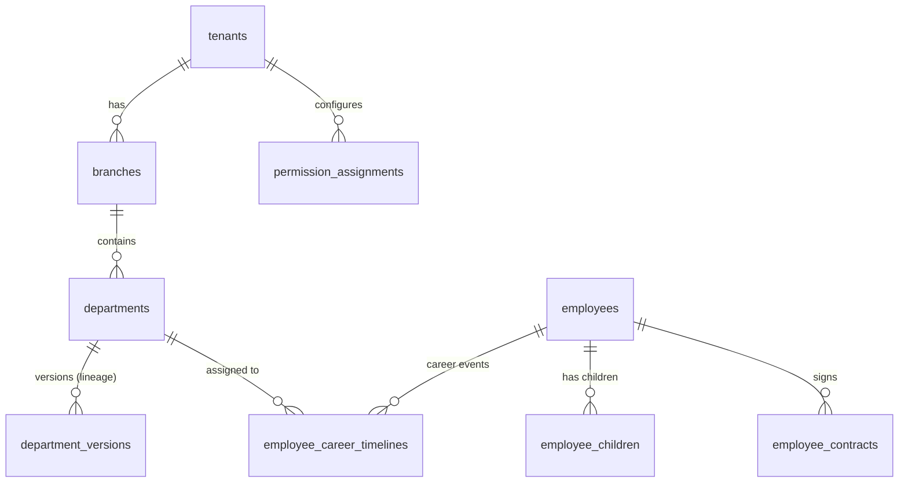
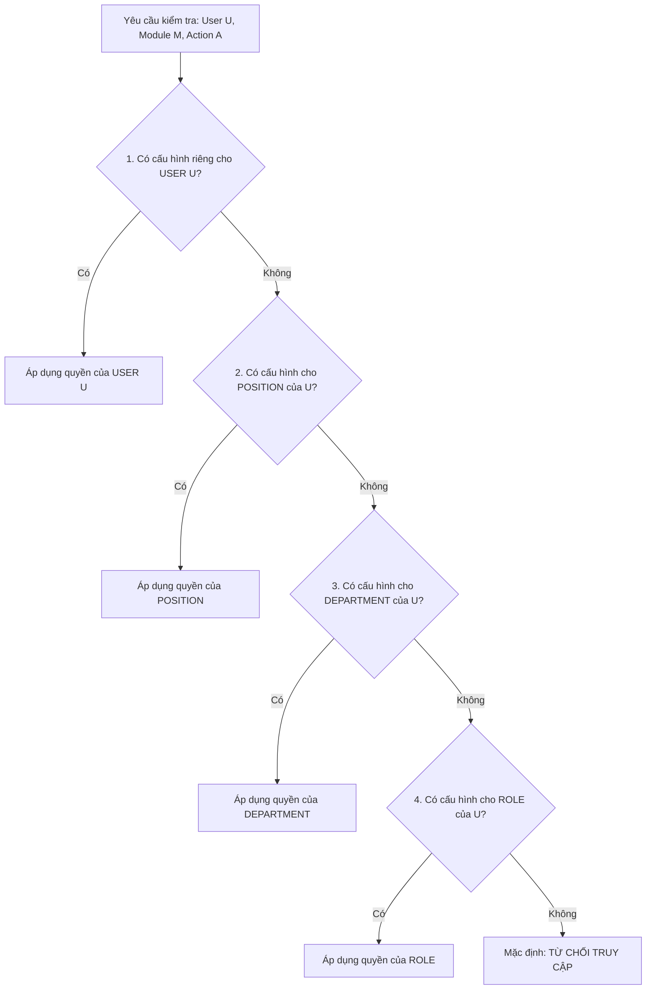

# TÀI LIỆU KỸ THUẬT MODULE 01: CORE HR & CAREER TIMELINE

> **Tên phân hệ:** `CoreHR`  
> **Namespace Backend:** `App\Modules\CoreHR`  
> **Trách nhiệm chính:** Quản lý tổ chức đa chi nhánh, sơ đồ phòng ban có lineage (lịch sử đổi tên/chức năng), hồ sơ nhân sự số mở rộng (CCCD, quê quán, số người phụ thuộc, lương cơ bản, tính thâm niên tự động), quản lý hồ sơ con nhỏ & giảm trừ gia cảnh thuế TNCN (`employee_children`), cây timeline sự kiện nghề nghiệp (Effective Dating), hợp đồng lao động và phân hệ Quản trị Phân quyền Ma trận Granular RBAC 4 tầng (`permission_assignments`).

---

## 1. Ranh giới Nghiệp vụ & Trách nhiệm (Domain Boundaries)

Module `CoreHR` đóng vai trò là "Single Source of Truth" (Nguồn chân lý duy nhất) về mặt thông tin tổ chức, nhân sự và quyền hạn truy cập cho toàn bộ hệ thống Smart-HR:
1. **Quản lý Pháp nhân & Chi nhánh (`tenants`, `branches`)**: Cung cấp ngữ cảnh cô lập dữ liệu đa người thuê (Multi-Tenancy Context) cho mọi truy vấn. Nhận diện các chi nhánh thuộc vùng cao, vùng sâu, vùng xa, biên giới, hải đảo (`is_remote_or_island`) để tự động áp dụng các ngưỡng bảo vệ thai sản theo Điều 137 BLLĐ 2019.
2. **Sơ đồ Phòng ban có Lineage (`departments`, `department_versions`)**: Quản lý cây phân cấp phòng ban, theo dõi lịch sử biến động tên gọi, chức năng nhiệm vụ và người quản lý trưởng bộ phận qua từng giai đoạn thời gian `[effective_date, end_date]`.
3. **Hồ sơ Nhân sự Số Mở rộng (`employees`)**: Quản lý đầy đủ thông tin định danh (CCCD/Hộ chiếu), quê quán, ngày vào làm việc, ngày ký chính thức, tình trạng làm việc/nghỉ việc (`status`, `offboard_date`), số người phụ thuộc, số con nhỏ, mức lương cơ bản và tự động tính toán thâm niên làm việc (`seniority_years`, `seniority_months`, `seniority_days`).
4. **Hồ sơ Con nhỏ & Phúc lợi Gia đình (`employee_children`)**: Quản lý hồ sơ chi tiết từng con nhỏ của nhân viên (ngày sinh, giới tính, mã số thuế giảm trừ gia cảnh, ngày bắt đầu/kết thúc giảm trừ, mức trợ cấp con nhỏ hàng tháng mặc định 300.000 đ/tháng), cung cấp dữ liệu nền tảng cho Module 02 (Policy Engine), Module 03 (Attendance) và Module 07 (Payroll).
5. **Cây Timeline Nghề nghiệp Nhân sự (`employee_career_timelines`)**: Quản lý toàn bộ lịch sử biến động nhân sự (Vào cty, Điều chuyển, Bổ nhiệm chức vụ, Nâng bậc lương, Nghỉ việc) theo cơ chế Effective Dating không hồi tố.
6. **Hợp đồng Lao động (`employee_contracts`)**: Quản lý các loại hợp đồng theo Bộ luật Lao động 2019 (Thử việc, Xác định thời hạn, Không xác định thời hạn, Mùa vụ).
7. **Phân hệ Quản trị Phân quyền Ma trận Granular RBAC 4 Tầng (`permission_assignments`)**: Cung cấp cơ chế phân quyền ma trận linh hoạt, cho phép gán 3 loại quyền (`can_view`, `can_manage`, `can_approve`) trên 5 modules lõi cho 4 đối tượng với thứ tự ưu tiên chặt chẽ: Cá nhân (`USER`) $\succ$ Chức vụ (`POSITION`) $\succ$ Phòng ban (`DEPARTMENT`) $\succ$ Vai trò (`ROLE`).
8. **Cấu trúc Menu Điều hướng Phân cấp**: Chuẩn hóa cấu trúc điều hướng Sidebar theo nguyên tắc Menu Cấp 1 $\to$ Sub-menu Cấp 2, loại bỏ hoàn toàn các liên kết đơn lẻ rời rạc.

---

## 2. Thiết kế Cơ sở Dữ liệu & Mô hình Dữ liệu (Database Schema)

### 2.1 Sơ đồ Thực thể Quan hệ (ERD)



### 2.2 Đặc tả Chi tiết các Bảng Dữ liệu

#### Bảng `branches` (Chi nhánh / Cửa hàng / Kho bãi)
- `id` (BIGINT UNSIGNED, PK, Auto Increment)
- `tenant_id` (BIGINT UNSIGNED, FK $\to$ `tenants.id`)
- `code` (VARCHAR(50), Unique per tenant) — Mã chi nhánh (VD: `HN_FLAGSHIP`, `PQ_STORE`)
- `name` (VARCHAR(255)) — Tên chi nhánh/kho
- `address` (VARCHAR(255), Nullable)
- `is_remote_or_island` (BOOLEAN, Default: `FALSE`) — Đánh dấu chi nhánh thuộc **vùng cao, vùng sâu, vùng xa, biên giới, hải đảo** (Căn cứ Điều 137 Khoản 1 Điểm a BLLĐ 2019 để áp dụng ngưỡng cấm ca đêm/OT cho lao động mang thai từ **tháng thứ 6**)
- `secret_key` (VARCHAR(100)) — Secret key dùng để ký HMAC cho Edge Daemon tại chi nhánh
- `is_active` (BOOLEAN, Default: `TRUE`)
- `created_at`, `updated_at` (TIMESTAMP)

#### Bảng `departments`
- `id` (BIGINT UNSIGNED, PK, Auto Increment)
- `tenant_id` (BIGINT UNSIGNED, FK $\to$ `tenants.id`)
- `branch_id` (BIGINT UNSIGNED, FK $\to$ `branches.id`)
- `code` (VARCHAR(50), Unique per tenant) — Mã cố định không đổi (VD: `TECH_DEV`, `SALES_RETAIL`)
- `parent_id` (BIGINT UNSIGNED, Nullable, FK $\to$ `departments.id`) — Phòng ban cha (cấu trúc Tree)
- `status` (ENUM: `ACTIVE`, `INACTIVE`, `ARCHIVED`, Default: `ACTIVE`)
- `created_at`, `updated_at` (TIMESTAMP)

#### Bảng `department_versions` (Lineage lịch sử phòng ban)
- `id` (BIGINT UNSIGNED, PK, Auto Increment)
- `department_id` (BIGINT UNSIGNED, FK $\to$ `departments.id`)
- `name` (VARCHAR(255)) — Tên phòng ban tại thời kỳ này (VD: "Phòng Phát triển Phần mềm" $\to$ đổi thành "Khối Công nghệ & Đổi mới")
- `mission_function` (TEXT, Nullable) — Chức năng, nhiệm vụ, quyền hạn chi tiết
- `manager_id` (BIGINT UNSIGNED, Nullable, FK $\to$ `employees.id`) — Trưởng phòng trong giai đoạn này
- `effective_date` (DATE) — Ngày bắt đầu áp dụng
- `end_date` (DATE, Nullable) — Ngày kết thúc áp dụng (NULL nếu là phiên bản đang có hiệu lực)
- `change_reason` (VARCHAR(255), Nullable) — Căn cứ đổi tên/tái cơ cấu (Số quyết định, lý do)
- `created_at` (TIMESTAMP)

#### Bảng `employees` (Hồ sơ Nhân sự Mở rộng)
- `id` (BIGINT UNSIGNED, PK, Auto Increment)
- `tenant_id` (BIGINT UNSIGNED, FK $\to$ `tenants.id`)
- `user_code` (VARCHAR(50), Unique per tenant) — Mã định danh nhân viên (VD: `EMP001`)
- `full_name` (VARCHAR(255))
- `gender` (ENUM: `MALE`, `FEMALE`, `OTHER`)
- `birth_date` (DATE)
- `citizen_id` (VARCHAR(50), Nullable) — Số CCCD / Hộ chiếu (được mã hóa mật mã)
- `hometown` (VARCHAR(255), Nullable) — Quê quán / Nguyên quán
- `email` (VARCHAR(255))
- `phone` (VARCHAR(20), Nullable)
- `join_date` (DATE) — Ngày đầu tiên làm việc tại công ty
- `official_date` (DATE, Nullable) — Ngày ký hợp đồng chính thức
- `offboard_date` (DATE, Nullable) — Ngày chính thức nghỉ việc (chấm dứt hợp đồng)
- `child_birth_date` (DATE, Nullable) — Ngày sinh con nhỏ (dùng cho chế độ con dưới 12 tháng dự phòng)
- `dependent_count` (INT UNSIGNED, Default: 0) — Số người phụ thuộc đăng ký giảm trừ gia cảnh
- `children_count` (INT UNSIGNED, Default: 0) — Số lượng con nhỏ được ghi nhận
- `base_salary` (DECIMAL(15,2), Default: 0.00) — Mức lương cơ bản thỏa thuận hiện tại
- `salary_allowances` (JSON, Nullable) — Danh sách các khoản phụ cấp lương cá nhân
- `seniority_years` (INT UNSIGNED, Default: 0) — Số năm thâm niên làm việc
- `seniority_months` (INT UNSIGNED, Default: 0) — Số tháng thâm niên làm việc lẻ
- `seniority_days` (INT UNSIGNED, Default: 0) — Số ngày thâm niên làm việc lẻ
- `status` (ENUM: `PROBATION`, `OFFICIAL`, `ON_LEAVE`, `TERMINATED`, Default: `PROBATION`)
- `created_at`, `updated_at` (TIMESTAMP)

#### Bảng `employee_children` (Hồ sơ Con nhỏ & Đăng ký Giảm trừ Gia cảnh)
- `id` (BIGINT UNSIGNED, PK, Auto Increment)
- `tenant_id` (BIGINT UNSIGNED, FK $\to$ `tenants.id`)
- `employee_id` (BIGINT UNSIGNED, FK $\to$ `employees.id`)
- `full_name` (VARCHAR(150)) — Họ tên con
- `gender` (ENUM: `MALE`, `FEMALE`, `OTHER`, Default: `MALE`)
- `birth_date` (DATE) — Ngày tháng năm sinh của con
- `birth_certificate_number` (VARCHAR(100), Nullable) — Số giấy khai sinh
- `is_tax_dependent` (BOOLEAN, Default: `TRUE`) — Có đăng ký giảm trừ gia cảnh thuế TNCN hay không
- `tax_dependent_code` (VARCHAR(50), Nullable) — Mã số thuế người phụ thuộc
- `tax_dependent_start_date` (DATE, Nullable) — Ngày bắt đầu áp dụng giảm trừ gia cảnh
- `tax_dependent_end_date` (DATE, Nullable) — Ngày hết hạn giảm trừ gia cảnh
- `has_monthly_allowance` (BOOLEAN, Default: `TRUE`) — Có hưởng trợ cấp con nhỏ hàng tháng từ công ty hay không
- `monthly_allowance_amount` (DECIMAL(15,2), Default: 300000.00) — Mức tiền trợ cấp con nhỏ mỗi tháng
- `notes` (TEXT, Nullable) — Ghi chú tình trạng con
- `is_active` (BOOLEAN, Default: `TRUE`)
- `created_at`, `updated_at` (TIMESTAMP)
- Composite Index: `(tenant_id, employee_id, birth_date)`

#### Bảng `permission_assignments` (Ma Trận Phân Quyền Granular RBAC 4 Tầng)
- `id` (BIGINT UNSIGNED, PK, Auto Increment)
- `tenant_id` (BIGINT UNSIGNED, FK $\to$ `tenants.id`)
- `subject_type` (ENUM: `ROLE`, `DEPARTMENT`, `POSITION`, `USER`) — Đối tượng được phân quyền
- `subject_id` (BIGINT UNSIGNED, Nullable) — ID của Phòng ban, Chức vụ hoặc Nhân viên (NULL nếu là `ROLE`)
- `subject_role` (VARCHAR(50), Nullable) — Tên vai trò nếu `subject_type = ROLE` (`SUPER_ADMIN`, `ADMIN`, `HR_MANAGER`, `ACCOUNTANT`, `BRANCH_MANAGER`, `EMPLOYEE`)
- `module_code` (ENUM: `CORE_HR`, `PAYROLL_SALARY`, `ATTENDANCE`, `POLICY_WELFARE`, `OFFICE_RESOURCES`) — Phân hệ được phân quyền
- `can_view` (BOOLEAN, Default: `FALSE`) — Quyền xem thông tin / dữ liệu của module
- `can_manage` (BOOLEAN, Default: `FALSE`) — Quyền quản trị / thêm / sửa / xóa (CRUD)
- `can_approve` (BOOLEAN, Default: `FALSE`) — Quyền phê duyệt đơn từ / chốt số liệu
- `notes` (VARCHAR(255), Nullable) — Ghi chú mục đích ủy quyền
- `created_at`, `updated_at` (TIMESTAMP)
- Composite Index: `(tenant_id, subject_type, subject_role, module_code)`, `(tenant_id, subject_type, subject_id, module_code)`

#### Bảng `employee_career_timelines` (Cây Timeline Nghề nghiệp)
- `id` (BIGINT UNSIGNED, PK, Auto Increment)
- `employee_id` (BIGINT UNSIGNED, FK $\to$ `employees.id`)
- `event_type` (ENUM: `ONBOARDING`, `TRANSFER`, `PROMOTION`, `ROLE_CHANGE`, `SALARY_ADJUSTMENT`, `OFFBOARDING`)
- `department_id` (BIGINT UNSIGNED, FK $\to$ `departments.id`) — Phòng ban trực thuộc tại thời điểm này
- `position_id` (BIGINT UNSIGNED) — Vị trí công việc (Job Position)
- `job_title` (VARCHAR(150)) — Chức danh hiển thị (VD: "Senior Backend Engineer")
- `manager_id` (BIGINT UNSIGNED, Nullable, FK $\to$ `employees.id`) — Người quản lý trực tiếp tại giai đoạn này
- `effective_date` (DATE) — Ngày bắt đầu có hiệu lực
- `end_date` (DATE, Nullable) — Ngày kết thúc (NULL nếu đang là vị trí hiện tại)
- `decision_number` (VARCHAR(100), Nullable) — Số Quyết định bổ nhiệm/điều chuyển
- `decision_date` (DATE, Nullable) — Ngày ký quyết định
- `notes` (TEXT, Nullable) — Ghi chú chi tiết nguyên nhân điều chuyển/thăng chức
- `created_at` (TIMESTAMP)

#### Bảng `employee_contracts` (Hợp đồng Lao động)
- `id` (BIGINT UNSIGNED, PK, Auto Increment)
- `employee_id` (BIGINT UNSIGNED, FK $\to$ `employees.id`)
- `contract_number` (VARCHAR(100)) — Số hợp đồng lao động
- `contract_type` (ENUM: `PROBATION`, `DEFINITE_TERM`, `INDEFINITE_TERM`, `SEASONAL`)
- `start_date` (DATE) — Ngày bắt đầu hợp đồng
- `end_date` (DATE, Nullable) — Ngày hết hạn (NULL nếu là hợp đồng không xác định thời hạn)
- `base_salary` (DECIMAL(15,2)) — Mức lương cơ bản thỏa thuận
- `insurance_salary` (DECIMAL(15,2)) — Mức lương làm căn cứ đóng BHXH/BHYT/BHTN
- `is_active` (BOOLEAN, Default: `TRUE`)
- `created_at`, `updated_at` (TIMESTAMP)

---

## 3. Quy chuẩn Nghiệp vụ Cốt lõi & Thuật toán (Core Logic & Algorithms)

### 3.1 Thuật toán Phân giải Quyền Ma trận 4 Tầng Ưu tiên (Resolution Algorithm)
Dịch vụ `PermissionResolutionService` thực thi việc xác định quyền hạn của người dùng đối với một hành vi trên phân hệ cụ thể theo quy tắc ưu tiên tầng từ cao xuống thấp:



> **Quy tắc phân tầng**:
> 1. **Cấp 1 - `USER` (Cao nhất)**: Phân quyền trực tiếp cho cá nhân (dùng cho trường hợp đặc biệt, biệt phái hoặc thu hồi tạm thời).
> 2. **Cấp 2 - `POSITION`**: Phân quyền theo chức danh công việc (VD: Kế toán trưởng, Trưởng ca).
> 3. **Cấp 3 - `DEPARTMENT`**: Phân quyền theo khối phòng ban (VD: Phòng Nhân sự, Phòng Kế toán).
> 4. **Cấp 4 - `ROLE` (Cơ bản)**: Phân quyền theo nhóm vai trò mặc định (`SUPER_ADMIN`, `ADMIN`, `HR_MANAGER`, `EMPLOYEE`).
> 5. **Bảo mật mặc định**: `SUPER_ADMIN` luôn có toàn quyền (`can_view = true`, `can_manage = true`, `can_approve = true`).

### 3.2 Thuật toán Tính toán Thâm niên Tự động (Seniority Calculation Algorithm)
Được triển khai trong `CareerTimelineService::calculateSeniority`:
```php
public function calculateSeniority(CarbonInterface $joinDate, ?CarbonInterface $endDate = null): array
{
    $targetDate = $endDate ?? Carbon::now();
    $diff = $joinDate->diff($targetDate);

    return [
        'years'  => $diff->y,
        'months' => $diff->m,
        'days'   => $diff->d,
        'total_months' => ($diff->y * 12) + $diff->m,
    ];
}
```
Khi nhân sự nghỉ việc (`OFFBOARDING`):
1. Cập nhật `employees.offboard_date = $offboardDate`.
2. Chuyển trạng thái `employees.status = TERMINATED`.
3. Tự động tính chốt thời gian thâm niên chính xác (`seniority_years`, `seniority_months`, `seniority_days`) ghi vào hồ sơ để phục vụ thanh toán trợ cấp thôi việc / mất việc theo Điều 46, Điều 47 BLLĐ 2019.

### 3.3 Quy trình Đăng ký Con nhỏ & Đồng bộ Giảm trừ Gia cảnh
1. Khi thêm mới hồ sơ con nhỏ trong `EmployeeChildrenController`:
   - Nếu `is_tax_dependent = true`: Tự động tăng `employees.dependent_count` thêm 1.
   - Tăng `employees.children_count` thêm 1.
   - Tự động kiểm tra độ tuổi con tại ngày hiện tại: Nếu con $< 12$ tháng, cập nhật trường `employees.child_birth_date` để kích hoạt ngay các chế độ bảo vệ thai sản theo Điều 137 BLLĐ trong phân ca và tính công.
2. Dữ liệu này tự động chuyển tiếp tới Module 07 (Payroll) để giảm trừ thuế TNCN mà không cần kế toán nhập tay.

### 3.4 Cấu trúc Navigation/Sidebar Menu Doanh nghiệp
Theo tiêu chuẩn thiết kế phân cấp, toàn bộ các chức năng của Core HR được gom nhóm khoa học:
- **Menu Cấp 1**: `Hồ sơ & Tổ chức`
  - **Sub-menu 2.1**: `Hồ sơ Nhân sự` (`/core-hr/employees`) — Quản lý danh sách, thêm mới, xem timeline, hợp đồng.
  - **Sub-menu 2.2**: `Con nhỏ & Gia đình` (`/core-hr/children`) — Danh sách con nhỏ, đăng ký người phụ thuộc, trợ cấp con nhỏ.
  - **Sub-menu 2.3**: `Sơ đồ Tổ chức` (`/core-hr/departments`) — Cây phòng ban, quản lý lineage phiên bản.
  - **Sub-menu 2.4**: `Phân quyền Ma trận` (`/core-hr/permissions`) — Bảng ma trận điều khiển quyền 4 tầng.

---

## 4. Kiến trúc Mã nguồn Backend & Frontend

### 4.1 Cấu trúc Thư mục Module Backend
```
app/Modules/CoreHR/
├── Controllers/
│   ├── DepartmentController.php
│   ├── EmployeeController.php
│   ├── EmployeeChildrenController.php
│   ├── CareerTimelineController.php
│   ├── ContractController.php
│   └── PermissionMatrixController.php
├── Requests/
│   ├── CreateDepartmentRequest.php
│   ├── UpdateDepartmentVersionRequest.php
│   ├── CreateEmployeeRequest.php
│   ├── StoreChildRequest.php
│   └── UpdatePermissionAssignmentRequest.php
├── Services/
│   ├── DepartmentService.php
│   ├── EmployeeService.php
│   ├── CareerTimelineService.php
│   ├── ContractService.php
│   └── PermissionResolutionService.php
├── Middleware/
│   └── CheckMatrixPermission.php  // Alias: perm:module.action
├── Models/
│   ├── Tenant.php
│   ├── Branch.php
│   ├── Department.php
│   ├── DepartmentVersion.php
│   ├── Employee.php
│   ├── EmployeeChild.php
│   ├── EmployeeCareerTimeline.php
│   ├── EmployeeContract.php
│   └── PermissionAssignment.php
└── Enums/
    ├── CareerEventType.php
    ├── ContractType.php
    ├── EmployeeStatus.php
    ├── Gender.php
    └── MatrixModuleCode.php
```

### 4.2 Giao diện Frontend (Vue 3 / Inertia.js / Element Plus)
```
resources/js/Pages/CoreHR/
├── Employees/
│   ├── Index.vue         // Danh sách nhân viên, bộ lọc phòng ban, tìm kiếm
│   ├── Create.vue        // Form thêm mới nhân viên đa trường mở rộng
│   └── Show.vue          // Chi tiết hồ sơ, tab Timeline, tab Hợp đồng
├── Children/
│   └── Index.vue         // Quản lý danh sách con nhỏ, modal thêm/sửa, liên kết quy chế
├── Departments/
│   └── Index.vue         // Cây sơ đồ tổ chức phòng ban, lịch sử đổi tên lineage
└── Permissions/
    └── Index.vue         // Bảng ma trận phân quyền 4 tầng trực quan
```

---

## 5. Danh mục RESTful / Inertia Routes

| Method | URI | Quyền hạn | Mô tả |
|---|---|---|---|
| `GET` | `/core-hr/employees` | `perm:CORE_HR.view` | Giao diện danh sách nhân sự |
| `POST` | `/core-hr/employees` | `perm:CORE_HR.manage` | Thêm mới nhân sự kèm thông tin mở rộng |
| `POST` | `/core-hr/employees/{id}/offboard` | `perm:CORE_HR.manage` | Đặt thôi việc & chốt thâm niên |
| `GET` | `/core-hr/children` | `perm:CORE_HR.view` | Danh sách con nhỏ & phúc lợi gia đình |
| `POST` | `/core-hr/children` | `perm:CORE_HR.manage` | Thêm mới hồ sơ con nhỏ & đăng ký giảm trừ |
| `GET` | `/core-hr/departments` | `perm:CORE_HR.view` | Sơ đồ tổ chức phòng ban |
| `POST` | `/core-hr/departments/{id}/version` | `perm:CORE_HR.manage` | Ban hành phiên bản phòng ban mới |
| `GET` | `/core-hr/permissions` | `perm:CORE_HR.manage` | Bảng ma trận phân quyền hệ thống |
| `POST` | `/core-hr/permissions/assign` | `perm:CORE_HR.manage` | Cập nhật gán quyền ma trận |

---

## 6. Kịch bản Kiểm thử Tích hợp (Test Scenarios)

1. **Test `GranularRBACMatrixResolutionPriority`**:
   - Gán quyền cho Role `EMPLOYEE`: `can_view = true`, `can_manage = false`.
   - Gán quyền ghi đè cho Cá nhân User 12 (thuộc Role `EMPLOYEE`): `can_manage = true`.
   - Kết quả kỳ vọng: User 12 có quyền `manage` trên module chỉ định; các nhân viên khác cùng role bị chặn truy cập.
2. **Test `AutomaticSeniorityCalculationOnTermination`**:
   - Nhân viên vào làm việc ngày `2021-03-01`.
   - Thực hiện thao tác nghỉ việc vào ngày `2026-09-01`.
   - Kết quả kỳ vọng: `seniority_years = 5`, `seniority_months = 6`, `seniority_days = 0`.
3. **Test `ChildTaxDependentAutoSync`**:
   - Thêm hồ sơ con nhỏ cho nhân viên có đánh dấu `is_tax_dependent = true`.
   - Kết quả kỳ vọng: Bản ghi `employee_children` được lưu thành công, trường `employees.dependent_count` tự động tăng chính xác.
