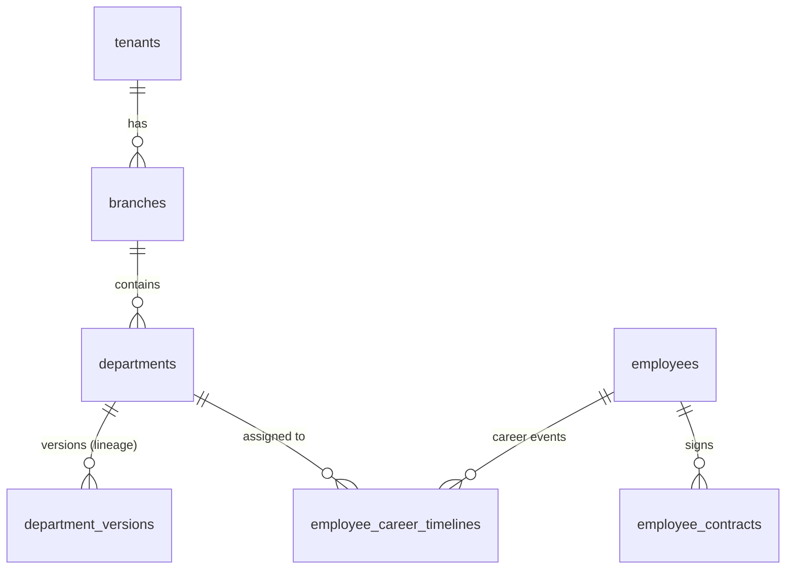

# TÀI LIỆU KỸ THUẬT MODULE 01: CORE HR & CAREER TIMELINE

> **Tên phân hệ:** `CoreHR`  
> **Namespace Backend:** `App\Modules\CoreHR`  
> **Trách nhiệm chính:** Quản lý tổ chức đa chi nhánh, sơ đồ phòng ban có lineage (lịch sử đổi tên/chức năng), hồ sơ nhân sự số, cây timeline sự kiện nghề nghiệp (Effective Dating) và hợp đồng lao động.

---

## 1. Ranh giới Nghiệp vụ & Trách nhiệm (Domain Boundaries)

Module `CoreHR` đóng vai trò là "Single Source of Truth" (Nguồn chân lý duy nhất) về mặt thông tin tổ chức và nhân sự cho toàn bộ hệ thống Smart-HR:
1. **Quản lý Pháp nhân & Chi nhánh (`tenants`, `branches`)**: Cung cấp ngữ cảnh cô lập dữ liệu đa người thuê (Multi-Tenancy Context) cho mọi truy vấn.
2. **Sơ đồ Phòng ban có Lineage (`departments`, `department_versions`)**: Quản lý cây phân cấp phòng ban, theo dõi lịch sử biến động tên gọi, chức năng nhiệm vụ và người quản lý trưởng bộ phận qua từng giai đoạn thời gian `[effective_date, end_date]`.
3. **Hồ sơ Nhân sự Số (`employees`)**: Quản lý thông tin định danh, ngày vào công ty, tình trạng hôn nhân, ngày sinh con nhỏ (phục vụ chính sách thai sản).
4. **Cây Timeline Nghề nghiệp Nhân sự (`employee_career_timelines`)**: Quản lý toàn bộ lịch sử biến động nhân sự (Vào cty, Điều chuyển, Bổ nhiệm chức vụ, Nâng bậc lương, Nghỉ việc) theo cơ chế Effective Dating.
5. **Hợp đồng Lao động (`employee_contracts`)**: Quản lý các loại hợp đồng theo Bộ luật Lao động 2019 (Thử việc, Xác định thời hạn, Không xác định thời hạn).

---

## 2. Thiết kế Cơ sở Dữ liệu & Mô hình Dữ liệu (Database Schema)

### 2.1 Sơ đồ Thực thể Quan hệ (ERD)



### 2.2 Đặc tả Chi tiết các Bảng Dữ liệu

#### Bảng `branches` (Chi nhánh / Cửa hàng / Kho bãi)
- `id` (BIGINT UNSIGNED, PK, Auto Increment)
- `tenant_id` (BIGINT UNSIGNED, FK $\to$ `tenants.id`)
- `code` (VARCHAR(50), Unique per tenant) — Mã chi nhánh (VD: `HN_FLAGSHIP`, `PQ_STORE`)
- `name` (VARCHAR(255)) — Tên chi nhánh/kho
- `address` (VARCHAR(255), Nullable)
- `is_remote_or_island` (BOOLEAN, Default: `FALSE`) — Đánh dấu chi nhánh thuộc **vùng cao, vùng sâu, vùng xa, biên giới, hải đảo** (Căn cứ Điều 137 Khoản 1 Điểm a BLLĐ 2019 để áp dụng ngưỡng cấm ca đêm/OT cho lao động mang thai từ **tháng thứ 6**)
- `secret_key` (VARCHAR(100)) — Secret key dùng để ký HMAC cho Edge Daemon tại chi nhánh
- `is_active` (BOOLEAN, Default: `TRUE`)
- `created_at`, `updated_at` (TIMESTAMP)

#### Bảng `departments`
- `id` (BIGINT UNSIGNED, PK, Auto Increment)
- `tenant_id` (BIGINT UNSIGNED, FK $\to$ `tenants.id`)
- `branch_id` (BIGINT UNSIGNED, FK $\to$ `branches.id`)
- `code` (VARCHAR(50), Unique per tenant) — Mã cố định không đổi (VD: `TECH_DEV`, `SALES_RETAIL`)
- `parent_id` (BIGINT UNSIGNED, Nullable, FK $\to$ `departments.id`) — Phòng ban cha (cấu trúc Tree)
- `status` (ENUM: `ACTIVE`, `INACTIVE`, `ARCHIVED`, Default: `ACTIVE`)
- `created_at`, `updated_at` (TIMESTAMP)

#### Bảng `department_versions` (Lineage lịch sử phòng ban)
- `id` (BIGINT UNSIGNED, PK, Auto Increment)
- `department_id` (BIGINT UNSIGNED, FK $\to$ `departments.id`)
- `name` (VARCHAR(255)) — Tên phòng ban tại thời kỳ này (VD: "Phòng Phát triển Phần mềm" $\to$ đổi thành "Khối Công nghệ & Đổi mới")
- `mission_function` (TEXT, Nullable) — Chức năng, nhiệm vụ, quyền hạn chi tiết
- `manager_id` (BIGINT UNSIGNED, Nullable, FK $\to$ `employees.id`) — Trưởng phòng trong giai đoạn này
- `effective_date` (DATE) — Ngày bắt đầu áp dụng
- `end_date` (DATE, Nullable) — Ngày kết thúc áp dụng (NULL nếu là phiên bản đang có hiệu lực)
- `change_reason` (VARCHAR(255), Nullable) — Căn cứ đổi tên/tái cơ cấu (Số quyết định, lý do)
- `created_at` (TIMESTAMP)

#### Bảng `employees`
- `id` (BIGINT UNSIGNED, PK, Auto Increment)
- `tenant_id` (BIGINT UNSIGNED, FK $\to$ `tenants.id`)
- `user_code` (VARCHAR(50), Unique per tenant) — Mã định danh nhân viên (VD: `EMP001`)
- `full_name` (VARCHAR(255))
- `gender` (ENUM: `MALE`, `FEMALE`, `OTHER`)
- `birth_date` (DATE)
- `citizen_id` (VARCHAR(50), Nullable) — CCCD/Hộ chiếu
- `email` (VARCHAR(255))
- `phone` (VARCHAR(20), Nullable)
- `join_date` (DATE) — Ngày đầu tiên làm việc
- `official_date` (DATE, Nullable) — Ngày ký hợp đồng chính thức
- `child_birth_date` (DATE, Nullable) — Ngày sinh con nhỏ (dùng cho chế độ con dưới 12 tháng và phúc lợi con nhỏ)
- `status` (ENUM: `PROBATION`, `OFFICIAL`, `ON_LEAVE`, `TERMINATED`, Default: `PROBATION`)
- `created_at`, `updated_at` (TIMESTAMP)

#### Bảng `employee_career_timelines` (Cây Timeline Nghề nghiệp)
- `id` (BIGINT UNSIGNED, PK, Auto Increment)
- `employee_id` (BIGINT UNSIGNED, FK $\to$ `employees.id`)
- `event_type` (ENUM: `ONBOARDING`, `TRANSFER`, `PROMOTION`, `ROLE_CHANGE`, `SALARY_ADJUSTMENT`, `OFFBOARDING`)
- `department_id` (BIGINT UNSIGNED, FK $\to$ `departments.id`) — Phòng ban trực thuộc tại thời điểm này
- `position_id` (BIGINT UNSIGNED) — Vị trí công việc (Job Position)
- `job_title` (VARCHAR(150)) — Chức danh hiển thị (VD: "Senior Backend Engineer")
- `manager_id` (BIGINT UNSIGNED, Nullable, FK $\to$ `employees.id`) — Người quản lý trực tiếp tại giai đoạn này
- `effective_date` (DATE) — Ngày bắt đầu có hiệu lực
- `end_date` (DATE, Nullable) — Ngày kết thúc (NULL nếu đang là vị trí hiện tại)
- `decision_number` (VARCHAR(100), Nullable) — Số Quyết định bổ nhiệm/điều chuyển
- `decision_date` (DATE, Nullable) — Ngày ký quyết định
- `notes` (TEXT, Nullable) — Ghi chú chi tiết nguyên nhân điều chuyển/thăng chức
- `created_at` (TIMESTAMP)

#### Bảng `employee_contracts`
- `id` (BIGINT UNSIGNED, PK, Auto Increment)
- `employee_id` (BIGINT UNSIGNED, FK $\to$ `employees.id`)
- `contract_number` (VARCHAR(100)) — Số hợp đồng lao động
- `contract_type` (ENUM: `PROBATION`, `DEFINITE_TERM`, `INDEFINITE_TERM`, `SEASONAL`)
- `start_date` (DATE) — Ngày bắt đầu hợp đồng
- `end_date` (DATE, Nullable) — Ngày hết hạn (NULL nếu là hợp đồng không xác định thời hạn)
- `base_salary` (DECIMAL(15,2)) — Mức lương cơ bản thỏa thuận
- `insurance_salary` (DECIMAL(15,2)) — Mức lương làm căn cứ đóng BHXH/BHYT/BHTN
- `is_active` (BOOLEAN, Default: TRUE)
- `created_at`, `updated_at` (TIMESTAMP)

---

## 3. Quy chuẩn Nghiệp vụ Cốt lõi & Giải thuật (Core Logic & Effective Dating)

### 3.1 Nguyên tắc Truy vấn Thời điểm (Point-in-Time Query Pattern)
Khi bất kỳ module nào (như `Attendance` hay `Payroll`) cần biết phòng ban hoặc người quản lý của nhân viên tại ngày công $T$:
```sql
SELECT t.*, d.code as department_code, dv.name as department_name
FROM employee_career_timelines t
JOIN departments d ON d.id = t.department_id
JOIN department_versions dv ON dv.department_id = d.id 
    AND :target_date >= dv.effective_date 
    AND (dv.end_date IS NULL OR :target_date <= dv.end_date)
WHERE t.employee_id = :employee_id
  AND :target_date >= t.effective_date
  AND (t.end_date IS NULL OR :target_date <= t.end_date)
LIMIT 1;
```
> **Đảm bảo**: Khi nhân sự chuyển phòng ban vào ngày 15/09, bảng công từ ngày 01-14/09 vẫn thuộc về phòng ban cũ, và từ 15-30/09 thuộc về phòng ban mới. Không làm thay đổi lịch sử.

### 3.2 Quy trình Tự động Đóng - Mở Timeline (Timeline Transition State Machine)
Khi thêm một bản ghi sự kiện điều chuyển mới (`Transfer` hoặc `Promotion`) có `effective_date = D`:
1. Mở một Database Transaction.
2. Tìm bản ghi timeline đang mở (`end_date IS NULL`) của nhân viên:
   - Nếu $D \le \text{effective\_date}$ của bản ghi hiện tại $\to$ Báo lỗi `ValidationException: Ngày hiệu lực mới phải sau ngày hiệu lực của mốc hiện tại`.
   - Cập nhật bản ghi hiện tại: `end_date = D - 1 day`.
3. Chèn bản ghi timeline mới với `effective_date = D` và `end_date = NULL`.
4. Commit Transaction và kích hoạt Domain Event `EmployeeTimelineChangedEvent`.

### 3.3 Quy trình Đổi tên / Thay đổi Chức năng Phòng ban
Khi ban hành quyết định đổi tên phòng ban từ ngày $D_{\text{apply}}$:
1. Đóng phiên bản phòng ban hiện tại: Cập nhật `end_date = D_{\text{apply}} - 1 day`.
2. Tạo bản ghi `department_versions` mới với tên mới, chức năng nhiệm vụ mới, `effective_date = D_{\text{apply}}` và `end_date = NULL`.
3. Giữ nguyên `department_id` và mã `code`, bảo đảm tính toàn vẹn liên kết khóa ngoại của các dữ liệu lịch sử.

---

## 4. Kiến trúc Mã nguồn Backend (Laravel 13 / PHP 8.4+)

### 4.1 Cấu trúc Thư mục Module
```
app/Modules/CoreHR/
├── Controllers/
│   ├── DepartmentController.php
│   ├── EmployeeController.php
│   ├── CareerTimelineController.php
│   └── ContractController.php
├── Requests/
│   ├── CreateDepartmentRequest.php
│   ├── UpdateDepartmentVersionRequest.php
│   ├── CreateEmployeeRequest.php
│   └── TransferEmployeeTimelineRequest.php
├── Services/
│   ├── DepartmentService.php
│   ├── EmployeeService.php
│   ├── CareerTimelineService.php
│   └── ContractService.php
├── Models/
│   ├── Tenant.php
│   ├── Branch.php
│   ├── Department.php
│   ├── DepartmentVersion.php
│   ├── Employee.php
│   ├── EmployeeCareerTimeline.php
│   └── EmployeeContract.php
├── Enums/
│   ├── CareerEventType.php
│   ├── ContractType.php
│   ├── EmployeeStatus.php
│   └── Gender.php
├── Events/
│   ├── EmployeeCreatedEvent.php
│   ├── EmployeeTimelineChangedEvent.php
│   └── ContractExpiringWarningEvent.php
└── DTOs/
    ├── DepartmentVersionData.php
    └── CareerTimelineData.php
```

### 4.2 Enums Chính
```php
namespace App\Modules\CoreHR\Enums;

enum CareerEventType: string
{
    case ONBOARDING = 'ONBOARDING';
    case TRANSFER = 'TRANSFER';
    case PROMOTION = 'PROMOTION';
    case ROLE_CHANGE = 'ROLE_CHANGE';
    case SALARY_ADJUSTMENT = 'SALARY_ADJUSTMENT';
    case OFFBOARDING = 'OFFBOARDING';
}

enum ContractType: string
{
    case PROBATION = 'PROBATION';               // Hợp đồng thử việc
    case DEFINITE_TERM = 'DEFINITE_TERM';       // Hợp đồng xác định thời hạn (12-36 tháng)
    case INDEFINITE_TERM = 'INDEFINITE_TERM';   // Hợp đồng không xác định thời hạn
    case SEASONAL = 'SEASONAL';                 // Hợp đồng theo vụ việc
}
```

---

## 5. Danh mục RESTful API Endpoints

| Method | URI | Quyền hạn | Mô tả |
|---|---|---|---|
| `GET` | `/api/v1/departments` | `hr.dept.view` | Lấy danh sách cây phòng ban hiện tại kèm thông tin phiên bản mới nhất |
| `POST` | `/api/v1/departments` | `hr.dept.create` | Tạo phòng ban mới kèm phiên bản khởi tạo |
| `POST` | `/api/v1/departments/{id}/versions` | `hr.dept.update` | Ban hành phiên bản mới (đổi tên, cập nhật chức năng, đổi trưởng phòng) |
| `GET` | `/api/v1/departments/{id}/history` | `hr.dept.view` | Lấy toàn bộ lịch sử biến động (lineage) của phòng ban qua các thời kỳ |
| `GET` | `/api/v1/employees` | `hr.emp.view` | Danh sách nhân viên kèm phân trang, tìm kiếm, lọc theo phòng ban hiện tại |
| `POST` | `/api/v1/employees` | `hr.emp.create` | Tạo hồ sơ nhân viên mới + tự động khởi tạo mốc timeline `ONBOARDING` |
| `GET` | `/api/v1/employees/{id}/timeline` | `hr.emp.view` | Lấy toàn bộ cây timeline lịch sử nghề nghiệp của nhân viên |
| `POST` | `/api/v1/employees/{id}/timeline` | `hr.emp.manage` | Ghi nhận sự kiện điều chuyển/bổ nhiệm mới (tự động đóng mốc cũ) |
| `GET` | `/api/v1/employees/{id}/contracts` | `hr.contract.view` | Danh sách các hợp đồng lao động của nhân viên |
| `POST` | `/api/v1/employees/{id}/contracts` | `hr.contract.manage`| Ký hợp đồng lao động mới |

---

## 6. Kịch bản Kiểm thử Tích hợp (Test Scenarios)

1. **Test `TimelineTransitionSuccess`**:
   - Khởi tạo nhân viên ngày 01/01/2026 tại phòng Ban Kỹ thuật (`effective_date = 2026-01-01`, `end_date = null`).
   - Điều chuyển sang Phòng R&D từ ngày 01/06/2026.
   - Kết quả kỳ vọng: Bản ghi cũ tự động cập nhật `end_date = 2026-05-31`. Bản ghi mới có `effective_date = 2026-06-01`, `end_date = null`.
2. **Test `PointInTimeDepartmentQuery`**:
   - Truy vấn phòng ban nhân viên vào ngày `2026-03-15` $\to$ Trả về Ban Kỹ thuật.
   - Truy vấn phòng ban nhân viên vào ngày `2026-07-20` $\to$ Trả về Phòng R&D.
3. **Test `DepartmentRenameHistoryPreserved`**:
   - Phòng ban đổi tên từ "Kế toán" thành "Tài chính - Kế toán" từ ngày 01/04/2026.
   - Bảng công tháng 03/2026 xuất báo cáo vẫn hiển thị tên "Kế toán". Bảng công tháng 04/2026 hiển thị tên "Tài chính - Kế toán".
