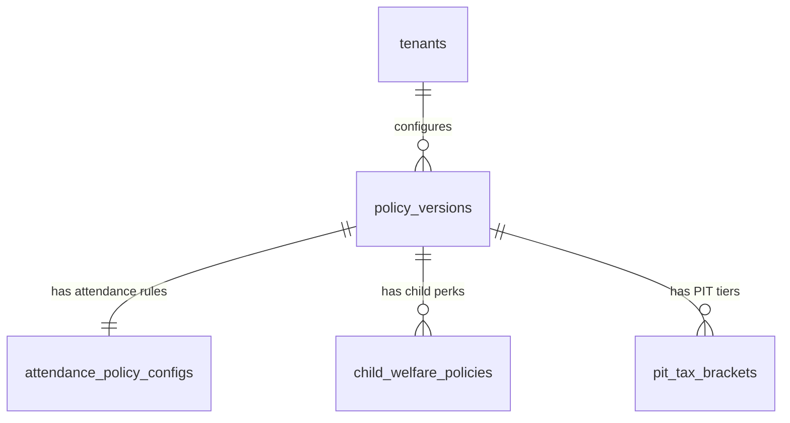

# TÀI LIỆU KỸ THUẬT MODULE 02: POLICY ENGINE (TRUNG TÂM CẤU HÌNH QUY CHẾ ĐỘNG)

> **Tên phân hệ:** `PolicyEngine`  
> **Namespace Backend:** `App\Modules\PolicyEngine`  
> **Trách nhiệm chính:** Quản trị tập trung toàn bộ cấu hình quy chế chấm công, phân ca, làm thêm giờ, chính sách phúc lợi con nhỏ/gia đình và biểu thuế TNCN lũy tiến 5 bậc theo các phiên bản hiệu lực thời gian (`policy_versions`), bảo đảm chính sách **Zero-Hardcode** cho toàn hệ thống.

---

## 1. Ranh giới Nghiệp vụ & Trách nhiệm (Domain Boundaries)

Module `PolicyEngine` đóng vai trò là "Cơ quan Lập pháp" trong hệ thống Smart-HR:
1. **Quản lý Phiên bản Quy chế (`policy_versions`)**: Cho phép doanh nghiệp tạo mới, sửa đổi hoặc nhân bản các bộ quy chế áp dụng theo từng mốc thời gian `[effective_from, effective_to]`.
2. **Quy chuẩn Chấm công & Phân ca (`attendance_policy_configs`)**:
   - Thời gian miễn trừ đi muộn/về sớm (Grace period).
   - Đơn vị tính làm tròn nghỉ phép (`leave_unit`) và làm tròn muộn/sớm (`early_leave_unit`).
   - Ràng buộc phân ca: Giờ nghỉ tối thiểu giữa 2 ca liên tiếp (mặc định 12h theo Điều 110 BLLĐ), nghỉ hàng tuần (24h liên tục theo Điều 111 BLLĐ), trần giờ làm chuẩn tuần (48h theo Điều 105 BLLĐ).
   - Biểu nấc phạt vi phạm theo số phút (JSON động) và biểu nhân hệ số theo tần suất tái phạm trong tháng (JSON động).
   - Hệ số làm thêm giờ: Ngày thường (1.5x), cuối tuần (2.0x), ngày lễ (3.0x), phụ cấp ca đêm (30%).
   - Tỷ lệ chuyển đổi giờ OT sang ngày nghỉ bù (`compensation_rate`).
3. **Ma trận Phúc lợi Con nhỏ & Gia đình Linh hoạt (`child_welfare_policies`)**:
   - *Quy định luật định bắt buộc (Statutory)*: Chế độ con dưới 12 tháng (miễn trừ 60 phút có hưởng lương/ngày, cấm ca đêm và làm thêm giờ theo Điều 137 BLLĐ).
   - *Quy chế mở rộng của Doanh nghiệp (Enterprise Custom)*: Cho phép doanh nghiệp tự định nghĩa thêm các nấc phúc lợi (VD: Con 1-11 tuổi miễn 60 phút không hưởng lương; Con 1-6 tuổi về sớm 30 phút có lương...).
4. **Biểu thuế TNCN Lũy tiến Động 5 Bậc (`pit_tax_brackets`)**: Quản lý các ngưỡng thu nhập tính thuế, thuế suất và số trừ nhanh theo luật thuế TNCN mới có hiệu lực từ tháng 01/2026.

---

## 2. Thiết kế Cơ sở Dữ liệu & Mô hình Dữ liệu (Database Schema)

### 2.1 Sơ đồ Thực thể Quan hệ (ERD)



### 2.2 Đặc tả Chi tiết các Bảng Dữ liệu

#### Bảng `policy_versions`
- `id` (BIGINT UNSIGNED, PK, Auto Increment)
- `tenant_id` (BIGINT UNSIGNED, FK $\to$ `tenants.id`)
- `code` (VARCHAR(50)) — Mã phiên bản (VD: `POL_2026_V1`)
- `name` (VARCHAR(255)) — Tên phiên bản (VD: "Quy chế Lao động & Đãi ngộ Áp dụng Từ 01/2026")
- `effective_from` (DATE) — Ngày bắt đầu áp dụng tính toán
- `effective_to` (DATE, Nullable) — Ngày kết thúc (NULL nếu đang là chính sách hiện hành)
- `is_active` (BOOLEAN, Default: TRUE)
- `created_at`, `updated_at` (TIMESTAMP)
- Unique index: `(tenant_id, code)`
- Composite index: `(tenant_id, effective_from, effective_to)`

#### Bảng `attendance_policy_configs`
- `id` (BIGINT UNSIGNED, PK, Auto Increment)
- `policy_version_id` (BIGINT UNSIGNED, FK $\to$ `policy_versions.id`, Unique)
- `grace_period_late_minutes` (INT, Default: 0) — Số phút muộn cho phép không phạt
- `grace_period_early_minutes` (INT, Default: 0) — Số phút về sớm cho phép không phạt
- `leave_unit_hours` (DECIMAL(4,2), Default: 4.00) — Đơn vị làm tròn nghỉ phép (4h = nửa ngày, 8h = 1 ngày)
- `early_leave_unit_hours` (DECIMAL(4,2), Default: 0.25) — Đơn vị làm tròn muộn/sớm (0.25h = 15 phút)
- `min_rest_hours_between_shifts` (INT, Default: 12) — Giờ nghỉ giữa ca (Điều 110 BLLĐ)
- `min_weekly_rest_hours` (INT, Default: 24) — Giờ nghỉ tuần liên tục (Điều 111 BLLĐ)
- `max_weekly_standard_hours` (INT, Default: 48) — Giờ chuẩn tối đa/tuần (Điều 105 BLLĐ)
- `ot_rate_weekday` (DECIMAL(4,2), Default: 1.50)
- `ot_rate_weekend` (DECIMAL(4,2), Default: 2.00)
- `ot_rate_holiday` (DECIMAL(4,2), Default: 3.00)
- `night_shift_bonus_rate` (DECIMAL(4,2), Default: 0.30) — Phụ cấp làm ca đêm
- `ot_night_extra_rate` (DECIMAL(4,2), Default: 0.20) — Phụ cấp thêm 20% khi làm thêm giờ vào ban đêm
- `ot_to_rostered_rate` (DECIMAL(4,2), Default: 1.00) — Hệ số quy đổi OT sang giờ công chuẩn
- `compensation_rate` (DECIMAL(4,2), Default: 8.00) — Số giờ OT quy đổi 1 ngày nghỉ bù
- `penalty_tiers_json` (JSON) — Cấu trúc nấc phạt phút vi phạm:
  ```json
  [
    {"min_minutes": 1, "max_minutes": 15, "fine_amount": 50000, "action": "FINE"},
    {"min_minutes": 16, "max_minutes": 30, "fine_amount": 100000, "action": "FINE"},
    {"min_minutes": 31, "max_minutes": 60, "fine_amount": 200000, "action": "FINE"},
    {"min_minutes": 61, "max_minutes": 999, "fine_amount": 0, "action": "HALF_DAY_DEDUCTION"}
  ]
  ```
- `frequency_penalty_json` (JSON) — Cấu trúc nhân hệ số theo tần suất tháng:
  ```json
  [
    {"min_count": 1, "max_count": 3, "multiplier": 1.0, "note": "Nhắc nhở"},
    {"min_count": 4, "max_count": 5, "multiplier": 2.0, "note": "Nhân đôi tiền phạt"},
    {"min_count": 6, "max_count": 999, "multiplier": 3.0, "note": "Nhân ba tiền phạt + Cắt chuyên cần"}
  ]
  ```

#### Bảng `child_welfare_policies` (Ma trận phúc lợi con nhỏ)
- `id` (BIGINT UNSIGNED, PK, Auto Increment)
- `policy_version_id` (BIGINT UNSIGNED, FK $\to$ `policy_versions.id`)
- `name` (VARCHAR(150)) — Tên chính sách
- `min_age_months` (INT) — Tuổi bắt đầu (tháng)
- `max_age_months` (INT) — Tuổi kết thúc (tháng)
- `daily_exemption_minutes` (INT) — Số phút miễn trừ mỗi ngày làm việc
- `pay_type` (ENUM: `PAID`, `UNPAID`, `PARTIAL`)
- `prohibit_night_shift` (BOOLEAN, Default: FALSE) — Cấm ca đêm theo mặc định
- `prohibit_overtime` (BOOLEAN, Default: FALSE) — Cấm làm thêm giờ theo mặc định
- `allow_night_and_ot_with_consent` (BOOLEAN, Default: TRUE) — Cho phép ca đêm/OT nếu có đơn thỏa thuận/đồng thuận tự nguyện (Điều 137 Khoản 1 Điểm b BLLĐ 2019)
- `is_statutory` (BOOLEAN, Default: FALSE) — TRUE nếu là quy định bắt buộc theo luật
- `is_active` (BOOLEAN, Default: TRUE)

#### Bảng `pit_tax_brackets` (Biểu thuế TNCN 5 bậc mới)
- `id` (BIGINT UNSIGNED, PK, Auto Increment)
- `policy_version_id` (BIGINT UNSIGNED, FK $\to$ `policy_versions.id`)
- `tier` (INT) — Bậc (1, 2, 3, 4, 5)
- `min_income` (DECIMAL(15,2)) — Thu nhập tính thuế từ (VND)
- `max_income` (DECIMAL(15,2), Nullable) — Thu nhập tính thuế đến (VND, NULL nếu là vô cùng)
- `tax_rate` (DECIMAL(5,2)) — Thuế suất (%) (5, 10, 20, 30, 35)
- `quick_subtraction` (DECIMAL(15,2)) — Số trừ nhanh (VND)

---

## 3. Kiến trúc Dịch vụ & Thuật toán Cốt lõi (Services & Logic)

### 3.1 Dịch vụ Phân giải Chính sách theo Thời điểm (`PolicyResolverService`)
Mọi nghiệp vụ tính toán (chấm công ngày, tổng kết tháng, tính lương) **tuyệt đối không đọc hardcode**, mà phải triệu gọi `PolicyResolverService`:

```php
namespace App\Modules\PolicyEngine\Services;

class PolicyResolverService
{
    /**
     * Lấy cấu hình quy chế áp dụng tại một ngày cụ thể (Point-in-time Resolution)
     */
    public function resolveForDate(int $tenantId, CarbonInterface $targetDate): ResolvedPolicyDTO
    {
        $cacheKey = "tenant_{$tenantId}:policy_for_date:{$targetDate->toDateString()}";

        return Cache::remember($cacheKey, 3600, function () use ($tenantId, $targetDate) {
            $version = PolicyVersion::where('tenant_id', $tenantId)
                ->where('effective_from', '<=', $targetDate->toDateString())
                ->where(function ($query) use ($targetDate) {
                    $query->whereNull('effective_to')
                          ->orWhere('effective_to', '>=', $targetDate->toDateString());
                })
                ->where('is_active', true)
                ->with(['attendanceConfig', 'childWelfarePolicies', 'pitTaxBrackets'])
                ->orderByDesc('effective_from')
                ->firstOrFail();

            return ResolvedPolicyDTO::fromModel($version);
        });
    }
}
```

### 3.2 Giải thuật Phân giải Phúc lợi Con nhỏ theo Ngày
Tại mỗi ngày làm việc $D$, đối với nhân viên có con sinh ngày $D_{\text{birth}}$:
1. Tính số tháng tuổi chính xác: $M = \text{diffInMonths}(D_{\text{birth}}, D)$.
2. Quét danh sách `childWelfarePolicies` đang kích hoạt trong `ResolvedPolicyDTO`:
   - Tìm policy thỏa mãn: $M_{\text{min}} \le M \le M_{\text{max}}$.
   - Trả về đối tượng `ActiveChildPerk`:
     - `daily_exemption_minutes`
     - `pay_type` (`PAID` hay `UNPAID`)
     - `prohibit_night_shift` (nếu TRUE $\to$ chặn xếp ca đêm $22:00 - 06:00$)
     - `prohibit_overtime` (nếu TRUE $\to$ chặn xếp OT)
3. Nếu con đã bước sang tháng thứ 12 vào ngày 15 trong tháng:
   - Từ ngày 01 đến 14: Áp dụng chế độ con dưới 12 tháng (hưởng 60 phút có lương, cấm ca đêm/OT).
   - Từ ngày 15 trở đi: Tự động chuyển sang chế độ tiếp theo (nếu công ty có cấu hình con 1-11 tuổi) hoặc về trạng thái bình thường.

---

## 4. Danh mục RESTful API Endpoints

| Method | URI | Quyền hạn | Mô tả |
|---|---|---|---|
| `GET` | `/api/v1/policies` | `policy.view` | Danh sách tất cả các phiên bản quy chế của công ty |
| `POST` | `/api/v1/policies` | `policy.manage` | Khởi tạo phiên bản quy chế mới |
| `GET` | `/api/v1/policies/{id}` | `policy.view` | Chi tiết một phiên bản (gồm cấu hình chấm công, con nhỏ, thuế TNCN) |
| `PUT` | `/api/v1/policies/{id}/attendance` | `policy.manage` | Cập nhật cấu hình chấm công & nấc phạt của phiên bản |
| `POST` | `/api/v1/policies/{id}/child-welfare` | `policy.manage` | Thêm mới một chế độ phúc lợi con nhỏ vào phiên bản |
| `PUT` | `/api/v1/policies/{id}/child-welfare/{childId}` | `policy.manage` | Sửa/Bật/Tắt chế độ phúc lợi con nhỏ |
| `PUT` | `/api/v1/policies/{id}/pit-brackets` | `policy.manage` | Điều chỉnh các bậc thuế TNCN 5 bậc của phiên bản |
| `POST` | `/api/v1/policies/{id}/clone` | `policy.manage` | Nhân bản một phiên bản quy chế cũ để chuẩn bị cho kỳ hiệu lực mới |

---

## 5. Kịch bản Kiểm thử Tích hợp (Test Scenarios)

1. **Test `PointInTimePolicySwitch`**:
   - Phiên bản 1 (`POL_2025`): Áp dụng từ `2025-01-01` đến `2025-12-31` với hệ số phạt muộn nấc 1 là 30.000 đ.
   - Phiên bản 2 (`POL_2026`): Áp dụng từ `2026-01-01` với hệ số phạt muộn nấc 1 là 50.000 đ.
   - Chạy tính công ngày `2025-12-30` $\to$ Phạt 30.000 đ.
   - Chạy tính công ngày `2026-01-02` $\to$ Phạt 50.000 đ.
2. **Test `ChildPolicyDynamicAgeBoundary`**:
   - Con nhân viên sinh ngày `2025-09-15`.
   - Ngày tính công `2026-09-14` (chưa tròn 12 tháng) $\to$ Được miễn trừ 60 phút có lương, kiểm tra phân ca đêm trả về vi phạm.
   - Ngày tính công `2026-09-16` (đã tròn 12 tháng) $\to$ Chế độ con dưới 12 tháng tự động kết thúc.
3. **Test `PITBracketFiveTiersCalculation`**:
   - Thu nhập tính thuế 25.000.000 đ.
   - Bậc 2: Thuế suất 10%, Số trừ nhanh 500.000 đ.
   - Tiền thuế TNCN tính được: $25.000.000 \times 10\% - 500.000 = 2.000.000\text{ đ}$.
