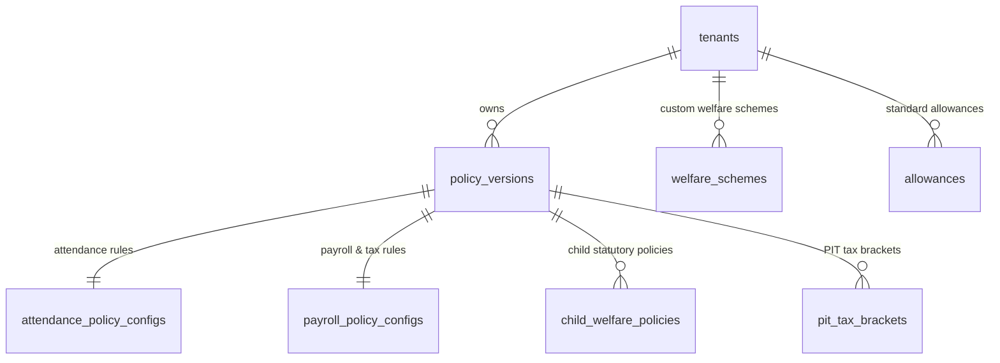

# TÀI LIỆU KỸ THUẬT MODULE 02: POLICY ENGINE (TRUNG TÂM CẤU HÌNH QUY CHẾ ĐỘNG)

> **Tên phân hệ:** `PolicyEngine`  
> **Namespace Backend:** `App\Modules\PolicyEngine`  
> **Trách nhiệm chính:** Quản trị tập trung toàn bộ cấu hình quy chế chấm công, phân ca, làm thêm giờ, cấu hình tiền lương & thuế TNCN, danh mục phụ cấp chuẩn hóa (`allowances`), khung phúc lợi doanh nghiệp đa năng (`welfare_schemes`), chính sách bảo vệ thai sản & con nhỏ, và biểu thuế TNCN lũy tiến 5 bậc theo các phiên bản hiệu lực thời gian (`policy_versions`), bảo đảm triết lý **Zero-Hardcode** và cơ chế **Caching Đa Tầng** cho toàn hệ thống.

---

## 1. Ranh giới Nghiệp vụ & Trách nhiệm (Domain Boundaries)

Module `PolicyEngine` đóng vai trò là "Cơ quan Lập pháp" trong hệ thống Smart-HR, cung cấp các bộ tham số quy chuẩn cho toàn bộ 10 module còn lại:
1. **Quản lý Phiên bản Quy chế (`policy_versions`)**: Cho phép doanh nghiệp tạo mới, sửa đổi hoặc nhân bản các bộ quy chế áp dụng theo từng mốc thời gian `[effective_from, effective_to]`. Mọi thay đổi nội quy hoặc thay đổi luật không làm ảnh hưởng đến dữ liệu công và lương của quá khứ.
2. **Quy chuẩn Chấm công & Phân ca (`attendance_policy_configs`)**:
   - Thời gian miễn trừ đi muộn/về sớm (Grace period).
   - Đơn vị tính làm tròn nghỉ phép (`leave_unit`) và làm tròn muộn/sớm (`early_leave_unit`).
   - Ràng buộc phân ca: Giờ nghỉ tối thiểu giữa 2 ca liên tiếp (mặc định 12h theo Điều 110 BLLĐ), nghỉ hàng tuần (24h liên tục theo Điều 111 BLLĐ), trần giờ làm chuẩn tuần (48h theo Điều 105 BLLĐ).
   - Biểu nấc phạt vi phạm theo số phút (JSON động) và biểu nhân hệ số theo tần suất tái phạm trong tháng (JSON động).
   - Hệ số làm thêm giờ: Ngày thường (1.5x), cuối tuần (2.0x), ngày lễ (3.0x), phụ cấp ca đêm (30%).
   - Tỷ lệ chuyển đổi giờ OT sang ngày nghỉ bù (`compensation_rate`).
3. **Cấu hình Tiền lương, Thuế & Bảo hiểm Xã hội (`payroll_policy_configs`)**:
   - Chế độ ngày công chuẩn: Cố định (`FIXED`, ví dụ: 24 hoặc 26 ngày) hoặc Theo lịch thực tế (`CALENDAR_BASED`).
   - Giờ làm việc tiêu chuẩn mỗi ngày (mặc định 8.00 giờ).
   - Ngày chi trả lương trong tháng (`payment_day`) và tùy chọn chi trả sớm nếu trùng ngày nghỉ/lễ.
   - Các mức giảm trừ gia cảnh thuế TNCN: Bản thân (mặc định 11.000.000 đ hoặc 15.400.000 đ theo chính sách mới) và Người phụ thuộc (mặc định 4.400.000 đ hoặc 6.160.000 đ/tháng).
   - Mức lương cơ sở nhà nước (2.340.000 đ) và các mức trần đóng BHXH/BHYT (20 lần lương cơ sở: 46.800.000 đ), BHTN (20 lần lương tối thiểu vùng: 99.200.000 đ).
   - Tỷ lệ trích nộp bảo hiểm của Người lao động (10.5%) và Người sử dụng lao động (21.5%).
   - Tỷ lệ lương thử việc tối thiểu (85%), mức khấu trừ thuế TNCN thử việc/vãng lai (10% với ngưỡng từ 2.000.000 đ).
   - Hệ số OT 6 bậc (Ngày thường ngày 1.5x, đêm 2.0x; Cuối tuần ngày 2.0x, đêm 2.7x; Ngày lễ ngày 3.0x, đêm 3.9x).
   - Kiểm soát 3 tầng trần OT miễn thuế: Ngày 50% ca, Tháng 40h, Năm 200h/300h theo Nghị định 145/2020/NĐ-CP.
4. **Khung Phúc lợi Doanh nghiệp Đa năng (`welfare_schemes`)**:
   - Trao quyền cho Quản trị viên/HR tự do định nghĩa mọi loại chế độ hỗ trợ: Trợ cấp tiền mặt hàng tháng, thưởng một lần (kết hôn, sinh con), miễn giảm giờ làm việc mỗi ngày, cộng thêm ngày nghỉ phép năm.
   - Điều kiện áp dụng linh hoạt: Theo giới tính (`FEMALE`, `MALE`, `ALL`), theo độ tuổi con nhỏ (từ tháng đến tháng), theo thâm niên làm việc tối thiểu, theo tính chất công việc.
   - Cờ bắt buộc luật định (`is_statutory`) hoặc doanh nghiệp mở rộng.
5. **Danh mục Phụ cấp Lương Chuẩn hóa (`allowances`)**:
   - Kế thừa và chuẩn hóa từ hệ thống thực chiến `timekeeper2`: Ăn trưa, điện thoại, xăng xe, nhà ở, độc hại, chuyên cần.
   - Phân định rõ ràng: Hình thức chi trả (`COMPANY_FIXED`, `INDIVIDUAL_FIXED`, `IRREGULAR`), có tính đóng BHXH không, có chịu thuế TNCN không, có tính vào đơn giá giờ OT không, và mức trần miễn thuế TNCN tối đa.
6. **Chuẩn hóa Trạng thái Hiện / Ẩn (`visibility: VISIBLE / HIDDEN`)**:
   - Thay thế toàn bộ các cờ bật/tắt cứng nhắc bằng trạng thái Hiện/Ẩn, cho phép doanh nghiệp chủ động hiển thị các chế độ áp dụng trên giao diện Portal hoặc tạm ẩn mà không làm gián đoạn CSDL.
7. **Biểu thuế TNCN Lũy tiến Động 5 Bậc (`pit_tax_brackets`)**: Quản lý các ngưỡng thu nhập tính thuế, thuế suất và số trừ nhanh theo luật thuế TNCN mới.
8. **Kiến trúc Caching Đa Tầng Hiệu năng cao**:
   - Sử dụng kết hợp Memory Caching (Static Array trong vòng đời Request) và Redis Caching với khóa định danh phân tầng `tenant_{id}:policy_for_date:{date}`.
   - Cơ chế tự động dọn sạch cache (`clearPolicyCache`) ngay khi có bất kỳ thay đổi nào trong cấu hình.

---

## 2. Thiết kế Cơ sở Dữ liệu & Mô hình Dữ liệu (Database Schema)

### 2.1 Sơ đồ Thực thể Quan hệ (ERD)



### 2.2 Đặc tả Chi tiết các Bảng Dữ liệu

#### Bảng `policy_versions`
- `id` (BIGINT UNSIGNED, PK, Auto Increment)
- `tenant_id` (BIGINT UNSIGNED, FK $\to$ `tenants.id`)
- `code` (VARCHAR(50)) — Mã phiên bản (VD: `POL_2026_V1`)
- `name` (VARCHAR(255)) — Tên phiên bản (VD: "Quy chế Lao động & Đãi ngộ Áp dụng Từ 01/2026")
- `effective_from` (DATE) — Ngày bắt đầu áp dụng tính toán
- `effective_to` (DATE, Nullable) — Ngày kết thúc (NULL nếu đang là chính sách hiện hành)
- `is_active` (BOOLEAN, Default: TRUE)
- `created_at`, `updated_at` (TIMESTAMP)
- Unique Index: `(tenant_id, code)`
- Composite Index: `(tenant_id, effective_from, effective_to)`

#### Bảng `attendance_policy_configs`
- `id` (BIGINT UNSIGNED, PK, Auto Increment)
- `policy_version_id` (BIGINT UNSIGNED, FK $\to$ `policy_versions.id`, Unique)
- `grace_period_late_minutes` (INT, Default: 0) — Số phút muộn cho phép không phạt
- `grace_period_early_minutes` (INT, Default: 0) — Số phút về sớm cho phép không phạt
- `leave_unit_hours` (DECIMAL(4,2), Default: 4.00) — Đơn vị làm tròn nghỉ phép (4h = nửa ngày, 8h = 1 ngày)
- `early_leave_unit_hours` (DECIMAL(4,2), Default: 0.25) — Đơn vị làm tròn muộn/sớm (0.25h = 15 phút)
- `min_rest_hours_between_shifts` (INT, Default: 12) — Giờ nghỉ giữa ca (Điều 110 BLLĐ)
- `min_weekly_rest_hours` (INT, Default: 24) — Giờ nghỉ tuần liên tục (Điều 111 BLLĐ)
- `max_weekly_standard_hours` (INT, Default: 48) — Giờ chuẩn tối đa/tuần (Điều 105 BLLĐ)
- `ot_rate_weekday` (DECIMAL(4,2), Default: 1.50)
- `ot_rate_weekend` (DECIMAL(4,2), Default: 2.00)
- `ot_rate_holiday` (DECIMAL(4,2), Default: 3.00)
- `night_shift_bonus_rate` (DECIMAL(4,2), Default: 0.30) — Phụ cấp làm ca đêm
- `compensation_rate` (DECIMAL(4,2), Default: 8.00) — Số giờ OT quy đổi 1 ngày nghỉ bù
- `penalty_tiers_json` (JSON) — Cấu trúc nấc phạt phút vi phạm
- `frequency_penalty_json` (JSON) — Cấu trúc nhân hệ số theo tần suất tháng

#### Bảng `payroll_policy_configs` (Cấu hình Lương, Thuế & BHXH)
- `id` (BIGINT UNSIGNED, PK, Auto Increment)
- `policy_version_id` (BIGINT UNSIGNED, FK $\to$ `policy_versions.id`, Unique)
- `standard_working_days_mode` (ENUM: `FIXED`, `CALENDAR_BASED`, Default: `FIXED`)
- `fixed_standard_working_days` (DECIMAL(4,2), Default: 26.00) — Ngày công chuẩn cố định
- `standard_working_hours_per_day` (DECIMAL(4,2), Default: 8.00) — Giờ chuẩn ngày
- `payment_day` (INT, Default: 10) — Ngày chi trả lương hàng tháng
- `pay_early_on_holiday_weekend` (BOOLEAN, Default: TRUE) — Chi trả sớm nếu trùng ngày nghỉ/lễ
- `personal_deduction` (DECIMAL(15,2), Default: 11000000.00) — Giảm trừ bản thân (VND/tháng)
- `dependent_deduction` (DECIMAL(15,2), Default: 4400000.00) — Giảm trừ người phụ thuộc (VND/tháng)
- `default_child_allowance` (DECIMAL(15,2), Default: 300000.00) — Trợ cấp con nhỏ mặc định
- `base_salary` (DECIMAL(15,2), Default: 2340000.00) — Mức lương cơ sở làm căn cứ trần bảo hiểm
- `max_salary_bhxh` (DECIMAL(15,2), Default: 46800000.00) — Trần đóng BHXH/BHYT (20 lần lương cơ sở)
- `max_salary_bhtn` (DECIMAL(15,2), Default: 99200000.00) — Trần đóng BHTN (20 lần lương tối thiểu vùng)
- `company_bhxh_rate` (DECIMAL(5,2), Default: 17.50)
- `company_bhyt_rate` (DECIMAL(5,2), Default: 3.00)
- `company_bhtn_rate` (DECIMAL(5,2), Default: 1.00)
- `employee_bhxh_rate` (DECIMAL(5,2), Default: 8.00)
- `employee_bhyt_rate` (DECIMAL(5,2), Default: 1.50)
- `employee_bhtn_rate` (DECIMAL(5,2), Default: 1.00)
- `probation_salary_percentage` (DECIMAL(5,2), Default: 85.00)
- `probation_pit_rate` (DECIMAL(5,2), Default: 10.00)
- `probation_pit_threshold` (DECIMAL(15,2), Default: 2000000.00)
- `ot_weekday_day_rate` (DECIMAL(4,2), Default: 1.50)
- `ot_weekday_night_rate` (DECIMAL(4,2), Default: 2.00)
- `ot_weekend_day_rate` (DECIMAL(4,2), Default: 2.00)
- `ot_weekend_night_rate` (DECIMAL(4,2), Default: 2.70)
- `ot_holiday_day_rate` (DECIMAL(4,2), Default: 3.00)
- `ot_holiday_night_rate` (DECIMAL(4,2), Default: 3.90)
- `ot_tax_exempt_daily_limit_percent` (INT, Default: 50) — Trần OT miễn thuế ngày (50%)
- `ot_tax_exempt_monthly_limit_hours` (INT, Default: 40) — Trần OT miễn thuế tháng (40h)
- `ot_tax_exempt_yearly_limit_hours` (INT, Default: 200) — Trần OT miễn thuế năm (200h/300h)

#### Bảng `welfare_schemes` (Khung Phúc lợi Doanh nghiệp Đa năng)
- `id` (BIGINT UNSIGNED, PK, Auto Increment)
- `tenant_id` (BIGINT UNSIGNED, FK $\to$ `tenants.id`)
- `policy_version_id` (BIGINT UNSIGNED, Nullable, FK $\to$ `policy_versions.id`)
- `code` (VARCHAR(50)) — Mã phúc lợi (VD: `CON_NHO_HO_TRO`, `PHU_NU_THAI_SAN`, `NGUOI_CAO_TUOI`)
- `name` (VARCHAR(200)) — Tên chế độ phúc lợi
- `category` (ENUM: `CHILD_CARE`, `MATERNITY_FEMALE`, `HEALTH_WELLNESS`, `WORKING_COND`, `FINANCIAL_SUPPORT`, `SPECIAL_ALLOWANCE`)
- `visibility` (ENUM: `VISIBLE`, `HIDDEN`, Default: `VISIBLE`) — Trạng thái Hiện / Ẩn
- `is_statutory` (BOOLEAN, Default: FALSE) — Bắt buộc luật định hay doanh nghiệp tự mở rộng
- `daily_exemption_minutes` (INT, Default: 0) — Số phút miễn trừ giờ làm việc mỗi ngày
- `pay_type` (ENUM: `PAID`, `UNPAID`, `PARTIAL`, Default: `PAID`)
- `prohibit_night_shift` (BOOLEAN, Default: FALSE)
- `prohibit_overtime` (BOOLEAN, Default: FALSE)
- `additional_leave_days_per_year` (DECIMAL(4,2), Default: 0.00) — Ngày phép cộng thêm hàng năm
- `monthly_allowance_amount` (DECIMAL(15,2), Default: 0.00) — Tiền trợ cấp hàng tháng
- `one_time_bonus_amount` (DECIMAL(15,2), Default: 0.00) — Tiền thưởng một lần
- `is_tax_exempt` (BOOLEAN, Default: FALSE) — Có miễn thuế TNCN không
- `applicable_gender` (ENUM: `ALL`, `FEMALE`, `MALE`, Default: `ALL`)
- `child_min_age_months` (INT, Nullable)
- `child_max_age_months` (INT, Nullable)
- `min_seniority_months` (INT, Nullable)
- `description` (TEXT, Nullable)
- Composite Index: `(tenant_id, visibility, category)`

#### Bảng `allowances` (Danh mục Phụ cấp Lương Doanh nghiệp)
- `id` (BIGINT UNSIGNED, PK, Auto Increment)
- `tenant_id` (BIGINT UNSIGNED, FK $\to$ `tenants.id`)
- `code` (VARCHAR(50)) — Mã phụ cấp (VD: `PC_AN_TRUA`, `PC_DIEN_THOAI`, `PC_XANG_XE`, `PC_CHUYEN_CAN`)
- `name` (VARCHAR(200)) — Tên phụ cấp
- `apply_type` (ENUM: `COMPANY_FIXED`, `INDIVIDUAL_FIXED`, `IRREGULAR`)
- `is_insurance_taxable` (BOOLEAN, Default: FALSE) — Có tính đóng BHXH bắt buộc không
- `is_pit_taxable` (BOOLEAN, Default: TRUE) — Có chịu thuế TNCN không
- `is_included_in_ot_wage` (BOOLEAN, Default: FALSE) — Có tính vào đơn giá giờ làm thêm OT không
- `tax_exemption_limit` (DECIMAL(15,2), Nullable) — Trần miễn thuế TNCN tối đa
- `default_amount` (DECIMAL(15,2), Default: 0.00)
- `visibility` (ENUM: `VISIBLE`, `HIDDEN`, Default: `VISIBLE`) — Trạng thái Hiện / Ẩn
- `notes` (TEXT, Nullable)
- Composite Index: `(tenant_id, visibility, apply_type)`

#### Bảng `child_welfare_policies` (Ma trận phúc lợi con nhỏ luật định)
- `id` (BIGINT UNSIGNED, PK, Auto Increment)
- `policy_version_id` (BIGINT UNSIGNED, FK $\to$ `policy_versions.id`)
- `name` (VARCHAR(150))
- `min_age_months` (INT)
- `max_age_months` (INT)
- `daily_exemption_minutes` (INT)
- `pay_type` (ENUM: `PAID`, `UNPAID`, `PARTIAL`)
- `prohibit_night_shift` (BOOLEAN, Default: FALSE)
- `prohibit_overtime` (BOOLEAN, Default: FALSE)
- `is_statutory` (BOOLEAN, Default: FALSE)
- `visibility` (ENUM: `VISIBLE`, `HIDDEN`, Default: `VISIBLE`)
- `is_active` (BOOLEAN, Default: TRUE)

#### Bảng `pit_tax_brackets` (Biểu thuế TNCN 5 bậc)
- `id` (BIGINT UNSIGNED, PK, Auto Increment)
- `policy_version_id` (BIGINT UNSIGNED, FK $\to$ `policy_versions.id`)
- `tier` (INT) — Bậc 1 đến 5
- `min_income` (DECIMAL(15,2))
- `max_income` (DECIMAL(15,2), Nullable)
- `tax_rate` (DECIMAL(5,2)) — 5%, 10%, 20%, 30%, 35%
- `quick_subtraction` (DECIMAL(15,2))

---

## 3. Kiến trúc Caching Đa Tầng & Dịch vụ Phân giải (Caching & Resolvers)

### 3.1 Dịch vụ Phân giải Quy chế Tối ưu Caching (`PolicyResolutionService`)

```php
namespace App\Modules\PolicyEngine\Services;

class PolicyResolutionService
{
    /** @var array<string, ResolvedPolicyDTO> In-memory static cache */
    protected static array $memoryCache = [];

    public function resolveForDate(int $tenantId, CarbonInterface $targetDate): ResolvedPolicyDTO
    {
        $dateStr = $targetDate->toDateString();
        $cacheKey = "tenant_{$tenantId}:policy_for_date:{$dateStr}";

        // Tầng 1: Memory Cache (0ms)
        if (isset(self::$memoryCache[$cacheKey])) {
            return self::$memoryCache[$cacheKey];
        }

        // Tầng 2: Redis Cache (TTL: 3600s)
        $dto = Cache::remember($cacheKey, 3600, function () use ($tenantId, $dateStr) {
            $version = PolicyVersion::where('tenant_id', $tenantId)
                ->where('effective_from', '<=', $dateStr)
                ->where(function ($query) use ($dateStr) {
                    $query->whereNull('effective_to')->orWhere('effective_to', '>=', $dateStr);
                })
                ->where('is_active', true)
                ->with([
                    'attendanceConfig',
                    'payrollConfig',
                    'childWelfarePolicies' => fn($q) => $q->where('visibility', 'VISIBLE'),
                    'pitTaxBrackets'
                ])
                ->orderByDesc('effective_from')
                ->firstOrFail();

            return ResolvedPolicyDTO::fromModel($version);
        });

        self::$memoryCache[$cacheKey] = $dto;
        return $dto;
    }

    /**
     * Dọn sạch toàn bộ cache quy chế khi có thay đổi cấu hình (Cache Invalidation)
     */
    public function clearPolicyCache(int $tenantId): void
    {
        self::$memoryCache = [];
        Cache::tags(["tenant_{$tenantId}_policies"])->flush();
    }
}
```

---

## 4. Giao diện Trung tâm Cấu hình (Vue 3 / Inertia.js / Element Plus)

Giao diện tại `resources/js/Pages/Policies/Index.vue` được chia thành 7 tab chuyên sâu:
1. **Tab 1 - Quy chuẩn Chấm công (`Attendance`)**: Nấc phạt vi phạm, giờ làm tròn, giờ nghỉ giữa ca.
2. **Tab 2 - Phúc lợi Con nhỏ (`Child Welfare`)**: Thiết lập chế độ con dưới 12 tháng, con 1-11 tuổi.
3. **Tab 3 - Cấu hình Lương & BHXH (`Payroll Config`)**: Ngày công chuẩn, trần bảo hiểm, ngày trả lương, 3 tầng trần OT miễn thuế.
4. **Tab 4 - Chế độ Phúc lợi Đa năng (`Welfare Schemes`)**: Bảng quản lý mọi chính sách phúc lợi doanh nghiệp, modal tạo/sửa với trạng thái Hiện/Ẩn.
5. **Tab 5 - Danh mục Phụ cấp (`Allowances`)**: Danh sách phụ cấp lương, cờ bảo hiểm, cờ thuế, cờ tính vào OT.
6. **Tab 6 - Biểu thuế TNCN 5 Bậc (`PIT Tax`)**: Điều chỉnh 5 bậc thu nhập và thuế suất.
7. **Tab 7 - Sandbox Thử nghiệm Thời gian thực (`Sandbox`)**: Mô phỏng tính toán nấc phạt, thử nghiệm biểu thuế TNCN 5 bậc và phúc lợi con nhỏ.

---

## 5. Danh mục RESTful / Inertia Endpoints

| Method | URI | Quyền hạn | Mô tả |
|---|---|---|---|
| `GET` | `/policies` | `perm:POLICY_WELFARE.view` | Xem trung tâm cấu hình quy chế |
| `POST` | `/policies/versions` | `perm:POLICY_WELFARE.manage` | Tạo phiên bản quy chế mới |
| `POST` | `/policies/attendance` | `perm:POLICY_WELFARE.manage` | Cập nhật cấu hình chấm công & nấc phạt |
| `POST` | `/policies/payroll` | `perm:POLICY_WELFARE.manage` | Cập nhật cấu hình lương, BHXH & trần OT |
| `POST` | `/policies/welfare-schemes` | `perm:POLICY_WELFARE.manage` | Thêm mới chế độ phúc lợi doanh nghiệp |
| `POST` | `/policies/welfare-schemes/{id}/toggle-visibility` | `perm:POLICY_WELFARE.manage` | Chuyển đổi trạng thái Hiện / Ẩn phúc lợi |
| `POST` | `/policies/allowances` | `perm:POLICY_WELFARE.manage` | Thêm mới / cập nhật danh mục phụ cấp lương |
| `POST` | `/policies/allowances/{id}/toggle-visibility` | `perm:POLICY_WELFARE.manage` | Chuyển đổi trạng thái Hiện / Ẩn phụ cấp |
| `POST` | `/policies/sandbox/penalty` | `perm:POLICY_WELFARE.view` | Sandbox thử nghiệm tính phạt muộn/sớm |
| `POST` | `/policies/sandbox/pit-tax` | `perm:POLICY_WELFARE.view` | Sandbox thử nghiệm tính thuế TNCN 5 bậc |

---

## 6. Kịch bản Kiểm thử Tích hợp (Test Scenarios)

1. **Test `MultiTierPolicyCacheInvalidation`**:
   - Gọi `resolveForDate` lần 1: Ghi nhận truy vấn CSDL và nạp vào Redis/Memory cache.
   - Gọi `resolveForDate` lần 2: Trả về kết quả từ cache mà không tốn truy vấn CSDL.
   - Cập nhật cấu hình nấc phạt và kích hoạt `clearPolicyCache($tenantId)`.
   - Gọi `resolveForDate` lần 3: Truy vấn lại CSDL với cấu hình nấc phạt mới nhất.
2. **Test `WelfareSchemeVisibilityFilter`**:
   - Thiết lập một phúc lợi có `visibility = HIDDEN`.
   - Pipeline tính công chạy quét phúc lợi áp dụng.
   - Kết quả kỳ vọng: Phúc lợi ở trạng thái `HIDDEN` bị bỏ qua, không được miễn trừ giờ công.
3. **Test `PayrollPolicyZeroHardcodeFallback`**:
   - Thay đổi mức giảm trừ gia cảnh người phụ thuộc từ 4.400.000 đ thành 6.160.000 đ trong `payroll_policy_configs`.
   - Chạy tính thuế TNCN cho nhân viên có 1 người phụ thuộc.
   - Kết quả kỳ vọng: Hệ thống tự động trừ đúng 6.160.000 đ mà không cần sửa mã nguồn PHP.
