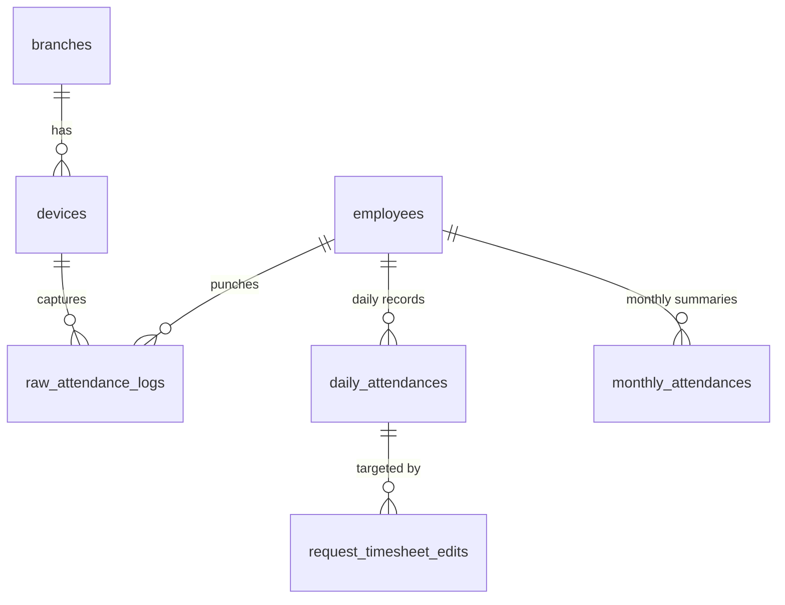
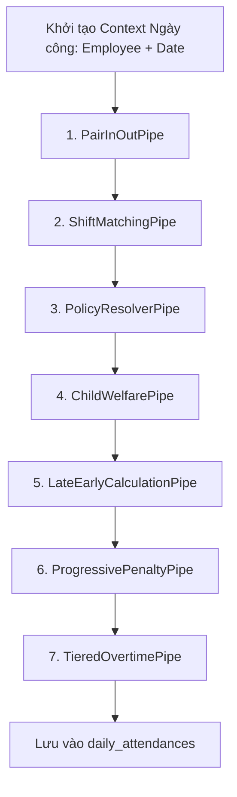

# TÀI LIỆU KỸ THUẬT MODULE 03: TIME & ATTENDANCE (ĐỘNG CƠ CHẤM CÔNG & THU THẬP BIOMETRIC)

> **Tên phân hệ:** `Attendance`  
> **Namespace Backend:** `App\Modules\Attendance`  
> **Trách nhiệm chính:** Thu thập dữ liệu quẹt thẻ từ Edge Daemon (Go), lưu trữ log thô bất biến (Immutable Audit Trail), thực thi Pipeline tính công theo ngày (`WorkDateCalculationPipeline`), cung cấp động cơ xem trước bảng công (`TimesheetPreviewService`), quản lý bảng công tháng và cơ chế khóa tháng (`MonthLockService`).

---

## 1. Ranh giới Nghiệp vụ & Trách nhiệm (Domain Boundaries)

Module `Attendance` là phân hệ xử lý dữ liệu lớn (High-Throughput / Big-Data) của hệ thống Smart-HR:
1. **Tiếp nhận Dữ liệu Quẹt thẻ từ Edge (`raw_attendance_logs`)**: API tiếp nhận batch log quẹt thẻ từ Go Daemon mạng LAN, xác thực chữ ký số HMAC-SHA256, khử trùng lặp và ghi vào bảng log thô bất biến.
2. **Động cơ Pipeline Tính công Theo ngày (`WorkDateCalculationPipeline`)**: Chuỗi 7 Pipe xử lý độc lập chuyển hóa log quẹt thẻ thô và ca kế hoạch thành kết quả công ngày (`daily_attendances`).
3. **Động cơ Bảng công Tạm tính (`TimesheetPreviewService`)**: Cho phép xem trước kết quả bảng công tháng khi áp dụng các đơn từ đang chờ duyệt (`PENDING`), giải phóng triệt để việc tắc nghẽn luồng phê duyệt từ hệ thống cũ.
4. **Bảng công Tổng hợp Tháng (`monthly_attendances`)**: Tính toán tổng ngày công, giờ công chuẩn, tổng OT, tổng phạt muộn/sớm và tổng ngày nghỉ phép có lương/không lương.
5. **Cơ chế Khóa Tháng (`MonthLockService`)**: Đóng băng dữ liệu công tháng khi đã chốt kỳ kế toán, ngăn chặn can thiệp hồi tố.

---

## 2. Thiết kế Cơ sở Dữ liệu & Mô hình Dữ liệu (Database Schema)

### 2.1 Sơ đồ Thực thể Quan hệ (ERD)

### 2.2 Đặc tả Chi tiết các Bảng Dữ liệu

#### Bảng `devices`
- `id` (BIGINT UNSIGNED, PK, Auto Increment)
- `branch_id` (BIGINT UNSIGNED, FK $\to$ `branches.id`)
- `device_name` (VARCHAR(150))
- `serial_number` (VARCHAR(100), Unique)
- `ip_address` (VARCHAR(50)) — IP Private trong mạng LAN
- `port` (INT, Default: 4370)
- `device_type` (ENUM: `ZKTECO`, `HIKVISION`, `FACE_ID`, `VIRTUAL`)
- `last_heartbeat_at` (TIMESTAMP, Nullable)
- `status` (ENUM: `ONLINE`, `OFFLINE`, `ERROR`, Default: `OFFLINE`)

#### Bảng `raw_attendance_logs` (Log Quẹt thẻ Thô BẤT BIẾN)
- `id` (BIGINT UNSIGNED, PK, Auto Increment)
- `tenant_id` (BIGINT UNSIGNED)
- `branch_id` (BIGINT UNSIGNED)
- `device_id` (BIGINT UNSIGNED, FK $\to$ `devices.id`)
- `device_user_code` (VARCHAR(50)) — Mã ID trên máy chấm công
- `employee_id` (BIGINT UNSIGNED, Nullable, FK $\to$ `employees.id`) — Phân giải từ `device_user_code`
- `punch_time` (DATETIME) — Thời gian quẹt thẻ chính xác
- `punch_state` (TINYINT, Default: 255) — 0: CheckIn, 1: CheckOut, 255: Auto
- `verify_type` (TINYINT, Default: 1) — 1: Vân tay, 2: FaceID, 3: Thẻ từ
- `sync_batch_id` (VARCHAR(100)) — ID lô đồng bộ từ Edge Daemon
- `created_at` (TIMESTAMP, Default: CURRENT_TIMESTAMP)
- Composite Index: `(employee_id, punch_time)`, `(device_id, device_user_code, punch_time)`

#### Bảng `daily_attendances` (Kết quả Công Ngày)
- `id` (BIGINT UNSIGNED, PK, Auto Increment)
- `tenant_id` (BIGINT UNSIGNED)
- `employee_id` (BIGINT UNSIGNED, FK $\to$ `employees.id`)
- `date` (DATE)
- `work_shift_id` (BIGINT UNSIGNED, Nullable, FK $\to$ `work_shifts.id`)
- `check_in` (DATETIME, Nullable)
- `check_out` (DATETIME, Nullable)
- `standard_hours` (DECIMAL(4,2), Default: 0.00) — Giờ làm việc chuẩn được ghi nhận
- `late_minutes` (INT, Default: 0) — Số phút đi muộn thực tế (sau trừ miễn giảm)
- `early_minutes` (INT, Default: 0) — Số phút về sớm thực tế (sau trừ miễn giảm)
- `ot_weekday_hours` (DECIMAL(4,2), Default: 0.00)
- `ot_weekend_hours` (DECIMAL(4,2), Default: 0.00)
- `ot_holiday_hours` (DECIMAL(4,2), Default: 0.00)
- `night_shift_hours` (DECIMAL(4,2), Default: 0.00)
- `child_policy_paid_hours` (DECIMAL(4,2), Default: 0.00) — Giờ miễn giảm có hưởng lương
- `child_policy_unpaid_hours` (DECIMAL(4,2), Default: 0.00) — Giờ miễn giảm không hưởng lương
- `late_early_penalty_amount` (DECIMAL(15,2), Default: 0.00) — Tiền phạt đi muộn/về sớm
- `status` (ENUM: `NORMAL`, `LATE_EARLY`, `ABSENT`, `LEAVE_PAID`, `LEAVE_UNPAID`, `HOLIDAY`)
- `is_manually_edited` (BOOLEAN, Default: FALSE)
- `created_at`, `updated_at` (TIMESTAMP)
- Unique Index: `(employee_id, date)`

#### Bảng `monthly_attendances` (Tổng hợp Công Tháng)
- `id` (BIGINT UNSIGNED, PK, Auto Increment)
- `tenant_id` (BIGINT UNSIGNED)
- `employee_id` (BIGINT UNSIGNED, FK $\to$ `employees.id`)
- `month_year` (VARCHAR(7)) — Định dạng: `YYYY-MM`
- `total_standard_days` (DECIMAL(5,2), Default: 0.00)
- `total_actual_days` (DECIMAL(5,2), Default: 0.00)
- `total_standard_hours` (DECIMAL(6,2), Default: 0.00)
- `total_ot_hours` (DECIMAL(6,2), Default: 0.00)
- `total_night_hours` (DECIMAL(6,2), Default: 0.00)
- `total_paid_leave_days` (DECIMAL(4,2), Default: 0.00)
- `total_unpaid_leave_days` (DECIMAL(4,2), Default: 0.00)
- `total_late_early_penalties` (DECIMAL(15,2), Default: 0.00)
- `is_locked` (BOOLEAN, Default: FALSE) — TRUE: Đã khóa tháng
- `locked_at` (TIMESTAMP, Nullable)
- `locked_by` (BIGINT UNSIGNED, Nullable, FK $\to$ `employees.id`)
- Unique Index: `(employee_id, month_year)`

---

## 3. Kiến trúc Pipeline Tính công Chi tiết (`WorkDateCalculationPipeline`)

Mỗi ngày công của một nhân viên được đưa qua Pipeline tuần tự 7 Pipe:

### Chi tiết các Pipe xử lý:

1. **`PairInOutPipe` (Ghép cặp Check-In / Check-Out)**:
   - Thu thập toàn bộ log quẹt thẻ trong khoảng $[Date\text{ }04:00, (Date+1)\text{ }06:00]$ để bao quát ca đêm.
   - *Khử trùng lặp (Debounce)*: Bỏ qua các lần quẹt thẻ cách nhau $< 60$ giây.
   - Lấy lần quẹt thẻ sớm nhất làm `candidate_in` và muộn nhất làm `candidate_out`.
   - Nếu chỉ có 1 lần quẹt: Gán cờ `MISSING_CHECK_OUT` hoặc `MISSING_CHECK_IN`.

2. **`ShiftMatchingPipe` (Khớp Ca Làm Việc)**:
   - Kiểm tra lịch phân ca `rosters` của nhân viên tại ngày đó.
   - Nếu có ca kế hoạch: Sử dụng `work_shift_id` kế hoạch.
   - Nếu không có lịch trước (ca linh hoạt / chuỗi cửa hàng): So khớp khoảng thời gian In/Out thực tế với danh mục `work_shifts` để tự động chọn ca có độ bao phủ thời gian tối ưu nhất.

3. **`PolicyResolverPipe` (Nạp Phiên bản Quy chế)**:
   - Gọi `PolicyResolverService::resolveForDate($tenantId, $date)` để lấy cấu hình quy chế hiệu lực.

4. **`ChildWelfarePipe` (Áp dụng Phúc lợi Con nhỏ)**:
   - Tính tuổi con tại ngày $D$. Nếu con $< 12$ tháng: Thiết lập `allowed_exemption_minutes = 60`, `pay_type = PAID`.
   - *Kiểm soát Ca đêm & Làm thêm giờ (Điều 137 Khoản 1 Điểm b BLLĐ 2019)*: Mặc định không bố trí; nếu phát sinh giờ làm đêm ($22:00 - 06:00$) hoặc OT, hệ thống đối soát xem có **Đơn thỏa thuận/đồng thuận tự nguyện** được duyệt hợp lệ hay không:
     - *Nếu có đơn đồng thuận*: Giờ ca đêm và OT vẫn được ghi nhận và tính lương đầy đủ theo các hệ số chuẩn luật định (1.5x, 2.0x, 3.0x, phụ cấp đêm 30%, OT đêm).
     - *Nếu không có đơn đồng thuận*: Hệ thống tự động đẩy cảnh báo vi phạm tuân thủ (Compliance Warning) lên Dashboard của HR/Quản lý để kiểm tra và bổ sung văn bản thỏa thuận.
   - Nếu thuộc chính sách mở rộng khác của công ty (con 1-11 tuổi): Nạp mức miễn trừ tương ứng (`pay_type = UNPAID`).

5. **`LateEarlyCalculationPipe` (Tính Muộn/Sớm & Giờ Chuẩn)**:
   - Tính số phút muộn thô: $T_{\text{late}} = \max(0, CheckIn - ShiftStart)$. Nếu $T_{\text{late}} \le \text{grace\_period\_late}$ thì $T_{\text{late}} = 0$.
   - Tính số phút về sớm thô: $T_{\text{early}} = \max(0, ShiftEnd - CheckOut)$. Nếu $T_{\text{early}} \le \text{grace\_period\_early}$ thì $T_{\text{early}} = 0$.
   - *Cơ chế Hấp thụ (Absorption)*:
     $$
     \text{Absorbed} = \min(T_{\text{late}} + T_{\text{early}},\; \text{Allowed Exemption Minutes})
     $$
     Giảm trừ vi phạm: $T_{\text{late\_final}} + T_{\text{early\_final}} = (T_{\text{late}} + T_{\text{early}}) - \text{Absorbed}$.
     Nếu `pay_type = PAID`: `child_policy_paid_hours = Absorbed / 60`.
     Nếu `pay_type = UNPAID`: `child_policy_unpaid_hours = Absorbed / 60`.
   - Tính giờ chuẩn:
     $$
     \text{Standard Hours} = \text{Shift Standard Hours} - \frac{T_{\text{late\_final}} + T_{\text{early\_final}}}{60}
     $$

6. **`ProgressivePenaltyPipe` (Phạt Muộn/Sớm Lũy tiến)**:
   - Tra cứu số tiền phạt theo nấc phút vi phạm từ `penalty_tiers_json`.
   - Quét số lần đi muộn/về sớm lũy kế trong tháng tính đến ngày $D$ để nhân hệ số phạt tần suất `frequency_penalty_json`.

7. **`TieredOvertimePipe` (Tính Làm thêm giờ & Ca đêm)**:
   - Bóc tách số giờ làm ngoài ca chuẩn.
   - Nhân hệ số theo ngày thường (1.5x), cuối tuần (2.0x), ngày lễ (3.0x).
   - Nếu có khung giờ nằm trong khoảng $22:00 - 06:00$: Tính thêm phụ cấp ca đêm 30% và OT đêm.

---

## 4. Động cơ Bảng công Tạm tính (`TimesheetPreviewService`)

### 4.1 Giải quyết Tắc nghẽn Luồng Phê duyệt
- **Vấn đề cũ**: Nhân viên gửi đơn sửa bảng công thì bị khóa không cho nộp đơn nghỉ phép/OT khác; hoặc quản lý phải duyệt hết các đơn khác mới duyệt được bảng công.
- **Giải pháp Smart-HR**:
  - Không ngăn cấm việc tạo đơn. Bảng công chính thức (`daily_attendances`) chỉ thay đổi khi đơn được duyệt (`APPROVED`).
  - Cung cấp API `GET /api/v1/attendances/preview`:
    1. Lấy dữ liệu công chính thức hiện tại của tháng.
    2. Nạp toàn bộ các đơn đang chờ duyệt (`status = PENDING`) của nhân viên trong tháng.
    3. Ghi đè giả lập các giá trị đề xuất vào bản sao trong RAM.
    4. Chạy lại `WorkDateCalculationPipeline` cho các ngày có biến động.
    5. Trả về cấu trúc bảng công tạm tính song song với bảng công chính thức.

---

## 5. Danh mục RESTful API Endpoints

| Method | URI | Quyền hạn | Mô tả |
|---|---|---|---|
| `POST` | `/api/v1/attendance/sync` | `edge.agent` | Endpoint nhận batch quẹt thẻ từ Go Daemon (Xác thực chữ ký HMAC-SHA256) |
| `GET` | `/api/v1/attendances/daily` | `att.view` | Bảng công chi tiết theo ngày (Lọc theo nhân viên, phòng ban, khoảng ngày) |
| `GET` | `/api/v1/attendances/monthly` | `att.view` | Bảng công tổng hợp tháng của nhân viên |
| `GET` | `/api/v1/attendances/preview` | `att.view` | Bảng công tạm tính (mô phỏng áp dụng các đơn PENDING) |
| `POST` | `/api/v1/attendances/recalculate` | `att.manage`| Kích hoạt tính toán lại công cho nhân viên hoặc toàn bộ chi nhánh |
| `POST` | `/api/v1/attendances/lock-month` | `att.lock` | Khóa bảng công tháng (ngăn chặn mọi sửa đổi hồi tố) |
| `POST` | `/api/v1/attendances/unlock-month` | `att.lock` | Mở khóa bảng công tháng (chỉ dành cho SuperAdmin kèm lý do bắt buộc) |

---

## 6. Kịch bản Kiểm thử Tích hợp (Test Scenarios)

1. **Test `HMACBatchSyncAndDeduplication`**:
   - Gửi payload quẹt thẻ từ Go Daemon kèm chữ ký HMAC hợp lệ.
   - Gửi 2 lần quẹt cùng 1 nhân viên cách nhau 15 giây.
   - Kết quả: Hệ thống ghi nhận thành công, chỉ lưu 1 quẹt thẻ đầu tiên vào tính toán.
2. **Test `ChildPolicyAbsorption`**:
   - Ca chuẩn 8h (08:00 - 17:00). Nhân viên có con 6 tháng tuổi.
   - Giờ đến: 08:45 (muộn 45 phút). Giờ về: 17:00.
   - Kết quả: 45 phút muộn được hấp thụ hoàn toàn bởi 60 phút miễn giảm. `late_minutes = 0`, `child_policy_paid_hours = 0.75`, `standard_hours = 8.00`, không bị phạt tiền.
3. **Test `TimesheetPreviewNonBlocking`**:
   - Bảng công ngày 10/09 hiển thị `ABSENT` (vắng mặt).
   - Nhân viên tạo đơn sửa công với CheckIn 08:00, CheckOut 17:00 (đang `PENDING`).
   - Gọi API bảng công chính thức $\to$ Vẫn là `ABSENT`.
   - Gọi API bảng công Preview $\to$ Hiển thị `NORMAL` với 8.00 giờ chuẩn.
