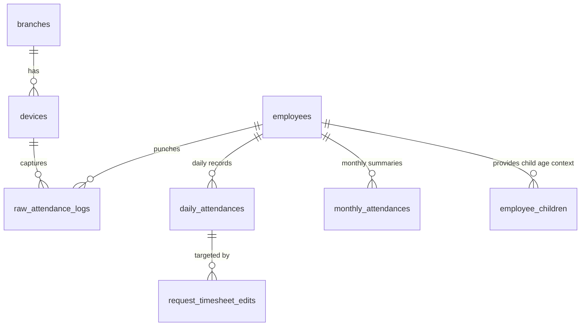
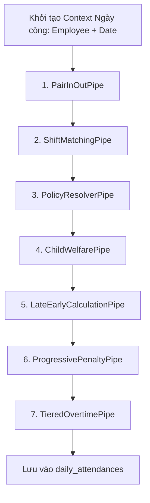

# TÀI LIỆU KỸ THUẬT MODULE 03: TIME & ATTENDANCE (ĐỘNG CƠ CHẤM CÔNG & THU THẬP BIOMETRIC)

> **Tên phân hệ:** `Attendance`  
> **Namespace Backend:** `App\Modules\Attendance`  
> **Trách nhiệm chính:** Thu thập dữ liệu quẹt thẻ từ Edge Daemon (Go), lưu trữ log thô bất biến (Immutable Audit Trail), thực thi Pipeline tính công theo ngày 7 Pipe (`WorkDateCalculationPipeline`), cung cấp động cơ xem trước bảng công (`TimesheetPreviewService`), quản lý bảng công tháng, cơ chế khóa tháng (`MonthLockService`) và giao diện xem trực quan Log thô & Bảng công Tạm tính.

---

## 1. Ranh giới Nghiệp vụ & Trách nhiệm (Domain Boundaries)

Module `Attendance` là phân hệ xử lý dữ liệu lớn (High-Throughput / Big-Data) của hệ thống Smart-HR:
1. **Tiếp nhận Dữ liệu Quẹt thẻ từ Edge (`raw_attendance_logs`)**: API tiếp nhận batch log quẹt thẻ từ Go Daemon mạng LAN, xác thực chữ ký số HMAC-SHA256, khử trùng lặp và ghi vào bảng log thô bất biến.
2. **Động cơ Pipeline Tính công Theo ngày (`WorkDateCalculationPipeline`)**: Chuỗi 7 Pipe xử lý độc lập chuyển hóa log quẹt thẻ thô và ca kế hoạch thành kết quả công ngày (`daily_attendances`).
3. **Động cơ Bảng công Tạm tính (`TimesheetPreviewService`)**: Cho phép xem trước kết quả bảng công tháng khi áp dụng các đơn từ đang chờ duyệt (`PENDING`), giải phóng triệt để việc tắc nghẽn luồng phê duyệt từ hệ thống cũ.
4. **Bảng công Tổng hợp Tháng (`monthly_attendances`)**: Tính toán tổng ngày công, giờ công chuẩn, tổng OT, tổng phạt muộn/sớm và tổng ngày nghỉ phép có lương/không lương.
5. **Cơ chế Khóa Tháng (`MonthLockService`)**: Đóng băng dữ liệu công tháng khi đã chốt kỳ kế toán, ngăn chặn can thiệp hồi tố.
6. **Tích hợp Phúc lợi Con nhỏ Đa nguồn**: Phân giải tự động độ tuổi của từng bé từ `employee_children` (hoặc `child_birth_date`), so khớp với các chế độ phúc lợi đang hiển thị (`visibility = VISIBLE`) trong Module 02.
7. **Hộp thoại Kiểm toán Log Quẹt thẻ Thô (Raw Logs Dialog)**: Cho phép Quản lý/HR bấm trực tiếp vào bất kỳ ô ngày công nào trên giao diện để mở modal xem toàn bộ lịch sử quẹt thẻ thô nguyên bản của nhân viên đó trong ngày.

---

## 2. Thiết kế Cơ sở Dữ liệu & Mô hình Dữ liệu (Database Schema)

### 2.1 Sơ đồ Thực thể Quan hệ (ERD)

### 2.2 Đặc tả Chi tiết các Bảng Dữ liệu

#### Bảng `devices`
- `id` (BIGINT UNSIGNED, PK, Auto Increment)
- `branch_id` (BIGINT UNSIGNED, FK -> `branches.id`)
- `device_name` (VARCHAR(150))
- `serial_number` (VARCHAR(100), Unique)
- `ip_address` (VARCHAR(50)) — IP Private trong mạng LAN
- `port` (INT, Default: 4370)
- `device_type` (ENUM: `ZKTECO`, `HIKVISION`, `FACE_ID`, `VIRTUAL`)
- `last_heartbeat_at` (TIMESTAMP, Nullable)
- `status` (ENUM: `ONLINE`, `OFFLINE`, `ERROR`, Default: `OFFLINE`)

#### Bảng `raw_attendance_logs` (Log Quẹt thẻ Thô BẤT BIẾN)
- `id` (BIGINT UNSIGNED, PK, Auto Increment)
- `tenant_id` (BIGINT UNSIGNED)
- `branch_id` (BIGINT UNSIGNED)
- `device_id` (BIGINT UNSIGNED, FK -> `devices.id`)
- `device_user_code` (VARCHAR(50)) — Mã ID trên máy chấm công
- `employee_id` (BIGINT UNSIGNED, Nullable, FK -> `employees.id`) — Phân giải từ `device_user_code`
- `punch_time` (DATETIME) — Thời gian quẹt thẻ chính xác
- `punch_state` (TINYINT, Default: 255) — 0: CheckIn, 1: CheckOut, 255: Auto
- `verify_type` (TINYINT, Default: 1) — 1: Vân tay, 2: FaceID, 3: Thẻ từ
- `sync_batch_id` (VARCHAR(100)) — ID lô đồng bộ từ Edge Daemon
- `created_at` (TIMESTAMP, Default: CURRENT_TIMESTAMP)
- Composite Index: `(employee_id, punch_time)`, `(device_id, device_user_code, punch_time)`

#### Bảng `daily_attendances` (Kết quả Công Ngày)
- `id` (BIGINT UNSIGNED, PK, Auto Increment)
- `tenant_id` (BIGINT UNSIGNED)
- `employee_id` (BIGINT UNSIGNED, FK -> `employees.id`)
- `date` (DATE)
- `work_shift_id` (BIGINT UNSIGNED, Nullable, FK -> `work_shifts.id`)
- `check_in` (DATETIME, Nullable)
- `check_out` (DATETIME, Nullable)
- `standard_hours` (DECIMAL(4,2), Default: 0.00) — Giờ làm việc chuẩn được ghi nhận
- `late_minutes` (INT, Default: 0) — Số phút đi muộn thực tế (sau trừ miễn giảm)
- `early_minutes` (INT, Default: 0) — Số phút về sớm thực tế (sau trừ miễn giảm)
- `ot_weekday_hours` (DECIMAL(4,2), Default: 0.00)
- `ot_weekend_hours` (DECIMAL(4,2), Default: 0.00)
- `ot_holiday_hours` (DECIMAL(4,2), Default: 0.00)
- `night_shift_hours` (DECIMAL(4,2), Default: 0.00)
- `child_policy_paid_hours` (DECIMAL(4,2), Default: 0.00) — Giờ miễn giảm có hưởng lương
- `child_policy_unpaid_hours` (DECIMAL(4,2), Default: 0.00) — Giờ miễn giảm không hưởng lương
- `late_early_penalty_amount` (DECIMAL(15,2), Default: 0.00) — Tiền phạt đi muộn/về sớm
- `status` (ENUM: `NORMAL`, `LATE_EARLY`, `ABSENT`, `LEAVE_PAID`, `LEAVE_UNPAID`, `HOLIDAY`)
- `is_manually_edited` (BOOLEAN, Default: FALSE)
- `created_at`, `updated_at` (TIMESTAMP)
- Unique Index: `(employee_id, date)`

#### Bảng `monthly_attendances` (Tổng hợp Công Tháng)
- `id` (BIGINT UNSIGNED, PK, Auto Increment)
- `tenant_id` (BIGINT UNSIGNED)
- `employee_id` (BIGINT UNSIGNED, FK -> `employees.id`)
- `month_year` (VARCHAR(7)) — Định dạng: `YYYY-MM`
- `total_standard_days` (DECIMAL(5,2), Default: 0.00)
- `total_actual_days` (DECIMAL(5,2), Default: 0.00)
- `total_standard_hours` (DECIMAL(6,2), Default: 0.00)
- `total_ot_hours` (DECIMAL(6,2), Default: 0.00)
- `total_night_hours` (DECIMAL(6,2), Default: 0.00)
- `total_paid_leave_days` (DECIMAL(4,2), Default: 0.00)
- `total_unpaid_leave_days` (DECIMAL(4,2), Default: 0.00)
- `total_late_early_penalties` (DECIMAL(15,2), Default: 0.00)
- `is_locked` (BOOLEAN, Default: FALSE) — TRUE: Đã khóa tháng
- `locked_at` (TIMESTAMP, Nullable)
- `locked_by` (BIGINT UNSIGNED, Nullable, FK -> `employees.id`)
- Unique Index: `(employee_id, month_year)`

---

## 3. Kiến trúc Pipeline Tính công Chi tiết (`WorkDateCalculationPipeline`)

Mỗi ngày công của một nhân viên được đưa qua Pipeline tuần tự 7 Pipe:

### Chi tiết các Pipe xử lý:

1. **`PairInOutPipe` (Ghép cặp Check-In / Check-Out)**:
   - Thu thập toàn bộ log quẹt thẻ trong khoảng [Date 04:00, (Date+1) 06:00] để bao quát ca đêm.
   - *Khử trùng lặp (Debounce)*: Bỏ qua các lần quẹt thẻ cách nhau < 60 giây.
   - Lấy lần quẹt thẻ sớm nhất làm `candidate_in` và muộn nhất làm `candidate_out`.
2. **`ShiftMatchingPipe` (Khớp Ca Làm Việc)**:
   - Kiểm tra lịch phân ca `rosters` của nhân viên tại ngày đó. Nếu không có lịch trước, tự động so khớp với danh mục `work_shifts` theo khung giờ thực tế tối ưu nhất.
3. **`PolicyResolverPipe` (Nạp Phiên bản Quy chế qua Caching Đa Tầng)**:
   - Gọi `PolicyResolutionService::resolveForDate($tenantId, $date)`.
4. **`ChildWelfarePipe` (Áp dụng Phúc lợi Con nhỏ & Gia đình)**:
   - Tra cứu hồ sơ con nhỏ từ `employee_children` (hoặc fallback `child_birth_date` trên `employees`).
   - Tìm chính sách phúc lợi có hiệu lực và trạng thái `visibility = VISIBLE`:
     - *Con dưới 12 tháng*: Miễn giảm **60 phút có hưởng lương/ngày** (`pay_type = PAID`) theo Điều 137 BLLĐ.
     - *Con 1-11 tuổi*: Miễn giảm theo cấu hình doanh nghiệp (VD: 30 hoặc 60 phút không hưởng lương hoặc có lương).
   - Kiểm soát đơn đồng thuận tự nguyện: Nếu có làm ca đêm hoặc OT, kiểm tra xem có đơn thỏa thuận tự nguyện (`CONSENT_NIGHT_OT`) được phê duyệt hay chưa.
5. **`LateEarlyCalculationPipe` (Tính Muộn/Sớm & Hấp thụ Miễn trừ)**:
   - Tính số phút muộn và về sớm thô. Trừ số phút miễn trừ (Grace Period).
   - *Hấp thụ Miễn trừ Phúc lợi (Absorption)*: Lấy tổng phút muộn/sớm trừ đi số phút miễn giảm con nhỏ. Giảm trừ vi phạm trước khi tính phạt.
6. **`ProgressivePenaltyPipe` (Phạt Muộn/Sớm Lũy tiến)**:
   - Tra cứu số tiền phạt theo nấc phút vi phạm từ `penalty_tiers_json`.
   - Nhân hệ số tần suất tái phạm trong tháng từ `frequency_penalty_json`.
7. **`TieredOvertimePipe` (Tính Làm thêm giờ & Ca đêm)**:
   - Bóc tách số giờ làm ngoài ca chuẩn, nhân hệ số theo quy chế (1.5x, 2.0x, 3.0x) và tính phụ cấp đêm 30%.

---

## 4. Giao diện Người dùng Bảng công & Động cơ Tạm tính

Giao diện tại `resources/js/Pages/Attendance/Index.vue` cung cấp:
1. **Chuyển đổi Chế độ Xem Mượt mà**:
   - **Chế độ Bảng công Chính thức**: Số liệu đã chốt từ các đơn đã duyệt (`APPROVED`).
   - **Chế độ Bảng công Tạm tính (Preview Mode)**: Mô phỏng kết quả nếu toàn bộ đơn chờ duyệt (`PENDING`) được thông qua.
   - Sử dụng `preserveScroll: true` và `preserveState: true` của Inertia.js giúp không giật lag màn hình.
2. **Hộp thoại Tra cứu Log Thô (Raw Logs Dialog)**:
   - Nhấp trực tiếp vào bất kỳ ô ngày công nào để mở Dialog hiển thị danh sách toàn bộ lượt quẹt thẻ thô kèm phương thức xác thực (Vân tay, FaceID, Thẻ từ) và mã thiết bị.

---

## 5. Danh mục RESTful / Inertia Endpoints

| Method | URI | Quyền hạn | Mô tả |
|---|---|---|---|
| `GET` | `/attendance` | `perm:ATTENDANCE.view` | Giao diện bảng công tháng của nhân sự |
| `POST` | `/attendance/calculate` | `perm:ATTENDANCE.manage` | Kích hoạt tính toán lại công theo khoảng ngày |
| `POST` | `/attendance/lock` | `perm:ATTENDANCE.approve` | Khóa bảng công tháng ngăn chặn sửa đổi |
| `POST` | `/attendance/unlock` | `perm:ATTENDANCE.approve` | Mở khóa bảng công tháng kèm lý do |
| `GET` | `/api/v1/attendance/raw-logs` | `perm:ATTENDANCE.view` | API lấy log quẹt thẻ thô theo nhân viên và ngày |
| `POST` | `/api/v1/attendance/sync` | `edge.agent` | Endpoint tiếp nhận batch quẹt thẻ từ Go Daemon có HMAC |

---

## 6. Kịch bản Kiểm thử Tích hợp (Test Scenarios)

1. **Test `ChildWelfarePipeMultipleChildren`**:
   - Nhân viên có 2 con: Bé A (8 tháng tuổi) và Bé B (5 tuổi).
   - Ngày làm việc nhân viên đi muộn 45 phút.
   - Kết quả kỳ vọng: Hệ thống ưu tiên áp dụng chế độ con dưới 12 tháng (miễn 60 phút có lương). Số phút muộn thực tế giảm về 0 phút, không bị phạt tiền.
2. **Test `TimesheetPreviewModeSimulation`**:
   - Nhân viên bị ghi nhận vắng mặt ngày 10/09.
   - Nhân viên gửi đơn xin nghỉ phép năm (`PENDING`).
   - Truy vấn xem ở chế độ Official: Trạng thái ngày 10/09 là `ABSENT`.
   - Truy vấn xem ở chế độ Preview: Trạng thái ngày 10/09 chuyển thành `LEAVE_PAID`, tổng ngày công tăng thêm 1.0 ngày.
