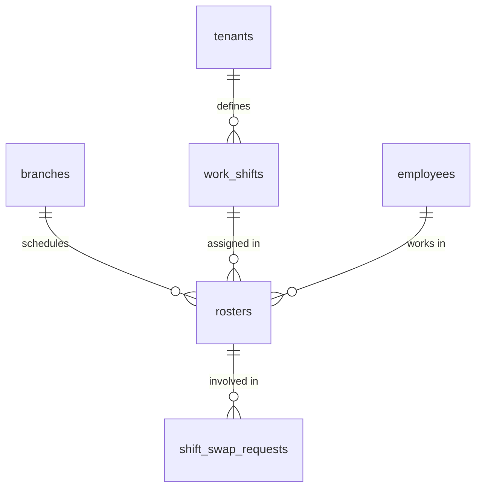
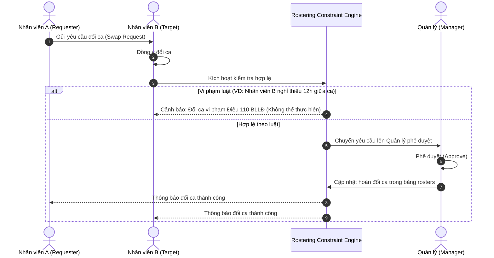

# TÀI LIỆU KỸ THUẬT MODULE 04: SHIFT PLANNING & ROSTERING (ĐỘNG CƠ PHÂN CA THÔNG MINH)

> **Tên phân hệ:** `Rostering`  
> **Namespace Backend:** `App\Modules\Rostering`  
> **Trách nhiệm chính:** Quản lý danh mục ca làm việc (ca hành chính, ca xoay, ca gãy, ca đêm), lập lịch phân ca nhân sự (`rosters`), giải bài toán phân ca tự động thỏa mãn các ràng buộc cứng của **Bộ luật Lao động 2019** (nghỉ 12h giữa ca, nghỉ 24h tuần, cấm phụ nữ nuôi con nhỏ làm ca đêm), và điều phối quy trình đổi ca (Shift Swap) / bắt ca thay (Shift Cover).

---

## 1. Ranh giới Nghiệp vụ & Trách nhiệm (Domain Boundaries)

Module `Rostering` giải quyết bài toán tối ưu hóa nguồn lực nhân sự phức tạp cho các mô hình chuỗi bán lẻ, siêu thị, nhà kho và nhà máy:
1. **Quản lý Ca làm việc Chuẩn (`work_shifts`)**:
   - *Ca cố định / Hành chính*: 08:00 - 17:00 (nghỉ trưa 12:00 - 13:00).
   - *Ca xoay (Rotating Shifts)*: Ca sáng (06:00 - 14:00), Ca chiều (14:00 - 22:00), Ca đêm (22:00 - 06:00).
   - *Ca gãy (Split Shifts)*: Phục vụ nhà hàng/FnB (Ca 1: 10:00 - 14:00; Ca 2: 17:00 - 21:00).
   - *Ca linh hoạt (Flex Shifts)*: Nhân viên chọn khung giờ trong ngày nhưng đảm bảo đủ 8h.
2. **Lịch Phân ca Nhân sự (`rosters`)**: Gán ca cụ thể cho từng nhân viên theo từng ngày. Hỗ trợ các trạng thái: `DRAFT`, `PUBLISHED`, `SWAP_PENDING`, `CANCELLED`.
3. **Động cơ Phân ca Tự động (Auto Rostering Constraint Solver)**:
   - Áp dụng kỹ thuật Constraint Programming / Solver toán học.
   - Thỏa mãn 100% các **Ràng buộc cứng (Hard Constraints)** của Bộ luật Lao động Việt Nam 2019.
   - Tối ưu hóa các **Ràng buộc mềm (Soft Constraints)** theo 2 chiến lược: *Công bằng (Fairness)* hoặc *Tối ưu chi phí quỹ lương (Cost Optimization)*.
4. **Quy trình Đổi ca & Nhận ca thay (Shift Swap & Shift Cover)**:
   - Cho phép 2 nhân viên tự thỏa thuận đổi ca cho nhau.
   - Cho phép nhân viên xin nhượng ca và đồng nghiệp nhận ca thay.
   - Động cơ Solver tự động kiểm tra xem việc đổi ca có làm vi phạm luật lao động (thiếu 12h nghỉ, quá 48h tuần...) trước khi gửi lên Quản lý duyệt.

---

## 2. Thiết kế Cơ sở Dữ liệu & Mô hình Dữ liệu (Database Schema)

### 2.1 Sơ đồ Thực thể Quan hệ (ERD)

### 2.2 Đặc tả Chi tiết các Bảng Dữ liệu

#### Bảng `work_shifts`
- `id` (BIGINT UNSIGNED, PK, Auto Increment)
- `tenant_id` (BIGINT UNSIGNED, FK $\to$ `tenants.id`)
- `code` (VARCHAR(50)) — Mã ca (VD: `SHIFT_SANG`, `SHIFT_TOI`, `SPLIT_FNB`)
- `name` (VARCHAR(150)) — Tên ca hiển thị
- `start_time` (TIME) — Giờ bắt đầu (VD: `08:00:00`)
- `end_time` (TIME) — Giờ kết thúc (VD: `17:00:00`)
- `break_start` (TIME, Nullable) — Bắt đầu giờ nghỉ giữa ca
- `break_end` (TIME, Nullable) — Kết thúc giờ nghỉ giữa ca
- `work_hours` (DECIMAL(4,2), Default: 8.00) — Số giờ làm việc tính công của ca
- `is_night_shift` (BOOLEAN, Default: FALSE) — TRUE nếu có khung giờ nằm trong $22:00 - 06:00$
- `is_split_shift` (BOOLEAN, Default: FALSE) — TRUE nếu là ca gãy
- `split_start_time_2` (TIME, Nullable) — Giờ bắt đầu đoạn ca 2 (cho ca gãy)
- `split_end_time_2` (TIME, Nullable) — Giờ kết thúc đoạn ca 2 (cho ca gãy)
- `is_active` (BOOLEAN, Default: TRUE)
- `created_at`, `updated_at` (TIMESTAMP)

#### Bảng `rosters`
- `id` (BIGINT UNSIGNED, PK, Auto Increment)
- `tenant_id` (BIGINT UNSIGNED)
- `branch_id` (BIGINT UNSIGNED, FK $\to$ `branches.id`)
- `employee_id` (BIGINT UNSIGNED, FK $\to$ `employees.id`)
- `date` (DATE) — Ngày làm việc
- `work_shift_id` (BIGINT UNSIGNED, FK $\to$ `work_shifts.id`)
- `status` (ENUM: `DRAFT`, `PUBLISHED`, `SWAP_PENDING`, `CANCELLED`, Default: `DRAFT`)
- `published_at` (TIMESTAMP, Nullable)
- `created_at`, `updated_at` (TIMESTAMP)
- Unique Index: `(employee_id, date)` — Mỗi nhân viên chỉ có 1 ca chính trong ngày
- Index: `(branch_id, date, status)`

#### Bảng `shift_swap_requests` (Yêu cầu Đổi ca / Nhận ca thay)
- `id` (BIGINT UNSIGNED, PK, Auto Increment)
- `tenant_id` (BIGINT UNSIGNED)
- `requester_id` (BIGINT UNSIGNED, FK $\to$ `employees.id`) — Nhân viên xin đổi ca
- `target_employee_id` (BIGINT UNSIGNED, Nullable, FK $\to$ `employees.id`) — Nhân viên được đề nghị đổi
- `requester_roster_id` (BIGINT UNSIGNED, FK $\to$ `rosters.id`) — Ca của người xin đổi
- `target_roster_id` (BIGINT UNSIGNED, Nullable, FK $\to$ `rosters.id`) — Ca của người nhận đổi (NULL nếu là Cover)
- `swap_type` (ENUM: `SWAP`, `COVER`) — SWAP: Đổi chéo ca; COVER: Chuyển hẳn ca cho người khác
- `reason` (TEXT)
- `is_legal_compliant` (BOOLEAN) — Kết quả kiểm tra của Solver (Không vi phạm luật 12h/24h)
- `violation_warnings` (JSON, Nullable) — Danh sách cảnh báo nếu có
- `status` (ENUM: `PENDING_TARGET`, `PENDING_MANAGER`, `APPROVED`, `REJECTED`, `CANCELLED`)
- `created_at`, `updated_at` (TIMESTAMP)

---

## 3. Thuật toán Động cơ Phân ca Tự động (Constraint Solver Engine)

Động cơ xếp ca được thiết kế dựa trên mô hình Thỏa mãn Ràng buộc (Constraint Satisfaction Problem - CSP) với cấu trúc phân tách rõ ràng giữa Luật Lao động bắt buộc và Chiến lược tối ưu của Doanh nghiệp.

### 3.1 Ràng buộc Cứng (Hard Constraints - Tuyệt đối không được vi phạm)

| Mã | Tên ràng buộc | Căn cứ Pháp luật | Định nghĩa Toán học |
|---|---|---|---|
| **HC-01** | Nghỉ giữa 2 ca liên tiếp | Điều 110 BLLĐ 2019 | $\forall i, d: \quad \text{StartTime}(Roster_{i, d+1}) - \text{EndTime}(Roster_{i, d}) \ge 12\text{ hours}$ |
| **HC-02** | Nghỉ hàng tuần liên tục | Điều 111 BLLĐ 2019 | $\forall i, w \in \text{Weeks}: \quad \exists \text{RestContinuous} \ge 24\text{ hours}$ |
| **HC-03** | Trần giờ làm chuẩn tuần | Điều 105 BLLĐ 2019 | $\forall i, w \in \text{Weeks}: \quad \sum_{d \in w} \text{StandardHours}(Roster_{i, d}) \le 48\text{ hours}$ |
| **HC-04** | Bảo vệ lao động mang thai | Điều 137 Khoản 1 Điểm a BLLĐ | $\text{If } \text{IsPregnant}(i) \land \text{PregnancyMonth}(i) \ge \text{PregnancyThreshold}(Branch_i) \implies \text{IsNightShift}(Shift) = \text{False} \land \text{IsOvertime}(Shift) = \text{False}$ (Cấm tuyệt đối) |
| **HC-05** | Bảo vệ nuôi con dưới 12 tháng | Điều 137 Khoản 1 Điểm b BLLĐ | $\text{If } \text{ChildAgeMonths}(i) < 12 \land \neg\text{HasConsentForm}(i) \implies \text{IsNightShift}(Shift) = \text{False} \land \text{IsOvertime}(Shift) = \text{False}$ |
| **HC-06** | Định biên tối thiểu ca | Nhu cầu chi nhánh | $\forall s \in \text{Shifts}, d: \quad \sum_{i} \mathbb{I}(Roster_{i, d} == s) \ge \text{MinRequiredStaff}(s, d)$ |

> ⚠️ **Quy tắc Phân định Pháp lý (Điều 137 BLLĐ 2019)**: 
> - Đối với **HC-04 (Lao động mang thai)**: Căn cứ **Điều 137 Khoản 1 Điểm a BLLĐ 2019**, pháp luật **nghiêm cấm tuyệt đối** người sử dụng lao động bố trí làm việc ban đêm ($22:00 - 06:00$), làm thêm giờ và đi công tác xa:
>   - **Từ tháng thứ 07 mang thai**: Đối với lao động làm việc trong điều kiện bình thường (ngưỡng mặc định: $\text{PregnancyThreshold} = 7$).
>   - **Từ tháng thứ 06 mang thai**: Đối với lao động làm việc ở **vùng cao, vùng sâu, vùng xa, biên giới, hải đảo** (xác định qua cờ `is_remote_or_island = true` trên bảng `branches`, ngưỡng áp dụng: $\text{PregnancyThreshold} = 6$).
>   - *Lưu ý*: Ràng buộc này là lệnh cấm tuyệt đối của luật, **không áp dụng cơ chế thỏa thuận tự nguyện**. Solver tự động loại trừ mọi ca đêm/OT khi đạt ngưỡng tháng tương ứng.
> - Đối với **HC-05 (Con dưới 12 tháng)**: Mặc định Solver cấm ca đêm/OT, **TRỪ KHI** nhân viên đã nộp **Đơn đồng thuận tự nguyện làm việc ban đêm / làm thêm giờ** (`has_consent_form = true`). Khi có thỏa thuận hợp lệ, Solver được phép bố trí ca và hệ thống lưu trữ bằng chứng để phục vụ thanh tra lao động. Đến khi con tròn 12 tháng tuổi (theo ngày sinh), cơ chế ràng buộc này tự động chấm dứt.

### 3.2 Ràng buộc Mềm (Soft Constraints - Hàm Mục tiêu Tối ưu)

Người quản lý khi bấm nút "Phân ca Tự động" có thể chọn 1 trong 2 chiến lược:

1. **Chiến lược 1: Công bằng Nhân sự (`FAIRNESS_FIRST`)**:
   - Mục tiêu: Cân bằng số ca đêm và ca cuối tuần giữa các nhân viên trong cùng nhóm/phòng ban.
   $$
   \min \sum_{i, j \in \text{Employees}} \left( w_1 \cdot |\text{NightShifts}_i - \text{NightShifts}_j| + w_2 \cdot |\text{WeekendShifts}_i - \text{WeekendShifts}_j| \right)
   $$
2. **Chiến lược 2: Tối ưu Chi phí Quỹ lương (`COST_OPTIMIZATION`)**:
   - Mục tiêu: Hạn chế tối đa việc phân ca dẫn đến phát sinh làm thêm giờ (OT) hoặc phụ cấp ca đêm vượt định mức, ưu tiên nhân viên hợp đồng full-time đủ định mức trước khi dùng part-time/OT.
   $$
   \min \left( \sum_{i} \text{EstimatedOvertimeCost}(i) + \sum_{i} \text{NightAllowanceCost}(i) \right)
   $$

---

## 4. Quy trình Đổi ca & Bắt ca thay (Shift Swap & Cover Workflow)

---

## 5. Danh mục RESTful API Endpoints

| Method | URI | Quyền hạn | Mô tả |
|---|---|---|---|
| `GET` | `/api/v1/work-shifts` | `shift.view` | Danh mục ca làm việc của chi nhánh |
| `POST` | `/api/v1/work-shifts` | `shift.manage` | Tạo mới hoặc cập nhật ca làm việc |
| `GET` | `/api/v1/rosters` | `roster.view` | Lấy bảng phân ca theo tuần/tháng (Lọc theo chi nhánh, phòng ban) |
| `POST` | `/api/v1/rosters/auto-generate` | `roster.manage` | Chạy động cơ Solver tự động phân ca theo chiến lược (Fairness / Cost) |
| `POST` | `/api/v1/rosters/publish` | `roster.publish` | Phát hành bảng ca chính thức (Gửi thông báo tới nhân viên) |
| `POST` | `/api/v1/rosters/swap-request` | `roster.swap` | Nhân viên gửi yêu cầu đổi ca hoặc chuyển nhượng ca |
| `POST` | `/api/v1/rosters/swap-request/{id}/respond` | `roster.swap` | Đồng nghiệp đồng ý/từ chối nhận đổi ca |
| `POST` | `/api/v1/rosters/swap-request/{id}/approve` | `roster.manage` | Quản lý phê duyệt việc đổi ca sau khi Solver xác nhận hợp lệ |

---

## 6. Kịch bản Kiểm thử Tích hợp (Test Scenarios)

1. **Test `TwelveHourRestConstraintViolation`**:
   - Nhân viên A làm ca Chiều ngày 01/09 (14:00 - 22:00).
   - Xếp ca Sáng ngày 02/09 (06:00 - 14:00).
   - Khoảng nghỉ thực tế: $06:00 - 22:00 = 8\text{ giờ} < 12\text{ giờ}$.
   - Kết quả kỳ vọng: Solver từ chối xếp ca này, báo vi phạm ràng buộc `HC-01 (Điều 110 BLLĐ 2019)`.
2. **Test `PregnantRemoteBranch6MonthsNightShiftBlock (HC-04)`**:
   - Nhân viên Nữ mang thai tháng thứ 06, làm việc tại Chi nhánh Huyện đảo Phú Quốc (`is_remote_or_island = true`).
   - Thử xếp ca Đêm (22:00 - 06:00) hoặc ca có làm thêm giờ (OT).
   - Kết quả kỳ vọng: Solver chặn tuyệt đối, báo vi phạm ràng buộc `HC-04 (Điều 137 Khoản 1 Điểm a BLLĐ 2019 - Áp dụng từ tháng thứ 6 cho vùng cao/biên giới/hải đảo)`.
3. **Test `PregnantNormalBranchThreshold (HC-04)`**:
   - Nhân viên Nữ mang thai tháng thứ 06, làm việc tại Chi nhánh TP. Hà Nội (`is_remote_or_island = false`).
   - Xếp ca bình thường: Hợp lệ vì chưa đạt ngưỡng tháng thứ 7.
   - Khi nhân viên bước sang tháng thứ 07 mang thai: Solver lập tức kích hoạt chặn tuyệt đối ca đêm và OT.
4. **Test `MaternityNightShiftBlockWithoutConsent (HC-05)`**:
   - Nhân viên Nữ đang nuôi con 8 tháng tuổi, chưa có đơn thỏa thuận tự nguyện (`has_consent_form = false`).
   - Thử xếp ca Đêm (22:00 - 06:00).
   - Kết quả kỳ vọng: Bị chặn ngay lập tức, báo vi phạm ràng buộc `HC-05 (Điều 137 BLLĐ 2019)`.
5. **Test `WeeklyRest24HoursContinuous (HC-02)`**:
   - Nhân viên được xếp làm liên tục 7 ngày trong tuần không có ngày nghỉ nào đủ 24h liên tục.
   - Kết quả kỳ vọng: Báo vi phạm ràng buộc `HC-02 (Điều 111 BLLĐ 2019)`.
