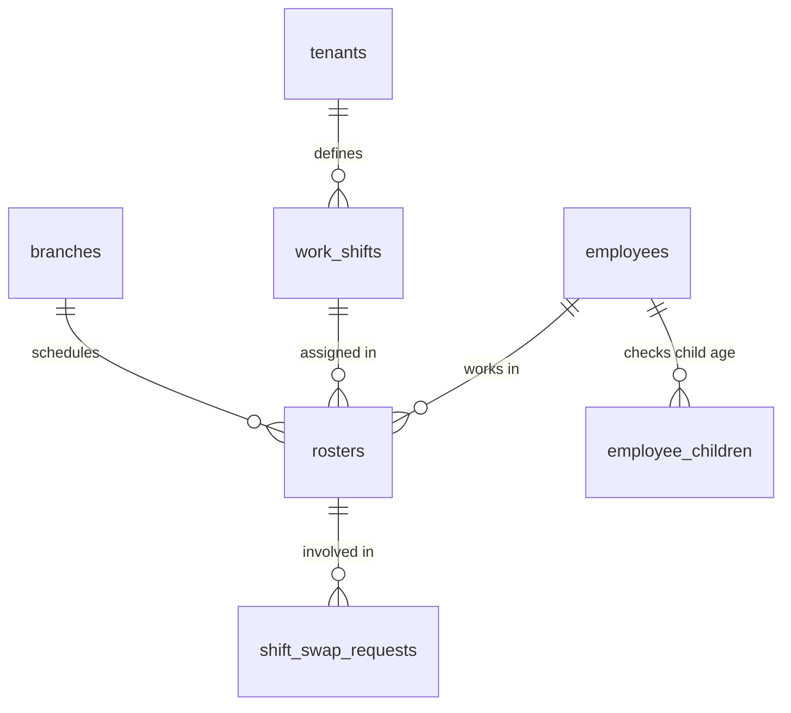

# TÀI LIỆU KỸ THUẬT MODULE 04: SHIFT PLANNING & ROSTERING (ĐỘNG CƠ PHÂN CA THÔNG MINH)

> **Tên phân hệ:** `Rostering`  
> **Namespace Backend:** `App\Modules\Rostering`  
> **Trách nhiệm chính:** Quản lý danh mục ca làm việc (ca hành chính, ca xoay, ca gãy, ca đêm), lập lịch phân ca nhân sự (`rosters`), giải bài toán phân ca tự động thỏa mãn các ràng buộc cứng của **Bộ luật Lao động 2019** (nghỉ 12h giữa ca, nghỉ 24h tuần, cấm phụ nữ mang thai và lao động nuôi con nhỏ làm ca đêm), và điều phối quy trình đổi ca (Shift Swap) / bắt ca thay (Shift Cover).

---

## 1. Ranh giới Nghiệp vụ & Trách nhiệm (Domain Boundaries)

Module `Rostering` giải quyết bài toán tối ưu hóa nguồn lực nhân sự phức tạp cho các mô hình chuỗi bán lẻ, siêu thị, nhà kho và nhà máy:
1. **Quản lý Ca làm việc Chuẩn (`work_shifts`)**:
   - *Ca cố định / Hành chính*: 08:00 - 17:00 (nghỉ trưa 12:00 - 13:00).
   - *Ca xoay (Rotating Shifts)*: Ca sáng (06:00 - 14:00), Ca chiều (14:00 - 22:00), Ca đêm (22:00 - 06:00).
   - *Ca gãy (Split Shifts)*: Phục vụ nhà hàng/FnB (Ca 1: 10:00 - 14:00; Ca 2: 17:00 - 21:00).
   - *Ca linh hoạt (Flex Shifts)*: Nhân viên chọn khung giờ trong ngày nhưng đảm bảo đủ 8h.
2. **Lịch Phân ca Nhân sự (`rosters`)**: Gán ca cụ thể cho từng nhân viên theo từng ngày. Hỗ trợ các trạng thái: `DRAFT`, `PUBLISHED`, `SWAP_PENDING`, `CANCELLED`.
3. **Động cơ Phân ca Tự động (Auto Rostering Constraint Solver)**:
   - Áp dụng kỹ thuật Constraint Programming / Solver toán học.
   - Thỏa mãn 100% các **Ràng buộc cứng (Hard Constraints)** của Bộ luật Lao động Việt Nam 2019.
   - Tối ưu hóa các **Ràng buộc mềm (Soft Constraints)** theo 2 chiến lược: *Công bằng (Fairness)* hoặc *Tối ưu chi phí quỹ lương (Cost Optimization)*.
4. **Quy trình Đổi ca & Nhận ca thay (Shift Swap & Shift Cover)**:
   - Cho phép 2 nhân viên tự thỏa thuận đổi ca cho nhau.
   - Cho phép nhân viên xin nhượng ca và đồng nghiệp nhận ca thay.
   - Động cơ Solver tự động kiểm tra xem việc đổi ca có làm vi phạm luật lao động (thiếu 12h nghỉ, quá 48h tuần...) trước khi gửi lên Quản lý duyệt.

---

## 2. Thiết kế Cơ sở Dữ liệu & Mô hình Dữ liệu (Database Schema)

### 2.1 Sơ đồ Thực thể Quan hệ (ERD)

### 2.2 Đặc tả Chi tiết các Bảng Dữ liệu

#### Bảng `work_shifts`
- `id` (BIGINT UNSIGNED, PK, Auto Increment)
- `tenant_id` (BIGINT UNSIGNED, FK -> `tenants.id`)
- `code` (VARCHAR(50)) — Mã ca (VD: `SHIFT_SANG`, `SHIFT_TOI`, `SPLIT_FNB`)
- `name` (VARCHAR(150)) — Tên ca hiển thị
- `start_time` (TIME) — Giờ bắt đầu (VD: `08:00:00`)
- `end_time` (TIME) — Giờ kết thúc (VD: `17:00:00`)
- `break_start` (TIME, Nullable) — Bắt đầu giờ nghỉ giữa ca
- `break_end` (TIME, Nullable) — Kết thúc giờ nghỉ giữa ca
- `work_hours` (DECIMAL(4,2), Default: 8.00) — Số giờ làm việc tính công của ca
- `is_night_shift` (BOOLEAN, Default: FALSE) — TRUE nếu có khung giờ nằm trong 22:00 - 06:00
- `is_split_shift` (BOOLEAN, Default: FALSE) — TRUE nếu là ca gãy
- `split_start_time_2` (TIME, Nullable) — Giờ bắt đầu đoạn ca 2 (cho ca gãy)
- `split_end_time_2` (TIME, Nullable) — Giờ kết thúc đoạn ca 2 (cho ca gãy)
- `is_active` (BOOLEAN, Default: TRUE)
- `created_at`, `updated_at` (TIMESTAMP)

#### Bảng `rosters`
- `id` (BIGINT UNSIGNED, PK, Auto Increment)
- `tenant_id` (BIGINT UNSIGNED)
- `branch_id` (BIGINT UNSIGNED, FK -> `branches.id`)
- `employee_id` (BIGINT UNSIGNED, FK -> `employees.id`)
- `date` (DATE) — Ngày làm việc
- `work_shift_id` (BIGINT UNSIGNED, FK -> `work_shifts.id`)
- `status` (ENUM: `DRAFT`, `PUBLISHED`, `SWAP_PENDING`, `CANCELLED`, Default: `DRAFT`)
- `published_at` (TIMESTAMP, Nullable)
- `created_at`, `updated_at` (TIMESTAMP)
- Unique Index: `(employee_id, date)`

---

## 3. Ràng buộc Pháp lý BLLĐ 2019 & Giải thuật Phân ca Tự động

### 3.1 Ràng buộc Cứng (Hard Constraints - Bắt buộc Tuân thủ)

| Mã Ràng buộc | Tên Ràng buộc | Căn cứ Pháp luật | Biểu thức Logic / Quy tắc Nghiệp vụ |
|:---:|---|---|---|
| **HC-01** | Nghỉ tối thiểu giữa 2 ca | Điều 110 BLLĐ 2019 | Bắt đầu ca sau - Kết thúc ca trước >= 12 giờ (với mọi nhân viên & ngày liên tiếp) |
| **HC-02** | Nghỉ hàng tuần liên tục | Điều 111 BLLĐ 2019 | Khoảng nghỉ liên tục trong tuần >= 24 giờ |
| **HC-03** | Trần giờ làm chuẩn tuần | Điều 105 BLLĐ 2019 | Tổng giờ tiêu chuẩn trong tuần <= 48 giờ |
| **HC-04** | Bảo vệ lao động mang thai | Điều 137 Khoản 1 Điểm a BLLĐ | Cấm ca đêm (22:00 - 06:00) & OT từ tháng thứ 7 (tháng thứ 6 nếu chi nhánh có `is_remote_or_island = true`). |
| **HC-05** | Bảo vệ nuôi con dưới 12 tháng | Điều 137 Khoản 1 Điểm b BLLĐ | Cấm ca đêm & OT, TRỪ KHI có đơn thỏa thuận tự nguyện (`CONSENT_NIGHT_OT`) hợp lệ. Kiểm tra độ tuổi từ `employee_children` (hoặc `child_birth_date`). |
| **HC-06** | Định biên tối thiểu ca | Nhu cầu chi nhánh | Số nhân viên được gán vào ca >= Định biên nhân sự tối thiểu của ca |

> ⚠️ **Quy tắc Kiểm tra Con nhỏ (HC-05)**:  
> Solver truy vấn danh sách con nhỏ của nhân viên từ bảng `employee_children`. Nếu có ít nhất 01 con dưới 12 tháng tuổi (AgeInMonths < 12):
> - Nếu nhân viên **chưa có đơn thỏa thuận tự nguyện** được duyệt -> Solver tuyệt đối không gán ca có cờ `is_night_shift = true` hoặc ca làm thêm giờ.
> - Nếu nhân viên **đã có đơn thỏa thuận tự nguyện** được duyệt -> Solver được phép gán ca đêm/OT và ghi nhận mã đơn vào lịch sử kiểm toán.

---

## 4. Danh mục RESTful / Inertia Endpoints

| Method | URI | Quyền hạn | Mô tả |
|---|---|---|---|
| `GET` | `/rosters` | `perm:ATTENDANCE.view` | Xem lịch phân ca của chi nhánh |
| `POST` | `/rosters/auto-generate` | `perm:ATTENDANCE.manage` | Chạy thuật toán Solver phân ca tự động |
| `POST` | `/rosters/publish` | `perm:ATTENDANCE.approve` | Công bố lịch phân ca chính thức |
| `POST` | `/rosters/swap` | `perm:ATTENDANCE.manage` | Đề xuất đổi ca làm việc giữa 2 nhân viên |
| `POST` | `/rosters/swap/{id}/approve` | `perm:ATTENDANCE.approve` | Quản lý phê duyệt hoán đổi ca |

---

## 5. Kịch bản Kiểm thử Tích hợp (Test Scenarios)

1. **Test `RestHours12BetweenShiftsEnforced`**:
   - Nhân viên A làm ca chiều kết thúc lúc 22:00 ngày 10/09.
   - Thử xếp nhân viên A làm ca sáng bắt đầu lúc 06:00 ngày 11/09 (khoảng nghỉ chỉ 8 giờ).
   - Kết quả kỳ vọng: Solver báo lỗi vi phạm HC-01 (Điều 110 BLLĐ), từ chối xếp ca.
2. **Test `ChildUnder12MonthsNightShiftBlockedWithoutConsent`**:
   - Nhân viên có con nhỏ 7 tháng tuổi trong `employee_children`, không có đơn thỏa thuận tự nguyện.
   - Chạy Solver phân ca tự động cho chi nhánh.
   - Kết quả kỳ vọng: Nhân viên không bị phân bất kỳ ca đêm nào trong suốt chu kỳ.
