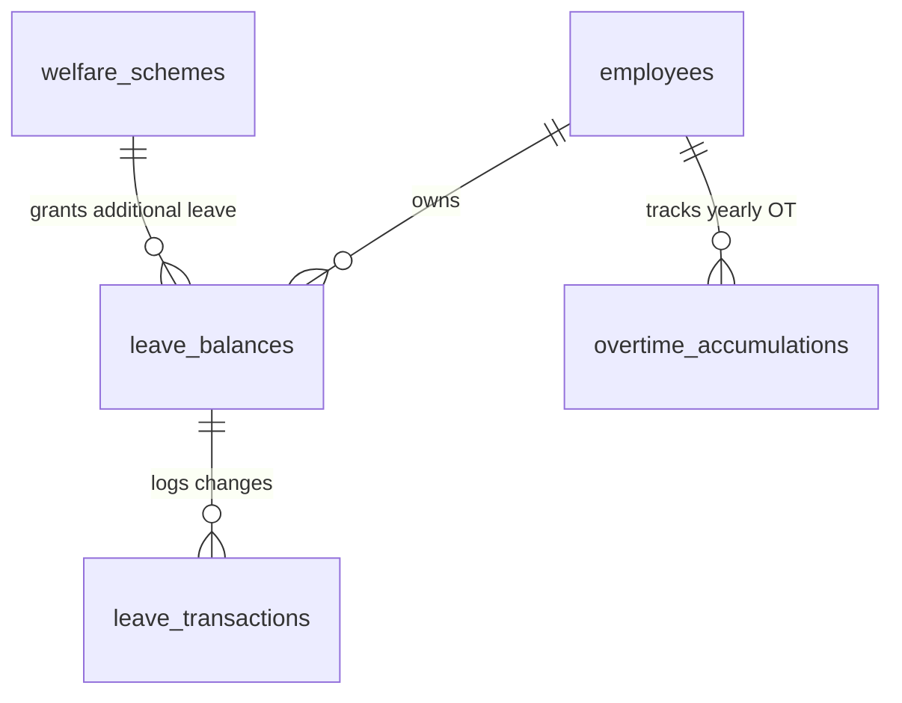

# TÀI LIỆU KỸ THUẬT MODULE 05: LEAVE & OVERTIME POLICY (QUẢN TRỊ NGHỈ PHÉP, LÀM THÊM GIỜ & PHÚC LỢI NGHỈ NGƠI)

> **Tên phân hệ:** `LeavePolicy`  
> **Namespace Backend:** `App\Modules\LeavePolicy`  
> **Trách nhiệm chính:** Quản trị quỹ phép năm tự động (Annual Leave Balances) kèm quy tắc tăng phép thâm niên theo **Điều 113 & 114 BLLĐ 2019**, quỹ nghỉ bù tích lũy từ làm thêm giờ (Comp-off Balances), tích hợp ngày nghỉ phép cộng thêm từ phúc lợi doanh nghiệp (`welfare_schemes`), các chế độ nghỉ hưởng nguyên lương (kết hôn, tang chế), kiểm soát hạn mức làm thêm giờ (OT Caps 40h/200h) và chế độ nghỉ phụ nữ (Women Health Break).

---

## 1. Ranh giới Nghiệp vụ & Trách nhiệm (Domain Boundaries)

Module `LeavePolicy` bảo đảm doanh nghiệp thực thi chính xác các quy định về chế độ nghỉ ngơi và làm thêm giờ:
1. **Quỹ Phép Năm Tự động (Annual Leave Balance Engine)**:
   - Khởi tạo 12 ngày phép/năm cho điều kiện lao động bình thường (14 ngày cho công việc nặng nhọc/độc hại).
   - Tự động cộng dồn theo tỷ lệ từng tháng làm việc (1 ngày/tháng).
   - **Tự động cộng thêm 1 ngày phép thâm niên cho mỗi đủ 5 năm làm việc** tại doanh nghiệp (Điều 114 BLLĐ 2019) dựa trên số năm thâm niên từ `CareerTimelineService`.
   - **Tích hợp ngày phép thưởng từ Phúc lợi Doanh nghiệp**: Tự động cộng thêm số ngày phép hàng năm theo quy định tại bảng `welfare_schemes.additional_leave_days_per_year` (VD: Lao động cao tuổi được cộng thêm 2 ngày phép/năm).
   - Quản lý quy tắc chuyển phép tồn sang năm sau (Carry-over) với hạn chót sử dụng (mặc định đến hết ngày 31/03 năm kế tiếp).
2. **Quỹ Nghỉ Bù Tích lũy từ Làm Thêm Giờ (Comp-off Balance Engine)**:
   - Cho phép nhân viên làm OT lựa chọn: **Nhận tiền lương OT** hoặc **Chuyển đổi sang quỹ ngày nghỉ bù**.
   - Quy đổi số giờ OT sang ngày nghỉ bù theo tỷ lệ cấu hình (`compensation_rate`, ví dụ: 8 giờ OT quy đổi thành 1 ngày nghỉ bù).
3. **Các Loại Nghỉ Việc Riêng Hưởng 100% Lương (Điều 115 BLLĐ 2019)**:
   - Bản thân kết hôn: Nghỉ **03 ngày**.
   - Con đẻ, con nuôi kết hôn: Nghỉ **01 ngày**.
   - Cha đẻ, mẹ đẻ, cha nuôi, mẹ nuôi; cha đẻ, mẹ đẻ, cha nuôi, mẹ nuôi của vợ hoặc chồng; vợ hoặc chồng; con đẻ, con nuôi chết: Nghỉ **03 ngày**.
4. **Kiểm soát Trần Giờ Làm Thêm (Overtime Compliance Monitoring)**:
   - Kiểm soát chặt chẽ 3 trần làm thêm giờ theo Điều 107 BLLĐ 2019 và Nghị định 145/2020/NĐ-CP:
     - Không quá 50% số giờ làm việc bình thường trong ngày.
     - Không quá **40 giờ/tháng**.
     - Không quá **200 giờ/năm** (hoặc tối đa **300 giờ/năm** đối với danh mục ngành nghề đặc thù có thông báo Sở LĐ-TB&XH).
     - *Lao động nuôi con dưới 12 tháng*: Mặc định không được làm thêm giờ, trừ trường hợp có đơn thỏa thuận tự nguyện hợp lệ.
5. **Chế độ Sức khỏe Phụ nữ (Women Health Break)**:
   - Trong thời gian hành kinh: Nghỉ mỗi ngày **30 phút**, tối thiểu 03 ngày trong một tháng.
   - Nuôi con dưới 12 tháng hoặc mang thai từ tháng thứ 7: Nghỉ mỗi ngày **60 phút** hưởng nguyên lương.

---

## 2. Thiết kế Cơ sở Dữ liệu & Mô hình Dữ liệu (Database Schema)

### 2.1 Sơ đồ Thực thể Quan hệ (ERD)



### 2.2 Đặc tả Chi tiết các Bảng Dữ liệu

#### Bảng `leave_balances` (Quỹ Phép của Nhân viên theo Năm)
- `id` (BIGINT UNSIGNED, PK, Auto Increment)
- `tenant_id` (BIGINT UNSIGNED)
- `employee_id` (BIGINT UNSIGNED, FK -> `employees.id`)
- `year` (INT) — Năm tính phép (VD: `2026`)
- `leave_type` (ENUM: `ANNUAL`, `COMPENSATION`) — Phép năm hoặc Nghỉ bù
- `carried_over_days` (DECIMAL(4,2), Default: 0.00) — Số phép tồn năm trước chuyển sang
- `carried_over_expiry_date` (DATE, Nullable) — Hạn sử dụng phép tồn (VD: `2026-03-31`)
- `statutory_allocated_days` (DECIMAL(4,2), Default: 12.00) — Định mức phép chuẩn năm
- `seniority_bonus_days` (DECIMAL(4,2), Default: 0.00) — Phép thâm niên cộng thêm (1 ngày / 5 năm)
- `welfare_bonus_days` (DECIMAL(4,2), Default: 0.00) — Phép cộng thêm từ chính sách phúc lợi doanh nghiệp
- `total_entitled_days` (DECIMAL(4,2), Default: 12.00) — Tổng phép được hưởng trong năm
- `accrued_days_to_date` (DECIMAL(4,2), Default: 0.00) — Số phép đã tích lũy tính đến tháng hiện tại
- `used_days` (DECIMAL(4,2), Default: 0.00) — Số phép đã sử dụng
- `pending_days` (DECIMAL(4,2), Default: 0.00) — Số phép đang chờ duyệt trong các đơn
- `remaining_days` (DECIMAL(4,2), Default: 12.00) — Số phép còn lại có thể sử dụng
- `created_at`, `updated_at` (TIMESTAMP)
- Unique Index: `(employee_id, year, leave_type)`

#### Bảng `leave_transactions` (Lịch sử Biến động Quỹ Phép)
- `id` (BIGINT UNSIGNED, PK, Auto Increment)
- `leave_balance_id` (BIGINT UNSIGNED, FK -> `leave_balances.id`)
- `transaction_type` (ENUM: `ACCRUAL`, `USAGE`, `EXPIRATION`, `ADJUSTMENT`, `COMPENSATION_CONVERT`)
- `days` (DECIMAL(4,2)) — Số ngày biến động (+ hoặc -)
- `reference_id` (BIGINT UNSIGNED, Nullable) — ID đơn nghỉ phép hoặc đơn OT tương ứng
- `description` (VARCHAR(255))
- `created_at` (TIMESTAMP, Default: CURRENT_TIMESTAMP)

#### Bảng `overtime_accumulations` (Theo dõi Lũy kế Giờ OT Năm)
- `id` (BIGINT UNSIGNED, PK, Auto Increment)
- `tenant_id` (BIGINT UNSIGNED)
- `employee_id` (BIGINT UNSIGNED, FK -> `employees.id`)
- `year` (INT)
- `total_ot_hours_year` (DECIMAL(6,2), Default: 0.00)
- `monthly_ot_json` (JSON) — Chi tiết số giờ OT theo từng tháng: `{"01": 15.5, "02": 20.0...}`
- `is_exceeded_200h` (BOOLEAN, Default: FALSE)
- `is_exceeded_300h` (BOOLEAN, Default: FALSE)
- Unique Index: `(employee_id, year)`

---

## 3. Thuật toán Tính Phép Năm & Tích lũy Thâm niên

### 3.1 Tự động Cộng Phép Thâm niên (Điều 114 BLLĐ 2019)
Vào ngày 01 tháng 01 hàng năm (hoặc khi nhân viên đạt mốc thâm niên tròn 5 năm, 10 năm trong năm):
```text
Số ngày phép thâm niên = floor(Số năm thâm niên / 5)
```
Ví dụ:
- Làm việc 4 năm: 0 ngày cộng thêm.
- Làm việc từ đủ 5 năm đến 9 năm: +1 ngày phép thâm niên.
- Làm việc từ đủ 10 năm đến 14 năm: +2 ngày phép thâm niên.

### 3.2 Tích lũy Phép Phúc lợi Doanh nghiệp
Nếu doanh nghiệp ban hành chế độ phúc lợi có `additional_leave_days_per_year > 0` trong `welfare_schemes`:
```text
Tổng ngày phép được hưởng = Phép luật định + Phép thâm niên + Phép phúc lợi doanh nghiệp
```

---

## 4. Danh mục RESTful / Inertia Endpoints

| Method | URI | Quyền hạn | Mô tả |
|---|---|---|---|
| `GET` | `/leave/balances` | `perm:ATTENDANCE.view` | Tra cứu quỹ phép cá nhân hoặc nhân viên |
| `POST` | `/leave/adjust` | `perm:ATTENDANCE.manage` | Điều chỉnh quỹ phép thủ công có lưu vết kiểm toán |
| `GET` | `/leave/ot-accumulations` | `perm:ATTENDANCE.view` | Bảng theo dõi trần OT năm của toàn bộ nhân sự |

---

## 5. Kịch bản Kiểm thử Tích hợp (Test Scenarios)

1. **Test `FiveYearSeniorityBonusAllocation`**:
   - Nhân viên gia nhập ngày `2021-01-01`.
   - Chạy job khởi tạo phép năm `2026` (đã đủ 5 năm thâm niên).
   - Kết quả kỳ vọng: `statutory_allocated_days = 12`, `seniority_bonus_days = 1`, tổng phép hưởng là 13 ngày.
2. **Test `WelfareSchemeAdditionalLeaveGranted`**:
   - Doanh nghiệp kích hoạt chế độ "Lao động cao tuổi" với `additional_leave_days_per_year = 2.0`.
   - Kết quả kỳ vọng: Nhân viên đủ điều kiện được ghi nhận `welfare_bonus_days = 2.0`, quỹ phép năm tăng tương ứng.
