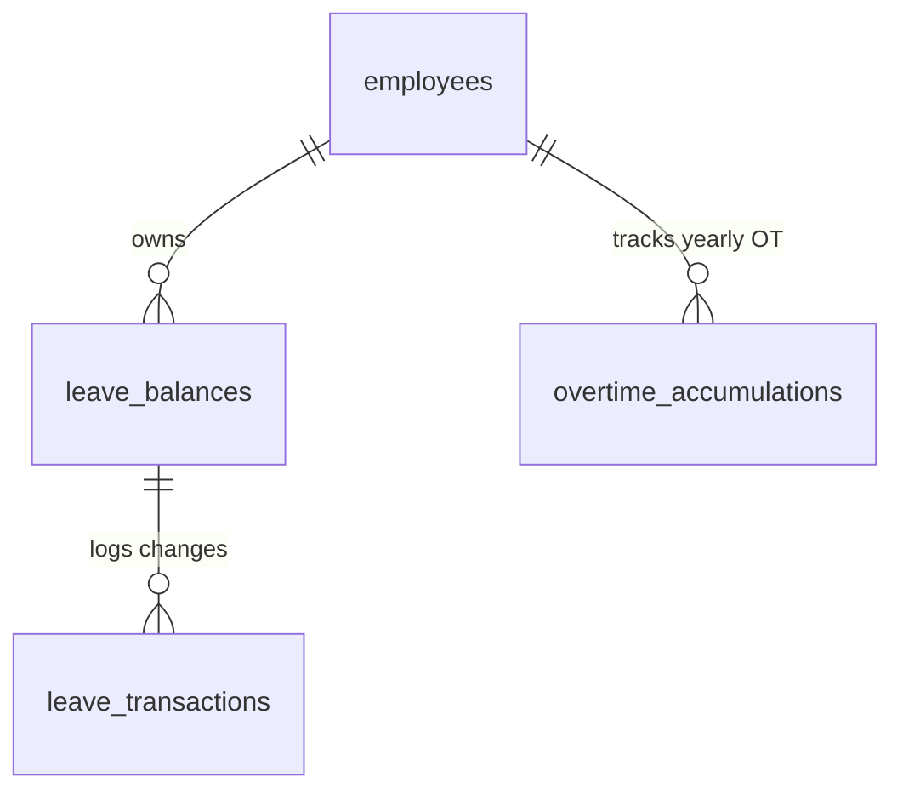

# TÀI LIỆU KỸ THUẬT MODULE 05: LEAVE & OVERTIME POLICY (QUẢN TRỊ NGHỈ PHÉP, LÀM THÊM GIỜ & PHÚC LỢI)

> **Tên phân hệ:** `LeavePolicy`  
> **Namespace Backend:** `App\Modules\LeavePolicy`  
> **Trách nhiệm chính:** Quản lý quỹ phép năm tự động (Annual Leave Balances) kèm quy tắc tăng phép thâm niên theo **Điều 113 & 114 BLLĐ 2019**, quỹ nghỉ bù tích lũy từ làm thêm giờ (Comp-off Balances), các chế độ nghỉ hưởng nguyên lương (kết hôn, tang chế), nghỉ bảo hiểm xã hội (ốm đau, thai sản), kiểm soát hạn mức làm thêm giờ (OT Caps) và chế độ nghỉ phụ nữ (Women Break).

---

## 1. Ranh giới Nghiệp vụ & Trách nhiệm (Domain Boundaries)

Module `LeavePolicy` bảo đảm doanh nghiệp thực thi chính xác các quy định về chế độ nghỉ ngơi và làm thêm giờ của người lao động:
1. **Quỹ Phép Năm Tự động (Annual Leave Balance Engine)**:
   - Khởi tạo 12 ngày phép/năm cho điều kiện lao động bình thường (14 ngày cho công việc nặng nhọc/độc hại).
   - Tự động cộng dồn theo tỷ lệ từng tháng làm việc ($1\text{ ngày/tháng}$).
   - **Tự động cộng thêm 1 ngày phép thâm niên cho mỗi đủ 5 năm làm việc** tại doanh nghiệp (Điều 114 BLLĐ 2019).
   - Quản lý quy tắc chuyển phép tồn sang năm sau (Carry-over) với hạn chót sử dụng (mặc định đến hết ngày 31/03 năm kế tiếp).
2. **Quỹ Nghỉ Bù Tích lũy từ Làm Thêm Giờ (Comp-off Balance Engine)**:
   - Cho phép nhân viên làm OT lựa chọn: **Nhận tiền lương OT** hoặc **Chuyển đổi sang quỹ ngày nghỉ bù**.
   - Quy đổi số giờ OT sang ngày nghỉ bù theo tỷ lệ cấu hình (`compensation_rate`, ví dụ: 8 giờ OT quy đổi thành 1 ngày nghỉ bù).
3. **Các Loại Nghỉ Việc Riêng Hưởng 100% Lương (Điều 115 BLLĐ 2019)**:
   - Bản thân kết hôn: Nghỉ **03 ngày**.
   - Con đẻ, con nuôi kết hôn: Nghỉ **01 ngày**.
   - Cha đẻ, mẹ đẻ, cha nuôi, mẹ nuôi; cha đẻ, mẹ đẻ, cha nuôi, mẹ nuôi của vợ hoặc chồng; vợ hoặc chồng; con đẻ, con nuôi chết: Nghỉ **03 ngày**.
4. **Kiểm soát Trần Giờ Làm Thêm (Overtime Compliance Monitoring)**:
   - Kiểm soát chặt chẽ 3 trần làm thêm giờ theo Điều 107 BLLĐ 2019 và Nghị định 145/2020/NĐ-CP:
     - Không quá $50\%$ số giờ làm việc bình thường trong ngày.
     - Không quá **40 giờ/tháng**.
     - Không quá **200 giờ/năm** (hoặc tối đa **300 giờ/năm** đối với danh mục ngành nghề đặc thù có thông báo Sở LĐ-TB&XH).
     - *Lao động nuôi con dưới 12 tháng*: Mặc định không được làm thêm giờ, **trừ trường hợp người lao động đồng ý (có văn bản/đơn đồng thuận tự nguyện)** theo Điều 137 Khoản 1 Điểm b BLLĐ 2019.
5. **Chế độ Sức khỏe Phụ nữ (Women Health Break)**:
   - Trong thời gian hành kinh: Nghỉ mỗi ngày **30 phút**, tối thiểu 03 ngày trong một tháng.
   - Nuôi con dưới 12 tháng hoặc mang thai từ tháng thứ 7: Nghỉ mỗi ngày **60 phút** hưởng nguyên lương.

---

## 2. Thiết kế Cơ sở Dữ liệu & Mô hình Dữ liệu (Database Schema)

### 2.1 Sơ đồ Thực thể Quan hệ (ERD)

### 2.2 Đặc tả Chi tiết các Bảng Dữ liệu

#### Bảng `leave_balances` (Quỹ Phép của Nhân viên theo Năm)
- `id` (BIGINT UNSIGNED, PK, Auto Increment)
- `tenant_id` (BIGINT UNSIGNED)
- `employee_id` (BIGINT UNSIGNED, FK $\to$ `employees.id`)
- `year` (INT) — Năm tính phép (VD: `2026`)
- `leave_type` (ENUM: `ANNUAL`, `COMPENSATION`) — Phép năm hoặc Nghỉ bù
- `carried_over_days` (DECIMAL(4,2), Default: 0.00) — Số phép tồn năm trước chuyển sang
- `carried_over_expiry_date` (DATE, Nullable) — Hạn sử dụng phép tồn (VD: `2026-03-31`)
- `statutory_allocated_days` (DECIMAL(4,2), Default: 12.00) — Định mức phép chuẩn năm
- `seniority_bonus_days` (DECIMAL(4,2), Default: 0.00) — Phép thâm niên cộng thêm (1 ngày / 5 năm)
- `total_entitled_days` (DECIMAL(4,2), Default: 12.00) — Tổng phép được hưởng trong năm
- `accrued_days_to_date` (DECIMAL(4,2), Default: 0.00) — Số phép đã tích lũy tính đến tháng hiện tại
- `used_days` (DECIMAL(4,2), Default: 0.00) — Số ngày phép đã sử dụng
- `pending_days` (DECIMAL(4,2), Default: 0.00) — Số ngày phép đang trong đơn chờ duyệt
- `remaining_days` (DECIMAL(4,2), Default: 12.00) — Phép khả dụng còn lại
- `created_at`, `updated_at` (TIMESTAMP)
- Unique Index: `(employee_id, year, leave_type)`

#### Bảng `leave_transactions` (Lịch sử Biến động Quỹ Phép)
- `id` (BIGINT UNSIGNED, PK, Auto Increment)
- `leave_balance_id` (BIGINT UNSIGNED, FK $\to$ `leave_balances.id`)
- `transaction_type` (ENUM: `MONTHLY_ACCRUAL`, `SENIORITY_ADD`, `LEAVE_USED`, `LEAVE_CANCELLED`, `CARRY_EXPIRED`, `MANUAL_ADJUSTMENT`)
- `amount` (DECIMAL(4,2)) — Giá trị tăng (+) hoặc giảm (-)
- `reference_request_id` (BIGINT UNSIGNED, Nullable) — ID đơn nghỉ phép liên quan
- `note` (VARCHAR(255))
- `created_at` (TIMESTAMP, Default: CURRENT_TIMESTAMP)

#### Bảng `overtime_accumulations` (Tích lũy Giờ OT & Trần Tuân thủ)
- `id` (BIGINT UNSIGNED, PK, Auto Increment)
- `tenant_id` (BIGINT UNSIGNED)
- `employee_id` (BIGINT UNSIGNED, FK $\to$ `employees.id`)
- `year` (INT)
- `month` (INT)
- `monthly_accumulated_hours` (DECIMAL(6,2), Default: 0.00) — Đã tích lũy trong tháng
- `yearly_accumulated_hours` (DECIMAL(6,2), Default: 0.00) — Đã tích lũy trong năm
- `is_300h_special_cap_approved` (BOOLEAN, Default: FALSE) — Được phép áp dụng trần 300h/năm
- `created_at`, `updated_at` (TIMESTAMP)
- Unique Index: `(employee_id, year, month)`

---

## 3. Quy tắc Tính toán & Giải thuật Nghiệp vụ (Business Rules)

### 3.1 Giải thuật Tính Phép Thâm niên (Điều 114 BLLĐ 2019)
Cứ mỗi 05 năm làm việc liên tục tính từ ngày `join_date`, nhân viên được cộng thêm 01 ngày phép năm:
$$
\text{Seniority Years} = \text{diffInYears}(\text{join\_date}, \text{CurrentDate})
$$
$$
\text{Seniority Bonus Days} = \left\lfloor \frac{\text{Seniority Years}}{5} \right\rfloor
$$
- Ví dụ:
  - Làm việc từ 1 đến 4 năm: 0 ngày cộng thêm (Tổng phép: 12).
  - Đủ 5 đến 9 năm: +1 ngày (Tổng phép: 13).
  - Đủ 10 đến 14 năm: +2 ngày (Tổng phép: 14).

### 3.2 Cơ chế Tích lũy Phép Hàng tháng (Monthly Accrual)
- Vào ngày đầu tiên của mỗi tháng, hệ thống chạy Job tự động `AccrueMonthlyLeaveJob`:
  $$
  \text{Monthly Accrual Rate} = \frac{\text{Total Entitled Days}}{12}
  $$
- Nếu nhân viên mới vào làm giữa năm: Tính tỷ lệ theo số tháng làm việc thực tế trong năm dương lịch.

### 3.3 Cơ chế Hết hạn Phép Tồn (Carry-Over Expiration)
- Phép tồn từ năm $Y-1$ được phép sử dụng đến hết ngày cấu hình (mặc định: `31/03/Y`).
- Vào lúc `00:00:00` ngày `01/04/Y`, hệ thống kích hoạt Job `ExpireCarriedOverLeaveJob`:
  - Kiểm tra số phép tồn chưa sử dụng hết.
  - Trừ trực tiếp khỏi `carried_over_days` và ghi nhận một bản ghi `leave_transactions` loại `CARRY_EXPIRED`.

---

## 4. Danh mục RESTful API Endpoints

| Method | URI | Quyền hạn | Mô tả |
|---|---|---|---|
| `GET` | `/api/v1/leave/balances/me` | `leave.self` | Nhân viên xem số dư phép năm, phép bù và phép tồn khả dụng |
| `GET` | `/api/v1/leave/balances/{empId}` | `leave.view` | Quản lý/HR tra cứu số dư quỹ phép của một nhân viên |
| `GET` | `/api/v1/leave/transactions/{empId}` | `leave.view` | Xem chi tiết lịch sử tích lũy/sử dụng phép của nhân viên |
| `POST` | `/api/v1/leave/balances/adjust` | `leave.manage`| HR điều chỉnh số dư phép thủ công (kèm lý do và số quyết định) |
| `GET` | `/api/v1/overtime/caps/{empId}` | `ot.view` | Kiểm tra số giờ OT đã tích lũy trong tháng (so với trần 40h) và năm (so với trần 200h) |

---

## 5. Kịch bản Kiểm thử Tích hợp (Test Scenarios)

1. **Test `SeniorityBonusLeaveCalculation`**:
   - Nhân viên vào công ty ngày `2016-01-01`.
   - Tính toán phép năm cho năm `2026` (Đã làm việc 10 năm).
   - Kết quả kỳ vọng: `seniority_bonus_days = 2`, `total_entitled_days = 14`.
2. **Test `CarriedOverExpiryJob`**:
   - Nhân viên có 3 ngày phép tồn năm 2025 chuyển sang năm 2026 với hạn dùng `2026-03-31`.
   - Đến hết ngày 31/03/2026, nhân viên mới dùng 1 ngày (còn thừa 2 ngày).
   - Chạy Job vào ngày `2026-04-01` $\to$ Số dư phép tồn giảm về 0, tạo log trừ 2 ngày do hết hạn.
3. **Test `MonthlyOvertimeCapWarning`**:
   - Nhân viên đã làm tích lũy 38 giờ OT trong tháng.
   - Nộp thêm đơn OT 4 giờ $\to$ Tổng OT dự kiến là 42h $> 40$h.
   - Kết quả kỳ vọng: Hệ thống kích hoạt cảnh báo vượt trần Điều 107 BLLĐ 2019, yêu cầu lãnh đạo phê duyệt ngoại lệ hoặc từ chối.
