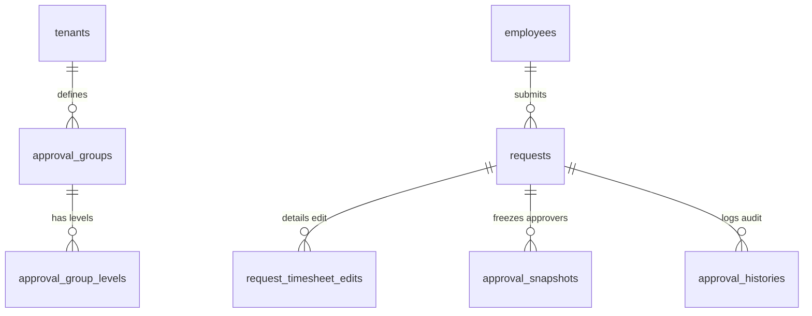
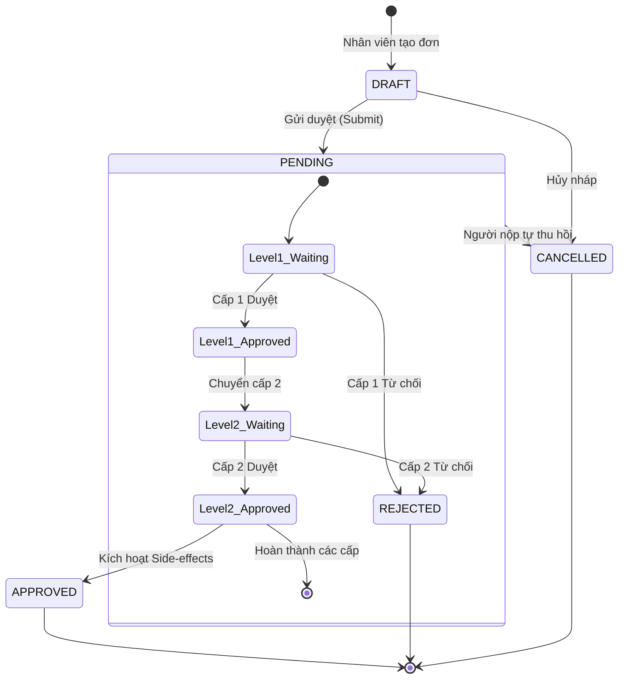

# TÀI LIỆU KỸ THUẬT MODULE 06: DYNAMIC WORKFLOW & APPROVAL (ĐỘNG CƠ LUỒNG DUYỆT ĐA CẤP & BIỂU MẪU ĐỘNG)

> **Tên phân hệ:** `Workflow`  
> **Namespace Backend:** `App\Modules\Workflow`  
> **Trách nhiệm chính:** Quản trị biểu mẫu động bằng JSON Schema, điều phối luồng phê duyệt đa cấp linh hoạt (theo cây sơ đồ tổ chức `Hierarchical` hoặc danh sách chỉ định `Sequential/Parallel`), lưu trữ snapshot chuỗi người duyệt tại thời điểm nộp đơn, và ghi nhận nhật ký kiểm toán phê duyệt bất biến (`approval_histories`).

---

## 1. Ranh giới Nghiệp vụ & Trách nhiệm (Domain Boundaries)

Module `Workflow` là trung tâm điều phối mọi yêu cầu xử lý từ nhân viên lên cấp quản lý:
1. **Biểu mẫu Động bằng JSON Schema (`form_schemas`)**:
   - Cho phép định nghĩa các trường dữ liệu tùy biến cho từng loại đơn từ (Lý do, Tệp đính kèm, Số tiền tạm ứng, Loại thiết bị mượn, Giấy xác nhận viện phí/BHXH...).
   - Hỗ trợ validation động: Ràng buộc trường bắt buộc, kiểu dữ liệu, giới hạn ký tự.
2. **Cơ chế Định tuyến Phê duyệt Đa dạng (Approval Routing Strategies)**:
   - *Duyệt theo Cây Tổ chức (Hierarchical Routing)*: Tự động tìm Quản lý trực tiếp (`manager_id`) $\to$ Trưởng phòng ban $\to$ Ban Giám đốc dựa trên `employee_career_timelines`.
   - *Duyệt theo Nhóm Chỉ định (Custom Approval Groups)*: Định nghĩa danh sách người duyệt theo từng cấp bậc với 2 chế độ:
     - `ALL` (Song song bắt buộc đồng thuận): Tất cả người trong cấp phải duyệt.
     - `ANY` (Song song linh hoạt): Bất kỳ ai trong cấp duyệt là chuyển cấp tiếp theo.
3. **Cơ chế Snapshot Chuỗi Phê duyệt (Temporal Approval Snapshot)**:
   - Khắc phục nhược điểm của hệ thống cũ: Khi nhân viên gửi đơn, hệ thống **chụp lại danh sách người duyệt chính xác tại thời điểm đó**. Nếu sau đó phòng ban đổi trưởng phòng, đơn cũ vẫn giữ nguyên thẩm quyền của người duyệt lịch sử.
4. **Cơ chế Tự duyệt Đơn (Self-Approval)**:
   - Nếu người tạo đơn chính là người có thẩm quyền cao nhất trong cấp duyệt đó $\to$ Đơn được tự động duyệt (`APPROVED`).
5. **Cơ chế Ủy quyền Phê duyệt (Approval Delegation)**:
   - Cho phép người quản lý ủy quyền cho cấp phó phê duyệt thay trong khoảng thời gian đi công tác hoặc nghỉ phép.

---

## 2. Thiết kế Cơ sở Dữ liệu & Mô hình Dữ liệu (Database Schema)

### 2.1 Sơ đồ Thực thể Quan hệ (ERD)

### 2.2 Đặc tả Chi tiết các Bảng Dữ liệu

#### Bảng `requests` (Đơn Từ Tổng Hợp)
- `id` (BIGINT UNSIGNED, PK, Auto Increment)
- `tenant_id` (BIGINT UNSIGNED)
- `employee_id` (BIGINT UNSIGNED, FK $\to$ `employees.id`)
- `request_type` (ENUM: `EDIT_TIMESHEET`, `OVERTIME`, `LEAVE_ANNUAL`, `LEAVE_COMPENSATION`, `LEAVE_UNPAID`, `LEAVE_SPECIAL`, `LEAVE_SI`, `WOMEN_BREAK`, `DEVICE_BORROW`, `CUSTOM`)
- `start_time` (DATETIME) — Thời gian bắt đầu
- `end_time` (DATETIME) — Thời gian kết thúc
- `duration_hours` (DECIMAL(5,2)) — Tổng số giờ đề xuất
- `reason` (TEXT) — Lý do nộp đơn
- `form_data_json` (JSON, Nullable) — Dữ liệu động theo schema của loại đơn
- `status` (ENUM: `DRAFT`, `PENDING`, `APPROVED`, `REJECTED`, `CANCELLED`, Default: `DRAFT`)
- `current_level` (INT, Default: 1) — Cấp duyệt hiện tại đang chờ xử lý
- `total_levels` (INT, Default: 1) — Tổng số cấp duyệt của đơn này
- `created_at`, `updated_at` (TIMESTAMP)
- Index: `(employee_id, status)`, `(start_time, end_time)`

#### Bảng `request_timesheet_edits` (Chi tiết Đơn Sửa Bảng Công)
- `id` (BIGINT UNSIGNED, PK, Auto Increment)
- `request_id` (BIGINT UNSIGNED, FK $\to$ `requests.id`)
- `daily_attendance_id` (BIGINT UNSIGNED, FK $\to$ `daily_attendances.id`)
- `proposed_check_in` (DATETIME, Nullable) — Giờ vào đề xuất sửa
- `proposed_check_out` (DATETIME, Nullable) — Giờ ra đề xuất sửa
- `original_check_in` (DATETIME, Nullable) — Giờ vào thực tế ban đầu
- `original_check_out` (DATETIME, Nullable) — Giờ ra thực tế ban đầu
- `reason` (VARCHAR(255)) — Lý do sửa (quên quẹt thẻ, máy hỏng, đi công tác...)

#### Bảng `approval_groups` & `approval_group_levels` (Cấu hình Cấp Duyệt)
- `approval_groups`:
  - `id` (BIGINT UNSIGNED, PK)
  - `tenant_id` (BIGINT UNSIGNED)
  - `code` (VARCHAR(50)), `name` (VARCHAR(150))
  - `routing_type` (ENUM: `HIERARCHICAL`, `CUSTOM_GROUP`)
- `approval_group_levels`:
  - `id` (BIGINT UNSIGNED, PK)
  - `approval_group_id` (BIGINT UNSIGNED, FK)
  - `level_number` (INT) — Cấp 1, Cấp 2, Cấp 3...
  - `evaluation_type` (ENUM: `ANY`, `ALL`)
  - `approver_ids_json` (JSON) — Danh sách ID nhân viên có thẩm quyền duyệt ở cấp này: `[101, 105]`

#### Bảng `approval_snapshots` (Snapshot Người Duyệt tại Thời điểm Gửi Đơn)
- `id` (BIGINT UNSIGNED, PK, Auto Increment)
- `request_id` (BIGINT UNSIGNED, FK $\to$ `requests.id`)
- `level_number` (INT)
- `approver_id` (BIGINT UNSIGNED, FK $\to$ `employees.id`)
- `status` (ENUM: `PENDING`, `APPROVED`, `REJECTED`, `BYPASSED`)
- `is_delegated` (BOOLEAN, Default: FALSE)
- `delegated_to_id` (BIGINT UNSIGNED, Nullable)
- `acted_at` (TIMESTAMP, Nullable)
- Unique Index: `(request_id, level_number, approver_id)`

#### Bảng `approval_histories` (Nhật ký Phê duyệt Bất biến)
- `id` (BIGINT UNSIGNED, PK, Auto Increment)
- `request_id` (BIGINT UNSIGNED, FK $\to$ `requests.id`)
- `approver_id` (BIGINT UNSIGNED, FK $\to$ `employees.id`)
- `level_number` (INT)
- `action` (ENUM: `APPROVE`, `REJECT`, `DELEGATE`, `CANCEL`)
- `comment` (TEXT, Nullable)
- `acted_at` (TIMESTAMP, Default: CURRENT_TIMESTAMP)
- Index: `(request_id, level_number)`

---

## 3. Máy Trạng thái Phê duyệt (Approval State Machine Engine)

### 3.4 Quy trình Đặc biệt: Đơn OT / Ca đêm cho Lao động Nuôi con Dưới 12 Tháng (Điều 137 BLLĐ)

Căn cứ **Điều 137 Khoản 1 Điểm b Bộ luật Lao động 2019**, người sử dụng lao động không được bố trí ca đêm hoặc làm thêm giờ cho lao động nuôi con dưới 12 tháng tuổi, **TRỪ TRƯỜNG HỢP ĐƯỢC NGƯỜI LAO ĐỘNG ĐỒNG Ý**.

Hệ thống triển khai quy trình kép nhằm bảo đảm an toàn pháp lý tuyệt đối:

1. **Phía Nhân viên Nộp Đơn (Employee Side)**:
   - Khi nhân viên nữ có `child_birth_date` chưa tròn 12 tháng tuổi tạo đơn `OVERTIME` hoặc đơn đăng ký ca đêm:
   - Form JSON Schema tự động kích hoạt các trường kiểm soát:
     - Checkbox cam kết tự nguyện (**Bắt buộc**): `is_voluntary_consent = true` (*"Tôi tự nguyện đồng thuận làm thêm giờ / làm việc ban đêm trong thời gian nuôi con dưới 12 tháng tuổi theo quy định tại Điều 137 BLLĐ 2019"*). Nếu không tích chọn, nút "Gửi đơn" sẽ bị khóa.
     - Minh chứng văn bản thỏa thuận (**Tùy chọn linh hoạt - Giảm tải dung lượng lưu trữ hệ thống**): Nhân viên hoặc bộ phận HR có thể cung cấp bằng chứng thỏa thuận theo 1 trong 2 hình thức:
       - *Phương thức 1 (Tải tệp trực tiếp)*: Đính kèm tệp văn bản/ảnh chụp đơn đã ký (`consent_document_file` - PDF/JPG/PNG).
       - *Phương thức 2 (Liên kết lưu trữ ngoài)*: Điền đường dẫn URL văn bản (`consent_document_url` - ví dụ: liên kết Google Drive, OneDrive, hoặc kho tài liệu số nội bộ của doanh nghiệp).
     - Việc cung cấp URL/tệp là tùy chọn (không bắt buộc chặn gửi đơn), giúp doanh nghiệp linh hoạt quản lý hồ sơ nhân sự dạng tập trung mà không gây phình to dung lượng lưu trữ máy chủ.

2. **Phía Người Duyệt Đơn (Approver / Manager Side)**:
   - Khi Approver mở màn hình chi tiết đơn để duyệt, hệ thống hiển thị **Banner Cảnh báo Pháp lý Nổi bật**:
     > ⚠️ **LƯU Ý PHÁP LÝ QUAN TRỌNG (ĐIỀU 137 BLLĐ 2019)**:  
     > Nhân sự này đang trong thời gian nuôi con dưới 12 tháng tuổi (Sinh ngày: **{child_birth_date}** - Hiện tại: **{child_age_months} tháng tuổi**).  
     > Người duyệt **bắt buộc kiểm tra kỹ văn bản/đơn đồng thuận tự nguyện** của người lao động (qua tệp đính kèm hoặc URL liên kết Google Drive/OneDrive được cung cấp) trước khi bấm "Phê duyệt" để làm căn cứ pháp lý khi cơ quan Thanh tra Lao động kiểm tra.
   - Bản ghi nhật ký phê duyệt (`approval_histories`) tự động ghi nhận cờ `verified_child_under_12m_consent = true` kèm ID của người duyệt để quy trách nhiệm rõ ràng.

3. **Mốc Tự động Hết Hiệu lực (Automatic Transition)**:
   - Cơ chế bắt buộc đơn đồng thuận này tự động chấm dứt khi con của nhân viên tròn đủ 12 tháng tuổi (tính chính xác theo ngày sinh trên Giấy khai sinh lưu trong hệ thống).
   - Sau mốc này, việc nộp và duyệt đơn OT/ca đêm trở về quy trình tiêu chuẩn thông thường.

---

## 4. Danh mục RESTful API Endpoints

| Method | URI | Quyền hạn | Mô tả |
|---|---|---|---|
| `GET` | `/api/v1/requests` | `req.view` | Danh sách đơn từ của nhân viên hoặc đơn cần duyệt của quản lý |
| `POST` | `/api/v1/requests` | `req.create` | Tạo đơn mới (tự động snapshot chuỗi người duyệt) |
| `GET` | `/api/v1/requests/{id}` | `req.view` | Chi tiết đơn, thông tin form schema và tiến độ duyệt từng cấp |
| `POST` | `/api/v1/requests/{id}/approve` | `req.approve`| Phê duyệt đơn ở cấp hiện tại (kèm ghi chú) |
| `POST` | `/api/v1/requests/{id}/reject` | `req.approve`| Từ chối đơn (bắt buộc nhập lý do) |
| `POST` | `/api/v1/requests/{id}/cancel` | `req.create` | Người tạo đơn tự thu hồi khi chưa được duyệt hoàn tất |
| `POST` | `/api/v1/requests/delegations` | `req.delegate`| Thiết lập ủy quyền phê duyệt cho nhân sự khác trong một khoảng thời gian |

---

## 5. Kịch bản Kiểm thử Tích hợp (Test Scenarios)

1. **Test `ApprovalChainSnapshotImmunity`**:
   - Nhân viên gửi đơn khi Trưởng phòng là Ông A. Chuỗi duyệt snapshot lưu `Ông A`.
   - 2 ngày sau, công ty bổ nhiệm Bà B làm Trưởng phòng mới.
   - Kết quả: Thẩm quyền duyệt đơn đã gửi vẫn thuộc về `Ông A`. Đơn mới gửi sau này sẽ thuộc về `Bà B`.
2. **Test `SelfApprovalBypass`**:
   - Giám đốc Khối tạo đơn công tác. Cấp duyệt theo quy định là Giám đốc Khối.
   - Kết quả: Đơn được tự động chuyển thành `APPROVED` ngay khi gửi.
3. **Test `TimesheetEditSideEffectExecution`**:
   - Duyệt thành công đơn sửa công ngày 05/09 từ `ABSENT` thành vào 08:00 - ra 17:00.
   - Kết quả: `daily_attendances` ngày 05/09 tự động đổi sang `NORMAL` với 8.00 giờ chuẩn.
