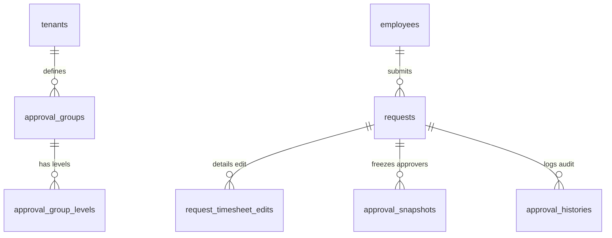

# TÀI LIỆU KỸ THUẬT MODULE 06: DYNAMIC WORKFLOW & APPROVAL (ĐỘNG CƠ LUỒNG DUYỆT ĐA CẤP & BIỂU MẪU ĐỘNG)

> **Tên phân hệ:** `Workflow`  
> **Namespace Backend:** `App\Modules\Workflow`  
> **Trách nhiệm chính:** Quản trị biểu mẫu động bằng JSON Schema, điều phối luồng phê duyệt đa cấp linh hoạt (theo cây sơ đồ tổ chức `Hierarchical` hoặc danh sách chỉ định `Sequential/Parallel`), hỗ trợ các loại đơn pháp lý đặc thù (như Đơn thỏa thuận tự nguyện ca đêm/OT con nhỏ theo Điều 137 BLLĐ, Đơn hưởng chế độ phúc lợi), lưu trữ snapshot chuỗi người duyệt tại thời điểm nộp đơn, tích hợp thẩm quyền duyệt từ Ma trận Phân quyền (`can_approve`), và ghi nhận nhật ký kiểm toán phê duyệt bất biến (`approval_histories`).

---

## 1. Ranh giới Nghiệp vụ & Trách nhiệm (Domain Boundaries)

Module `Workflow` là trung tâm điều phối mọi yêu cầu xử lý từ nhân viên lên cấp quản lý:
1. **Biểu mẫu Động bằng JSON Schema (`form_schemas`)**:
   - Cho phép định nghĩa các trường dữ liệu tùy biến cho từng loại đơn từ (Lý do, Tệp đính kèm, Giấy khai sinh, Cam kết tự nguyện...).
   - Hỗ trợ validation động: Ràng buộc trường bắt buộc, kiểu dữ liệu, giới hạn ký tự.
2. **Hỗ trợ Danh mục Đơn Từ Toàn diện**:
   - Đơn xin sửa công (`EDIT_TIMESHEET`).
   - Đơn làm thêm giờ (`OVERTIME`).
   - Các loại đơn nghỉ phép: Phép năm (`LEAVE_ANNUAL`), Nghỉ bù (`LEAVE_COMPENSATION`), Nghỉ không lương (`LEAVE_UNPAID`), Nghỉ chế độ BHXH (`LEAVE_SI`).
   - **Đơn Thỏa thuận Tự nguyện Làm Đêm / Làm Thêm Giờ (`CONSENT_NIGHT_OT`)**: Dành riêng cho lao động nuôi con dưới 12 tháng tự nguyện đăng ký làm ca đêm hoặc OT theo Điều 137 Khoản 1 Điểm b BLLĐ 2019.
   - **Đơn Đăng ký Hưởng Chế độ Phúc lợi Doanh nghiệp (`WELFARE_CLAIM`)**: Đăng ký trợ cấp con nhỏ, hỗ trợ tài chính, quà kết hôn/sinh con theo `welfare_schemes`.
3. **Cơ chế Định tuyến Phê duyệt Đa dạng**:
   - *Duyệt theo Cây Tổ chức (Hierarchical Routing)*: Tự động tìm Quản lý trực tiếp (`manager_id`) -> Trưởng phòng ban -> Ban Giám đốc dựa trên `employee_career_timelines`.
   - *Duyệt theo Nhóm Chỉ định (Custom Approval Groups)*: Định nghĩa danh sách người duyệt theo từng cấp bậc (`ALL` song song hoặc `ANY` linh hoạt).
4. **Cơ chế Snapshot Chuỗi Phê duyệt (Temporal Approval Snapshot)**:
   - Chụp lại danh sách người duyệt chính xác tại thời điểm nộp đơn. Đảm bảo tính pháp lý lịch sử khi phòng ban thay đổi trưởng phòng.
5. **Kiểm soát Thẩm quyền Duyệt qua Ma trận RBAC**:
   - Người duyệt phải có quyền `can_approve = true` trên phân hệ tương ứng theo phân giải từ `PermissionResolutionService`.

---

## 2. Thiết kế Cơ sở Dữ liệu & Mô hình Dữ liệu (Database Schema)

### 2.1 Sơ đồ Thực thể Quan hệ (ERD)

### 2.2 Đặc tả Chi tiết các Bảng Dữ liệu

#### Bảng `requests` (Đơn Từ Tổng Hợp)
- `id` (BIGINT UNSIGNED, PK, Auto Increment)
- `tenant_id` (BIGINT UNSIGNED)
- `employee_id` (BIGINT UNSIGNED, FK -> `employees.id`)
- `request_type` (ENUM: `EDIT_TIMESHEET`, `OVERTIME`, `LEAVE_ANNUAL`, `LEAVE_COMPENSATION`, `LEAVE_UNPAID`, `LEAVE_SPECIAL`, `LEAVE_SI`, `WOMEN_BREAK`, `CONSENT_NIGHT_OT`, `WELFARE_CLAIM`, `CUSTOM`)
- `start_time` (DATETIME) — Thời gian bắt đầu
- `end_time` (DATETIME) — Thời gian kết thúc
- `duration_hours` (DECIMAL(5,2)) — Tổng số giờ đề xuất
- `reason` (TEXT) — Lý do nộp đơn
- `form_data_json` (JSON, Nullable) — Dữ liệu động theo schema (VD: giấy khai sinh, file đính kèm)
- `status` (ENUM: `DRAFT`, `PENDING`, `APPROVED`, `REJECTED`, `CANCELLED`, Default: `DRAFT`)
- `current_level` (INT, Default: 1) — Cấp duyệt hiện tại đang chờ xử lý
- `total_levels` (INT, Default: 1) — Tổng số cấp duyệt
- `created_at`, `updated_at` (TIMESTAMP)
- Index: `(employee_id, status)`, `(request_type, status)`

#### Bảng `approval_snapshots` (Đóng Băng Người Duyệt Lịch Sử)
- `id` (BIGINT UNSIGNED, PK, Auto Increment)
- `request_id` (BIGINT UNSIGNED, FK -> `requests.id`, Unique per level)
- `level` (INT) — Cấp duyệt
- `approver_id` (BIGINT UNSIGNED, FK -> `employees.id`) — Người có thẩm quyền duyệt tại thời điểm nộp
- `approver_name` (VARCHAR(255))
- `approver_position` (VARCHAR(150))
- `status` (ENUM: `WAITING`, `APPROVED`, `REJECTED`, `SKIPPED`, Default: `WAITING`)
- `action_at` (TIMESTAMP, Nullable)
- `comments` (TEXT, Nullable)
- `created_at` (TIMESTAMP, Default: CURRENT_TIMESTAMP)

#### Bảng `approval_histories` (Nhật ký Phê duyệt Kiểm toán)
- `id` (BIGINT UNSIGNED, PK, Auto Increment)
- `request_id` (BIGINT UNSIGNED, FK -> `requests.id`)
- `actor_id` (BIGINT UNSIGNED, FK -> `employees.id`) — Người thực hiện hành động
- `action` (ENUM: `SUBMIT`, `APPROVE`, `REJECT`, `CANCEL`, `DELEGATE`)
- `level` (INT)
- `comments` (TEXT, Nullable)
- `ip_address` (VARCHAR(45), Nullable)
- `created_at` (TIMESTAMP, Default: CURRENT_TIMESTAMP)

---

## 3. Danh mục RESTful / Inertia Endpoints

| Method | URI | Quyền hạn | Mô tả |
|---|---|---|---|
| `GET` | `/requests` | `perm:ATTENDANCE.view` | Danh sách đơn từ của tôi hoặc đơn cần duyệt |
| `POST` | `/requests` | `perm:ATTENDANCE.manage` | Nộp đơn từ mới (kèm snapshot người duyệt) |
| `POST` | `/requests/{id}/approve` | `perm:ATTENDANCE.approve` | Phê duyệt đơn từ |
| `POST` | `/requests/{id}/reject` | `perm:ATTENDANCE.approve` | Từ chối đơn từ kèm lý do bắt buộc |
| `POST` | `/requests/{id}/cancel` | `perm:ATTENDANCE.manage` | Người tạo đơn tự hủy khi đơn đang PENDING |

---

## 4. Kịch bản Kiểm thử Tích hợp (Test Scenarios)

1. **Test `ConsentNightOTApprovalUnlocksRoster`**:
   - Nhân viên nuôi con nhỏ dưới 12 tháng nộp đơn `CONSENT_NIGHT_OT`.
   - Cấp trên phê duyệt đơn (`APPROVED`).
   - Chạy lại Solver phân ca Module 04.
   - Kết quả kỳ vọng: Ràng buộc HC-05 được mở khóa hợp pháp, cho phép xếp ca đêm mà không báo lỗi.
2. **Test `ApproverSnapshotIntegrityAfterOrgChange`**:
   - Nhân viên nộp đơn ngày 01/09 (Trưởng phòng A duyệt).
   - Ngày 05/09, công ty bổ nhiệm Trưởng phòng B thay cho A.
   - Kết quả kỳ vọng: `approval_snapshots` vẫn ghi nhận Trưởng phòng A là người duyệt hợp pháp của đơn nộp ngày 01/09.
