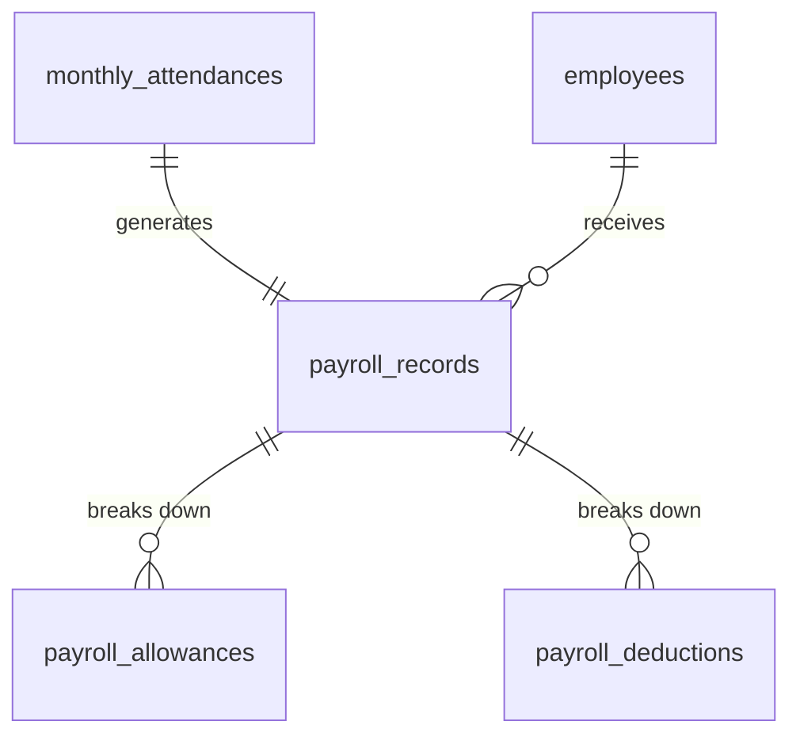
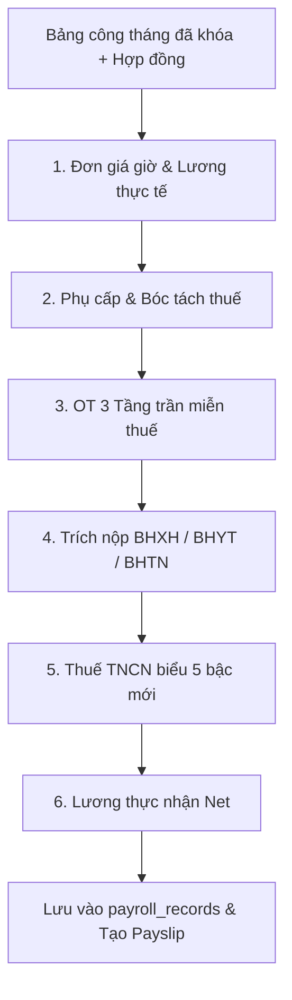

# TÀI LIỆU KỸ THUẬT MODULE 07: PAYROLL & STATUTORY GATEWAY (ĐỘNG CƠ TÍNH LƯƠNG, BẢO HIỂM & THUẾ PHÁP ĐỊNH)

> **Tên phân hệ:** `Payroll`  
> **Namespace Backend:** `App\Modules\Payroll`  
> **Trách nhiệm chính:** Tự động kết nối dữ liệu từ bảng công đã khóa (`monthly_attendances`), thực thi giải thuật tính lương Gross-to-Net, bóc tách tiền làm thêm giờ (OT) miễn thuế theo thuật toán 3 tầng trần, trích nộp các khoản bảo hiểm bắt buộc (BHXH/BHYT/BHTN), áp dụng biểu thuế TNCN 5 bậc lũy tiến động có hiệu lực từ 2026, xuất phiếu lương số và định dạng file chi trả ngân hàng.

---

## 1. Ranh giới Nghiệp vụ & Trách nhiệm (Domain Boundaries)

Module `Payroll` là phân hệ tài chính nhạy cảm nhất trong hệ thống Smart-HR:
1. **Kết nối Dữ liệu Bảng công Khóa Kỳ**: Chỉ thực hiện tính lương trên các bảng công tháng đã được khóa (`is_locked = true`), bảo đảm số liệu không bị biến động trong quá trình tính toán.
2. **Đơn giá Giờ Chuẩn & Lương Cơ bản Thực tế**:
   - Tính toán đơn giá giờ làm việc chuẩn (`Hourly Wage`) từ Lương cơ bản và các phụ cấp đủ điều kiện tính OT.
   - Tính lương cơ bản theo ngày công thực tế (hỗ trợ cả 2 chế độ: Ngày chuẩn cố định `fixed_standard_days` hoặc Ngày chuẩn theo lịch `calendar_standard_days`).
3. **Phân loại & Xử lý Phụ cấp (Allowances Processing)**:
   - Phụ cấp chịu thuế và không chịu thuế TNCN (Ăn trưa, Điện thoại, Xăng xe, Đồng phục theo định mức quy định).
   - Phụ cấp nhà ở đặc biệt: Khống chế mức miễn thuế tối đa bằng $15\%$ tổng thu nhập chịu thuế (chưa gồm tiền nhà) sau khi trừ bảo hiểm bắt buộc theo Thông tư 111/2013/TT-BTC.
   - Phụ cấp chuyên cần: Tự động cắt về $0$ nếu nhân viên có thời gian đi muộn/về sớm hoặc có ngày nghỉ không lương trong tháng.
4. **Thuật toán Bóc tách Tiền OT Miễn thuế 3 Tầng Trần**:
   - Bóc tách phần thù lao trả cao hơn do làm thêm giờ (50% của ngày thường, 100% của cuối tuần, 200% của ngày lễ) được miễn thuế TNCN.
   - Kiểm soát chặt chẽ 3 tầng trần: Ngày $50\%$ ca, Tháng $40$h, Năm $200$h/$300$h theo Nghị định 145/2020/NĐ-CP.
5. **Trích nộp Bảo hiểm Xã hội Bắt buộc**:
   - Trích nộp phần người lao động: BHXH $8\%$, BHYT $1.5\%$, BHTN $1\%$ (Tổng $10.5\%$).
   - Trích nộp phần người sử dụng lao động: BHXH $17.5\%$, BHYT $3\%$, BHTN $1\%$ (Tổng $21.5\%$).
   - Khống chế mức trần đóng BHXH/BHYT bằng 20 lần mức lương cơ sở theo luật hiện hành.
6. **Biểu thuế TNCN Lũy tiến Động 5 Bậc (Hiệu lực từ 2026)**:
   - Áp dụng mức giảm trừ gia cảnh bản thân (11.000.000 đ/tháng) và người phụ thuộc (4.400.000 đ/người/tháng).
   - Áp dụng biểu thuế lũy tiến từng phần 5 bậc theo quy định mới nhất.
7. **Phiếu Lương Điện tử & File Chuyển khoản Ngân hàng**:
   - Tạo phiếu lương điện tử bảo mật (Digital Payslip) có mã hóa để nhân viên xem trên cổng tự phục vụ.
   - Xuất file chi trả lô định dạng Excel/TXT theo chuẩn các ngân hàng phổ biến (Vietcombank, Techcombank, BIDV, MBBank...).

---

## 2. Thiết kế Cơ sở Dữ liệu & Mô hình Dữ liệu (Database Schema)

### 2.1 Sơ đồ Thực thể Quan hệ (ERD)

### 2.2 Đặc tả Chi tiết các Bảng Dữ liệu

#### Bảng `payroll_records` (Bảng Lương Tổng Hợp của Nhân Viên)
- `id` (BIGINT UNSIGNED, PK, Auto Increment)
- `tenant_id` (BIGINT UNSIGNED)
- `employee_id` (BIGINT UNSIGNED, FK $\to$ `employees.id`)
- `monthly_attendance_id` (BIGINT UNSIGNED, FK $\to$ `monthly_attendances.id`, Unique per month)
- `month_year` (VARCHAR(7)) — Format: `YYYY-MM`
- `contract_salary` (DECIMAL(15,2)) — Lương thỏa thuận trên hợp đồng
- `actual_standard_salary` (DECIMAL(15,2)) — Lương cơ bản theo ngày công thực tế
- `total_allowances_taxable` (DECIMAL(15,2), Default: 0.00)
- `total_allowances_non_taxable` (DECIMAL(15,2), Default: 0.00)
- `attendance_allowance` (DECIMAL(15,2), Default: 0.00)
- `overtime_pay_total` (DECIMAL(15,2), Default: 0.00) — Tổng tiền lương làm thêm giờ
- `overtime_pay_tax_exempt` (DECIMAL(15,2), Default: 0.00) — Tiền OT được miễn thuế TNCN
- `gross_salary` (DECIMAL(15,2)) — Tổng thu nhập trước thuế/bảo hiểm
- `employee_si_amount` (DECIMAL(15,2), Default: 0.00) — BHXH 8%
- `employee_hi_amount` (DECIMAL(15,2), Default: 0.00) — BHYT 1.5%
- `employee_ui_amount` (DECIMAL(15,2), Default: 0.00) — BHTN 1%
- `total_employee_insurance` (DECIMAL(15,2), Default: 0.00) — Tổng bảo hiểm trừ vào lương
- `self_deduction_amount` (DECIMAL(15,2), Default: 11000000.00) — Giảm trừ bản thân
- `dependent_deduction_amount` (DECIMAL(15,2), Default: 0.00) — Giảm trừ gia cảnh
- `taxable_income` (DECIMAL(15,2), Default: 0.00) — Thu nhập chịu thuế
- `assessable_income` (DECIMAL(15,2), Default: 0.00) — Thu nhập tính thuế
- `pit_amount` (DECIMAL(15,2), Default: 0.00) — Thuế TNCN phải nộp (biểu 5 bậc)
- `late_early_penalty_deduction` (DECIMAL(15,2), Default: 0.00) — Tiền phạt đi muộn/về sớm
- `net_salary` (DECIMAL(15,2)) — Lương thực lĩnh chuyển khoản
- `status` (ENUM: `DRAFT`, `APPROVED`, `PAID`, Default: `DRAFT`)
- `approved_by` (BIGINT UNSIGNED, Nullable, FK $\to$ `employees.id`)
- `approved_at` (TIMESTAMP, Nullable)
- `paid_at` (TIMESTAMP, Nullable)
- `created_at`, `updated_at` (TIMESTAMP)
- Unique Index: `(employee_id, month_year)`

#### Bảng `payroll_allowances` (Chi tiết Các Khoản Phụ cấp)
- `id` (BIGINT UNSIGNED, PK, Auto Increment)
- `payroll_record_id` (BIGINT UNSIGNED, FK $\to$ `payroll_records.id`)
- `allowance_code` (VARCHAR(50)) — `LUNCH`, `PHONE`, `HOUSING`, `ATTENDANCE`
- `amount` (DECIMAL(15,2))
- `taxable_part` (DECIMAL(15,2)) — Phần tính thuế TNCN
- `non_taxable_part` (DECIMAL(15,2)) — Phần được miễn thuế TNCN
- `is_included_in_insurance` (BOOLEAN, Default: FALSE)

---

## 3. Các Công thức & Giải thuật Tính Lương Cốt lõi (Core Formulas)

### 3.1 Đơn giá Giờ Chuẩn & Lương Cơ bản Thực tế
1. **Đơn giá giờ làm việc chuẩn (`Hourly Wage`)**:
   $$
   \text{Hourly Wage} = \frac{\text{Base Salary} + \sum \text{Allowances}_{\text{included\_in\_ot}}}{\text{Standard Days} \times 8}
   $$
2. **Lương cơ bản theo ngày công thực tế (`Actual Standard Salary`)**:
   $$
   \text{Actual Standard Salary} = \frac{\text{Base Salary}}{\text{Standard Days}} \times \text{Actual Standard Days}
   $$

### 3.2 Thuật toán Bóc tách Tiền OT Miễn thuế 3 Tầng Trần
- Đối với mỗi giờ OT trong ngày thường: Nhân viên nhận $150\%$ đơn giá giờ chuẩn.
  - Phần tiền $100\%$ đơn giá là tiền lương làm thêm bình thường $\to$ Chịu thuế TNCN.
  - Phần tiền $50\%$ đơn giá trả cao hơn $\to$ Được miễn thuế TNCN.
- **Kiểm soát 3 tầng trần**:
  1. *Trần ngày*: $\text{Max Daily OT} = \text{Shift Hours} \times 50\%$.
  2. *Trần tháng*: $\text{Max Monthly OT} = 40\text{ hours}$.
  3. *Trần năm*: $\text{Max Yearly OT} = 200\text{ hours}$ (hoặc $300\text{ hours}$).
  - Nếu số giờ OT tích lũy vượt quá bất kỳ trần nào trong 3 trần trên $\to$ Toàn bộ phần vượt trần vẫn được thanh toán đủ theo hệ số nhưng **chịu thuế TNCN 100%** (không được miễn phần thù lao cao hơn).

### 3.3 Công thức Thuế TNCN 5 Bậc (Luật Sửa đổi 2026)
1. **Thu nhập chịu thuế**:
   $$
   \text{Taxable Income} = \text{Gross Salary} - \text{Total Allowances Non-Taxable} - \text{OT Pay Tax Exempt}
   $$
2. **Thu nhập tính thuế**:
   $$
   \text{Assessable Income} = \max\left(0,\; \text{Taxable Income} - \text{Total Employee Insurance} - 11.000.000 - (\text{Dependents} \times 4.400.000)\right)
   $$
3. **Tra cứu Biểu thuế 5 Bậc**:

| Bậc | Thu nhập tính thuế ($I$) | Thuế suất ($r$) | Số trừ nhanh ($Q$) | Tiền thuế phải nộp ($T = I \times r - Q$) |
|:---:|---|:---:|:---:|---|
| **1** | Đến 10 triệu đồng | 5% | 0 | $I \times 5\%$ |
| **2** | Trên 10 đến 30 triệu đồng | 10% | 500.000 đ | $I \times 10\% - 500.000$ |
| **3** | Trên 30 đến 60 triệu đồng | 20% | 3.500.000 đ | $I \times 20\% - 3.500.000$ |
| **4** | Trên 60 đến 100 triệu đồng | 30% | 9.500.000 đ | $I \times 30\% - 9.500.000$ |
| **5** | Trên 100 triệu đồng | 35% | 14.500.000 đ | $I \times 35\% - 14.500.000$ |

---

## 4. Danh mục RESTful API Endpoints

| Method | URI | Quyền hạn | Mô tả |
|---|---|---|---|
| `POST` | `/api/v1/payroll/calculate` | `payroll.calculate` | Chạy Job tính lương tự động cho toàn bộ nhân viên trong tháng |
| `GET` | `/api/v1/payroll/records` | `payroll.view` | Bảng lương tổng hợp tháng (Lọc theo phòng ban, chi nhánh) |
| `GET` | `/api/v1/payroll/records/{id}` | `payroll.view` | Chi tiết bảng lương của một nhân viên (bóc tách thuế, OT, bảo hiểm) |
| `GET` | `/api/v1/payroll/payslip/me` | `payroll.self` | Nhân viên xem phiếu lương cá nhân của mình |
| `POST` | `/api/v1/payroll/approve` | `payroll.approve` | Ban Giám đốc phê duyệt chốt bảng lương chính thức |
| `GET` | `/api/v1/payroll/export-bank` | `payroll.export` | Xuất file chi trả lương chuyển khoản theo format ngân hàng đã chọn |

---

## 5. Kịch bản Kiểm thử Tích hợp (Test Scenarios)

1. **Test `PayrollLockEnforcement`**:
   - Thử tính lương cho tháng 09/2026 khi `monthly_attendances` của tháng chưa khóa (`is_locked = false`).
   - Kết quả kỳ vọng: Ném ngoại lệ `LockedMonthRequiredException`, từ chối tính lương để bảo vệ dữ liệu.
2. **Test `AttendanceAllowanceForfeitureOnLate`**:
   - Phụ cấp chuyên cần chuẩn: 500.000 đ.
   - Nhân viên có 1 lần đi muộn 15 phút trong tháng.
   - Kết quả kỳ vọng: `attendance_allowance = 0 đ` (Cắt chuyên cần theo quy định nội bộ).
3. **Test `FiveTierPITCalculation`**:
   - Nhân viên có lương gross 45.000.000 đ, đóng BHXH 4.725.000 đ, 1 người phụ thuộc (4.400.000 đ).
   - Thu nhập tính thuế: $45.000.000 - 4.725.000 - 11.000.000 - 4.400.000 = 24.875.000\text{ đ}$.
   - Rơi vào Bậc 2 (10% - 500.000 đ).
   - Tiền thuế TNCN tính được: $24.875.000 \times 10\% - 500.000 = 1.987.500\text{ đ}$.
