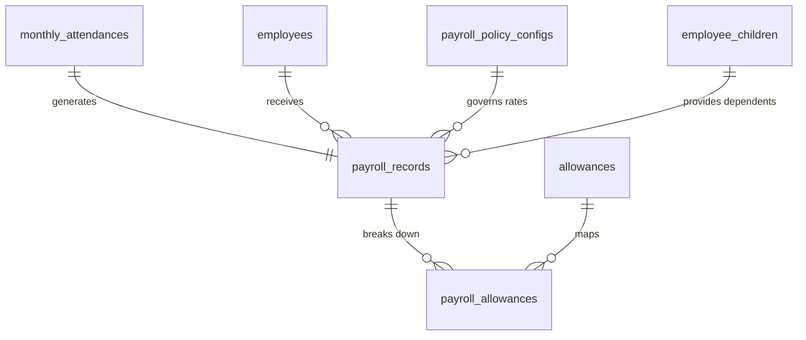
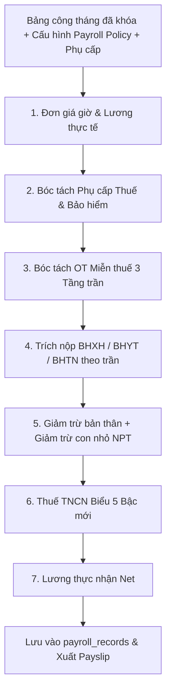

# TÀI LIỆU KỸ THUẬT MODULE 07: PAYROLL & STATUTORY GATEWAY (ĐỘNG CƠ TÍNH LƯƠNG, BẢO HIỂM & THUẾ PHÁP ĐỊNH)

> **Tên phân hệ:** `Payroll`  
> **Namespace Backend:** `App\Modules\Payroll`  
> **Trách nhiệm chính:** Tự động kết nối dữ liệu từ bảng công đã khóa (`monthly_attendances`), thực thi giải thuật tính lương Gross-to-Net dựa trên cấu hình linh hoạt từ `payroll_policy_configs`, tích hợp danh mục phụ cấp lương chuẩn hóa (`allowances`), bóc tách tiền làm thêm giờ (OT) miễn thuế theo thuật toán 3 tầng trần, tự động đồng bộ người phụ thuộc từ hồ sơ con nhỏ (`employee_children`), trích nộp các khoản bảo hiểm bắt buộc (BHXH/BHYT/BHTN), áp dụng biểu thuế TNCN 5 bậc lũy tiến động hiệu lực từ 2026, xuất phiếu lương số và định dạng file chi trả ngân hàng.

---

## 1. Ranh giới Nghiệp vụ & Trách nhiệm (Domain Boundaries)

Module `Payroll` là phân hệ tài chính nhạy cảm nhất trong hệ thống Smart-HR:
1. **Kết nối Dữ liệu Bảng công Khóa Kỳ**: Chỉ thực hiện tính lương trên các bảng công tháng đã được khóa (`is_locked = true`), bảo đảm số liệu không bị biến động trong quá trình tính toán.
2. **Cấu hình Lương Động (Zero-Hardcode via `payroll_policy_configs`)**:
   - Tự động nạp chế độ tính ngày công chuẩn: Cố định (`fixed_standard_working_days`) hoặc Theo lịch thực tế (`calendar_standard_days`).
   - Tự động áp dụng mức trần đóng BHXH/BHTN, tỷ lệ đóng bảo hiểm và các mức giảm trừ gia cảnh thuế TNCN theo phiên bản quy chế hiệu lực.
3. **Phân loại & Xử lý Phụ cấp từ Danh mục Chuẩn (`allowances`)**:
   - Tích hợp danh mục phụ cấp kế thừa từ `timekeeper2`: Ăn trưa, điện thoại, xăng xe, nhà ở, chuyên cần...
   - Tự động bóc tách phần chịu thuế và phần miễn thuế theo ngưỡng trần luật định (`tax_exemption_limit`).
   - Nhận diện các khoản phụ cấp được tính đóng BHXH bắt buộc (`is_insurance_taxable`) và phụ cấp tính vào đơn giá giờ OT (`is_included_in_ot_wage`).
4. **Đồng bộ Người Phụ thuộc Tự động từ Hồ sơ Con nhỏ**:
   - Tự động quét các con nhỏ có đăng ký giảm trừ (`employee_children.is_tax_dependent = true`) và `employees.dependent_count`.
   - Nhân số lượng người phụ thuộc với mức giảm trừ người phụ thuộc quy định tại `payroll_policy_configs.dependent_deduction` (mặc định 4.400.000 đ hoặc 6.160.000 đ/tháng).
5. **Thuật toán Bóc tách Tiền OT Miễn thuế 3 Tầng Trần**:
   - Bóc tách phần thù lao trả cao hơn do làm thêm giờ (50% của ngày thường, 100% của cuối tuần, 200% của ngày lễ) được miễn thuế TNCN.
   - Kiểm soát 3 tầng trần: Ngày $50\%$ ca, Tháng $40$h, Năm $200$h/$300$h theo Nghị định 145/2020/NĐ-CP. Nếu vượt trần, phần vượt vẫn được trả lương đầy đủ nhưng chịu thuế TNCN 100%.
6. **Trích nộp Bảo hiểm Xã hội Bắt buộc**:
   - Trích nộp phần người lao động: BHXH $8\%$, BHYT $1.5\%$, BHTN $1\%$ (Tổng $10.5\%$).
   - Trích nộp phần người sử dụng lao động: BHXH $17.5\%$, BHYT $3\%$, BHTN $1\%$ (Tổng $21.5\%$).
   - Khống chế mức trần đóng BHXH/BHYT bằng 20 lần mức lương cơ sở (`max_salary_bhxh`).
7. **Biểu thuế TNCN Lũy tiến Động 5 Bậc (Hiệu lực từ 2026)**:
   - Áp dụng biểu thuế lũy tiến từng phần 5 bậc mới nhất: 5%, 10%, 20%, 30%, 35%.

---

## 2. Thiết kế Cơ sở Dữ liệu & Mô hình Dữ liệu (Database Schema)

### 2.1 Sơ đồ Thực thể Quan hệ (ERD)

### 2.2 Đặc tả Chi tiết các Bảng Dữ liệu

#### Bảng `payroll_records` (Bảng Lương Tổng Hợp của Nhân Viên)
- `id` (BIGINT UNSIGNED, PK, Auto Increment)
- `tenant_id` (BIGINT UNSIGNED)
- `employee_id` (BIGINT UNSIGNED, FK $\to$ `employees.id`)
- `monthly_attendance_id` (BIGINT UNSIGNED, FK $\to$ `monthly_attendances.id`, Unique per month)
- `month_year` (VARCHAR(7)) — Format: `YYYY-MM`
- `contract_salary` (DECIMAL(15,2)) — Lương thỏa thuận trên hợp đồng
- `actual_standard_salary` (DECIMAL(15,2)) — Lương cơ bản theo ngày công thực tế
- `total_allowances_taxable` (DECIMAL(15,2), Default: 0.00)
- `total_allowances_non_taxable` (DECIMAL(15,2), Default: 0.00)
- `attendance_allowance` (DECIMAL(15,2), Default: 0.00)
- `overtime_pay_total` (DECIMAL(15,2), Default: 0.00) — Tổng tiền lương làm thêm giờ
- `overtime_pay_tax_exempt` (DECIMAL(15,2), Default: 0.00) — Tiền OT được miễn thuế TNCN
- `gross_salary` (DECIMAL(15,2)) — Tổng thu nhập trước thuế/bảo hiểm
- `employee_si_amount` (DECIMAL(15,2), Default: 0.00) — BHXH 8%
- `employee_hi_amount` (DECIMAL(15,2), Default: 0.00) — BHYT 1.5%
- `employee_ui_amount` (DECIMAL(15,2), Default: 0.00) — BHTN 1%
- `total_employee_insurance` (DECIMAL(15,2), Default: 0.00) — Tổng bảo hiểm trừ vào lương
- `self_deduction_amount` (DECIMAL(15,2)) — Giảm trừ bản thân (lấy từ `payroll_policy_configs`)
- `dependent_deduction_amount` (DECIMAL(15,2)) — Giảm trừ gia cảnh (tính từ `employee_children`)
- `taxable_income` (DECIMAL(15,2), Default: 0.00) — Thu nhập chịu thuế
- `assessable_income` (DECIMAL(15,2), Default: 0.00) — Thu nhập tính thuế
- `pit_amount` (DECIMAL(15,2), Default: 0.00) — Thuế TNCN phải nộp (biểu 5 bậc)
- `late_early_penalty_deduction` (DECIMAL(15,2), Default: 0.00) — Tiền phạt đi muộn/về sớm
- `net_salary` (DECIMAL(15,2)) — Lương thực lĩnh chuyển khoản
- `status` (ENUM: `DRAFT`, `APPROVED`, `PAID`, Default: `DRAFT`)
- `approved_by` (BIGINT UNSIGNED, Nullable, FK $\to$ `employees.id`)
- `approved_at` (TIMESTAMP, Nullable)
- `paid_at` (TIMESTAMP, Nullable)
- `created_at`, `updated_at` (TIMESTAMP)
- Unique Index: `(employee_id, month_year)`

#### Bảng `payroll_allowances` (Chi tiết Các Khoản Phụ cấp)
- `id` (BIGINT UNSIGNED, PK, Auto Increment)
- `payroll_record_id` (BIGINT UNSIGNED, FK $\to$ `payroll_records.id`)
- `allowance_code` (VARCHAR(50)) — Khớp với mã trong bảng `allowances`
- `amount` (DECIMAL(15,2))
- `taxable_part` (DECIMAL(15,2)) — Phần tính thuế TNCN
- `non_taxable_part` (DECIMAL(15,2)) — Phần được miễn thuế TNCN
- `is_included_in_insurance` (BOOLEAN, Default: FALSE)

---

## 3. Các Công thức & Giải thuật Tính Lương Cốt lõi

### 3.1 Đơn giá Giờ Chuẩn & Lương Cơ bản Thực tế
1. **Đơn giá giờ làm việc chuẩn (`Hourly Wage`)**:
   $$
   \text{Hourly Wage} = \frac{\text{Base Salary} + \sum \text{Allowances}_{\text{included\_in\_ot}}}{\text{Standard Working Days} \times \text{Standard Hours Per Day}}
   $$
2. **Lương cơ bản theo ngày công thực tế (`Actual Standard Salary`)**:
   $$
   \text{Actual Standard Salary} = \frac{\text{Base Salary}}{\text{Standard Working Days}} \times \text{Actual Standard Days}
   $$

### 3.2 Thu nhập Tính thuế & Giảm trừ Gia cảnh Con nhỏ
$$
\text{Dependent Deduction} = \text{Count}(\text{Active Dependent Children}) \times \text{dependent\_deduction\_rate}
$$
$$
\text{Assessable Income} = \max\left(0,\; \text{Taxable Income} - \text{Total Insurance} - \text{Personal Deduction} - \text{Dependent Deduction}\right)
$$

### 3.3 Tra cứu Biểu thuế TNCN 5 Bậc Mới

| Bậc | Thu nhập tính thuế ($I$) | Thuế suất ($r$) | Số trừ nhanh ($Q$) | Tiền thuế phải nộp ($T = I \times r - Q$) |
|:---:|---|:---:|:---:|---|
| **1** | Đến 10 triệu đồng | 5% | 0 | $I \times 5\%$ |
| **2** | Trên 10 đến 30 triệu đồng | 10% | 500.000 đ | $I \times 10\% - 500.000$ |
| **3** | Trên 30 đến 60 triệu đồng | 20% | 3.500.000 đ | $I \times 20\% - 3.500.000$ |
| **4** | Trên 60 đến 100 triệu đồng | 30% | 9.500.000 đ | $I \times 30\% - 9.500.000$ |
| **5** | Trên 100 triệu đồng | 35% | 14.500.000 đ | $I \times 35\% - 14.500.000$ |

---

## 4. Danh mục RESTful / Inertia Endpoints

| Method | URI | Quyền hạn | Mô tả |
|---|---|---|---|
| `GET` | `/payroll` | `perm:PAYROLL_SALARY.view` | Bảng lương tổng hợp tháng của nhân sự |
| `POST` | `/payroll/calculate` | `perm:PAYROLL_SALARY.manage` | Kích hoạt tính lương tự động cho toàn bộ nhân viên |
| `POST` | `/payroll/approve` | `perm:PAYROLL_SALARY.approve` | Ban Giám đốc phê duyệt chốt bảng lương |
| `GET` | `/payroll/payslip/me` | `perm:PAYROLL_SALARY.view` | Nhân viên xem phiếu lương cá nhân bảo mật |
| `GET` | `/payroll/export-bank` | `perm:PAYROLL_SALARY.manage` | Xuất file chi trả ngân hàng chuẩn định dạng |

---

## 5. Kịch bản Kiểm thử Tích hợp (Test Scenarios)

1. **Test `PayrollCalculationWithDynamicChildrenDependents`**:
   - Nhân viên có mức lương Gross 40.000.000 đ.
   - Nhân viên có 2 con nhỏ được duyệt giảm trừ gia cảnh trong `employee_children` (mỗi bé 4.400.000 đ).
   - Kết quả kỳ vọng: `dependent_deduction_amount = 8.800.000 đ`. Thu nhập tính thuế giảm tương ứng trước khi áp biểu thuế 5 bậc.
2. **Test `OvertimeTaxExemptThreeTierCapEnforcement`**:
   - Nhân viên làm 45 giờ OT trong tháng (vượt trần tháng 40 giờ theo Điều 107).
   - Kết quả kỳ vọng: 40 giờ OT đầu tiên được miễn thuế phần trả cao hơn ($50\%$ đơn giá). 5 giờ OT vượt trần vẫn được nhận đủ 150% tiền lương nhưng chịu thuế TNCN toàn bộ 100%.
