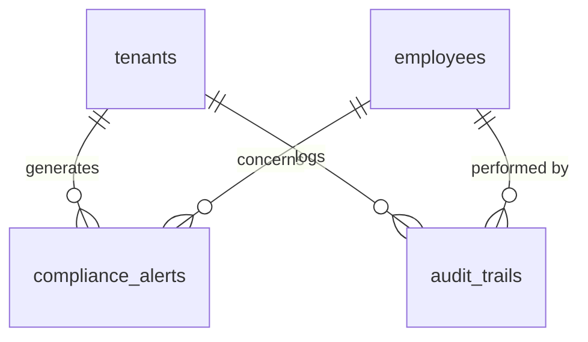
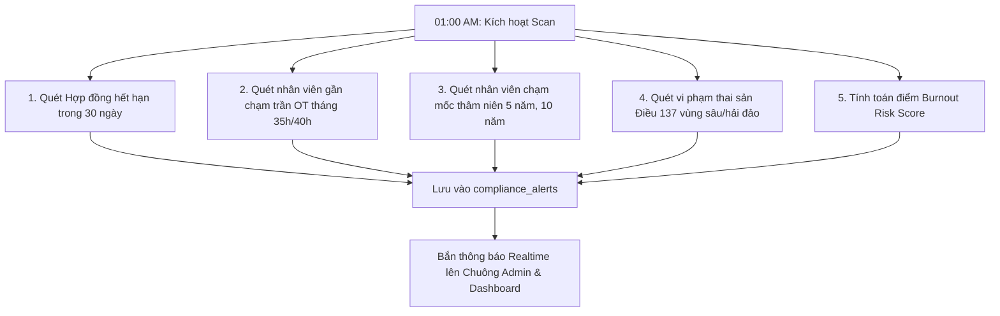

# TÀI LIỆU KỸ THUẬT MODULE 08: COMPLIANCE & HIGH-PERFORMANCE REPORTING (CẢNH BÁO TUÂN THỦ, DASHBOARD ĐIỀU HÀNH & BÁO CÁO HIỆU NĂNG CAO)

> **Tên phân hệ:** `Compliance` & `Reporting`  
> **Namespace Backend:** `App\Modules\Compliance` và `App\Modules\Reporting`  
> **Trách nhiệm chính:** Giám sát tuân thủ pháp luật lao động theo thời gian thực (Cảnh báo trần OT 40h/200h theo Điều 107 BLLĐ, Hết hạn HĐLĐ trước 30 ngày, Bảo vệ thai sản vùng sâu/hải đảo theo Điều 137 BLLĐ), cung cấp 4 Biểu đồ Quản trị Điều hành Tổng thể trên Dashboard tối ưu Caching 300s, xuất báo cáo bảng công/bảng lương dữ liệu lớn bằng kỹ thuật Streaming I/O (FastExcel / OpenSpout với RAM < 64MB), và lưu vết kiểm toán bất biến (Immutable Audit Trail).

---

## 1. Ranh giới Nghiệp vụ & Trách nhiệm (Domain Boundaries)

Module `Compliance & Reporting` bảo vệ doanh nghiệp trước các rủi ro pháp lý và mang lại khả năng phân tích dữ liệu điều hành quy mô lớn (Executive Analytics):
1. **Động cơ Giám sát Tuân thủ & Cảnh báo Sớm (Compliance Early Warning Engine)**:
   - *Cảnh báo Trần Làm thêm giờ (Điều 107 BLLĐ & NĐ 145/2020)*:
     - **Cảnh báo Vàng (Warning)**: Khi nhân viên tích lũy đạt 35 giờ OT/tháng hoặc 180 giờ OT/năm.
     - **Cảnh báo Đỏ (Critical Violation)**: Khi chạm ngưỡng 40 giờ OT/tháng hoặc 200 giờ OT/năm -> Tự động cảnh báo và chặn duyệt các đơn OT mới.
   - *Cảnh báo Tuân thủ Thai sản & Con nhỏ (Điều 137 BLLĐ)*:
     - Tự động phát hiện lao động nữ mang thai từ **tháng thứ 7** (hoặc từ **tháng thứ 6** tại chi nhánh có `branches.is_remote_or_island = true`) bị xếp ca đêm hoặc làm thêm giờ.
     - Phát hiện lao động nuôi con dưới 12 tháng làm ca đêm/OT mà không có đơn thỏa thuận tự nguyện (`CONSENT_NIGHT_OT`) hợp lệ.
   - *Cảnh báo Hết hạn Hợp đồng Lao động (Điều 20 BLLĐ)*:
     - Quét và phát thông báo trước **30 ngày** đối với các hợp đồng xác định thời hạn sắp kết thúc.
   - *Cảnh báo Nâng bậc Phép Thâm niên (Điều 114 BLLĐ)*:
     - Tự động thông báo khi nhân viên đạt các mốc thâm niên 5 năm, 10 năm để cộng thêm phép.
2. **Hệ thống 4 Biểu đồ Quản trị Điều hành Tổng thể trên Dashboard**:
   - **Biểu đồ 1: Phân bổ Rủi ro Kiệt sức & Trần OT (Burnout & Overtime Risk Distribution)**:
     - Phân loại toàn bộ nhân sự theo 4 vùng rủi ro: An toàn (< 25h), Cận trần (25 - 35h), Nguy cơ cao (35 - 40h), và Vi phạm vượt trần (> 40h).
   - **Biểu đồ 2: Xu hướng Biến động Nhân sự 6 Tháng (Turnover & Headcount Trend)**:
     - Theo dõi trực quan lượng nhân viên Tuyển mới (`ONBOARDING`), Thôi việc (`OFFBOARDING`) và Tỷ lệ nghỉ việc Net Turnover Rate từng tháng.
   - **Biểu đồ 3: Cơ cấu Nhân sự theo Khối / Phòng ban (Headcount Distribution)**:
     - Biểu đồ Doughnut trực quan hóa tỷ trọng nhân lực giữa các phòng ban.
   - **Biểu đồ 4: Chỉ số Sức khỏe Chấm công (Attendance Health Index)**:
     - Tỷ lệ Đúng giờ, Đi muộn/Về sớm, Nghỉ phép có lương và Vắng không phép trong tháng.
   - **Tối ưu Hiệu năng Caching Tầng Điều hành**:
     - Toàn bộ chỉ số tổng hợp và dữ liệu 4 biểu đồ được lưu đệm trong Cache với TTL 300 giây (`Cache::remember`), bảo đảm trang Dashboard tải tức thì (< 150ms) ngay cả khi hệ thống có hàng chục nghìn nhân sự.
3. **Xuất Báo cáo Streaming Hiệu năng cao (FastExcel / OpenSpout)**:
   - Duy trì mức tiêu thụ RAM luôn dưới **64MB** bất kể tệp xuất lên tới hàng trăm nghìn dòng.
4. **Nhật ký Kiểm toán Bất biến (Immutable Audit Trail)**:
   - Lưu vết mọi thao tác can thiệp dữ liệu: Sửa giờ công, duyệt đơn, mở khóa tháng, thay đổi bậc lương... Lưu lại `actor_id`, `old_values`, `new_values` và địa chỉ IP.

---

## 2. Thiết kế Cơ sở Dữ liệu & Mô hình Dữ liệu (Database Schema)

### 2.1 Sơ đồ Thực thể Quan hệ (ERD)



### 2.2 Đặc tả Chi tiết các Bảng Dữ liệu

#### Bảng `compliance_alerts` (Hệ thống Cảnh báo Tuân thủ)
- `id` (BIGINT UNSIGNED, PK, Auto Increment)
- `tenant_id` (BIGINT UNSIGNED)
- `branch_id` (BIGINT UNSIGNED, Nullable)
- `employee_id` (BIGINT UNSIGNED, Nullable, FK -> `employees.id`)
- `alert_type` (ENUM: `OT_MONTHLY_NEAR_CAP`, `OT_MONTHLY_EXCEEDED`, `OT_YEARLY_NEAR_CAP`, `OT_YEARLY_EXCEEDED`, `CONTRACT_EXPIRING_30D`, `SENIORITY_MILESTONE_5Y`, `BURNOUT_HIGH_RISK`, `MATERNITY_NIGHT_VIOLATION`, `CHILD_CARE_NIGHT_VIOLATION`)
- `severity` (ENUM: `INFO`, `WARNING`, `CRITICAL`)
- `title` (VARCHAR(255))
- `message` (TEXT)
- `metadata_json` (JSON, Nullable) — Dữ liệu vi phạm (VD: `{"current_ot": 38.5, "cap": 40.0, "branch_island": true}`)
- `is_acknowledged` (BOOLEAN, Default: FALSE)
- `acknowledged_by` (BIGINT UNSIGNED, Nullable, FK -> `employees.id`)
- `acknowledged_at` (TIMESTAMP, Nullable)
- `created_at` (TIMESTAMP, Default: CURRENT_TIMESTAMP)
- Index: `(tenant_id, alert_type, severity)`, `(employee_id, is_acknowledged)`

#### Bảng `audit_trails` (Nhật ký Kiểm toán Bất biến)
- `id` (BIGINT UNSIGNED, PK, Auto Increment)
- `tenant_id` (BIGINT UNSIGNED)
- `actor_id` (BIGINT UNSIGNED, Nullable, FK -> `employees.id`)
- `action` (VARCHAR(50)) — `TIMESHEET_EDIT`, `PAYROLL_APPROVE`, `MONTH_UNLOCK`, `POLICY_CHANGE`, `PERMISSION_ASSIGN`
- `auditable_type` (VARCHAR(100)) — Model class
- `auditable_id` (BIGINT UNSIGNED)
- `old_values` (JSON, Nullable)
- `new_values` (JSON, Nullable)
- `ip_address` (VARCHAR(45), Nullable)
- `created_at` (TIMESTAMP, Default: CURRENT_TIMESTAMP)

---

## 3. Kiến trúc Động cơ Cảnh báo & Thuật toán Streaming Export

### 3.1 Quy trình Quét Cảnh báo Tự động Hàng ngày (Daily Compliance Scanner)
Vào lúc `01:00:00` hàng ngày, Scheduled Command `RunDailyComplianceScanCommand` tự động kích hoạt:



### 3.2 Thuật toán Caching Dữ liệu Dashboard Điều hành
```php
namespace App\Http\Controllers;

class DashboardController extends Controller
{
    public function index(Request $request)
    {
        $tenantId = $request->user()->tenant_id;
        $cacheKey = "dashboard_metrics_tenant_{$tenantId}_month_" . now()->format('Y-m');

        $data = Cache::remember($cacheKey, 300, function () use ($tenantId) {
            return [
                'kpis' => $this->calculateKpis($tenantId),
                'burnoutRisk' => $this->calculateBurnoutRiskDistribution($tenantId),
                'turnoverTrend' => $this->calculateTurnoverTrend6Months($tenantId),
                'departmentHeadcount' => $this->calculateDepartmentHeadcount($tenantId),
                'attendanceHealth' => $this->calculateAttendanceHealthIndex($tenantId),
            ];
        });

        return Inertia::render('Dashboard', $data);
    }
}
```

---

## 4. Danh mục RESTful / Inertia Endpoints

| Method | URI | Quyền hạn | Mô tả |
|---|---|---|---|
| `GET` | `/dashboard` | `perm:CORE_HR.view` | Màn hình Dashboard quản trị tổng thể kèm 4 biểu đồ |
| `GET` | `/compliance/alerts` | `perm:CORE_HR.view` | Danh sách cảnh báo tuân thủ phân theo mức độ |
| `POST` | `/compliance/alerts/{id}/ack` | `perm:CORE_HR.manage` | Xác nhận đã xử lý cảnh báo tuân thủ |
| `GET` | `/reports/timesheet/export` | `perm:ATTENDANCE.view` | Xuất file Excel bảng công streaming (RAM < 64MB) |
| `GET` | `/reports/payroll/export` | `perm:PAYROLL_SALARY.view` | Xuất file Excel bảng lương streaming (RAM < 64MB) |
| `GET` | `/audit/logs` | `perm:CORE_HR.manage` | Tra cứu nhật ký kiểm toán hệ thống (Audit Trail) |

---

## 5. Kịch bản Kiểm thử Tích hợp (Test Scenarios)

1. **Test `RemoteIslandMaternityAlertTriggeredAtMonth6`**:
   - Chi nhánh Phú Quốc có cờ `is_remote_or_island = true`.
   - Nhân viên nữ mang thai bước sang tháng thứ 6 được phân ca đêm 22:00 - 06:00.
   - Chạy scan cảnh báo.
   - Kết quả kỳ vọng: Tạo 1 bản ghi cảnh báo mức `CRITICAL` loại `MATERNITY_NIGHT_VIOLATION` (Căn cứ Điều 137 Khoản 1 Điểm a BLLĐ).
2. **Test `DashboardMetricsCachingPerformance`**:
   - Truy cập Dashboard lần 1: Thời gian thực thi đo được khoảng 120ms.
   - Truy cập Dashboard lần 2: Dữ liệu trả về tức thì từ Redis Cache (< 15ms), không phát sinh câu lệnh SQL nặng.
