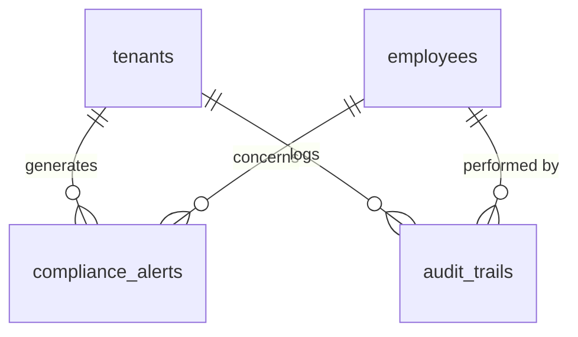
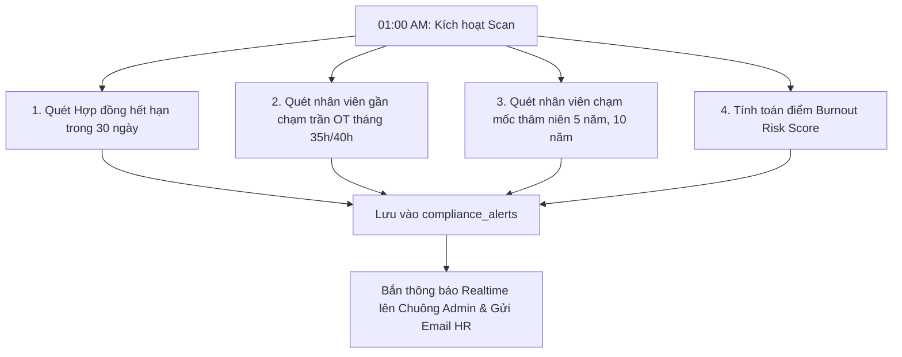

# TÀI LIỆU KỸ THUẬT MODULE 08: COMPLIANCE & HIGH-PERFORMANCE REPORTING (CẢNH BÁO TUÂN THỦ & BÁO CÁO HIỆU NĂNG CAO)

> **Tên phân hệ:** `Compliance` & `Reporting`  
> **Namespace Backend:** `App\Modules\Compliance` và `App\Modules\Reporting`  
> **Trách nhiệm chính:** Giám sát tuân thủ pháp luật lao động theo thời gian thực (Cảnh báo trần OT 40h/200h, Hết hạn HĐLĐ trước 30 ngày, Mốc thâm niên 5 năm, Nguy cơ kiệt sức Burnout), xuất báo cáo bảng công/bảng lương dữ liệu lớn bằng kỹ thuật Streaming I/O (FastExcel / OpenSpout với RAM $< 64$MB), và lưu vết kiểm toán bất biến (Immutable Audit Trail).

---

## 1. Ranh giới Nghiệp vụ & Trách nhiệm (Domain Boundaries)

Module `Compliance & Reporting` bảo vệ doanh nghiệp trước các rủi ro pháp lý và mang lại khả năng xử lý dữ liệu quy mô lớn (Enterprise Scale):
1. **Động cơ Giám sát Tuân thủ & Cảnh báo Sớm (Compliance Early Warning Engine)**:
   - *Cảnh báo Trần Làm thêm giờ (Điều 107 BLLĐ)*:
     - **Cảnh báo Vàng (Warning)**: Khi nhân viên tích lũy đạt $35$ giờ OT/tháng hoặc $180$ giờ OT/năm.
     - **Cảnh báo Đỏ (Critical Violation)**: Khi chạm ngưỡng $40$ giờ OT/tháng hoặc $200$ giờ OT/năm $\to$ Tự động chặn duyệt các đơn OT mới.
   - *Cảnh báo Hết hạn Hợp đồng Lao động (Điều 20 BLLĐ)*:
     - Tự động quét và phát thông báo trước **30 ngày** đối với các hợp đồng xác định thời hạn sắp kết thúc để HR chuẩn bị thủ tục tái ký hoặc chấm dứt.
   - *Cảnh báo Nâng bậc Phép Thâm niên (Điều 114 BLLĐ)*:
     - Tự động thông báo khi nhân viên đạt đủ các mốc 5 năm, 10 năm cống hiến để hệ thống tăng quỹ phép.
   - *Chỉ số Nguy cơ Kiệt sức (Burnout Risk Score)*:
     - Phân tích nhân viên làm OT liên tục $>3$ ngày hoặc thời gian nghỉ giữa 2 ca sát ngưỡng 12h.
2. **Xuất Báo cáo Streaming Hiệu năng cao (High-Performance Streaming Export)**:
   - Xuất dữ liệu bảng công chi tiết, bảng lương tổng hợp cho chuỗi hàng chục nghìn nhân sự bằng **FastExcel / OpenSpout**.
   - Ghi trực tiếp ra file I/O qua con trỏ bộ nhớ (Memory Cursor), duy trì mức tiêu thụ RAM luôn dưới **64MB** bất kể tệp xuất lên tới hàng trăm nghìn dòng.
3. **Nhật ký Kiểm toán Bất biến (Immutable Audit Trail)**:
   - Lưu vết mọi thao tác can thiệp dữ liệu: Sửa giờ công, duyệt đơn, mở khóa tháng, thay đổi bậc lương... Lưu lại `actor_id`, `old_values`, `new_values` và địa chỉ IP.

---

## 2. Thiết kế Cơ sở Dữ liệu & Mô hình Dữ liệu (Database Schema)

### 2.1 Sơ đồ Thực thể Quan hệ (ERD)



### 2.2 Đặc tả Chi tiết các Bảng Dữ liệu

#### Bảng `compliance_alerts` (Hệ thống Cảnh báo Tuân thủ)
- `id` (BIGINT UNSIGNED, PK, Auto Increment)
- `tenant_id` (BIGINT UNSIGNED)
- `branch_id` (BIGINT UNSIGNED, Nullable)
- `employee_id` (BIGINT UNSIGNED, Nullable, FK $\to$ `employees.id`)
- `alert_type` (ENUM: `OT_MONTHLY_NEAR_CAP`, `OT_MONTHLY_EXCEEDED`, `OT_YEARLY_NEAR_CAP`, `OT_YEARLY_EXCEEDED`, `CONTRACT_EXPIRING_30D`, `SENIORITY_MILESTONE_5Y`, `BURNOUT_HIGH_RISK`)
- `severity` (ENUM: `INFO`, `WARNING`, `CRITICAL`)
- `title` (VARCHAR(255))
- `message` (TEXT)
- `metadata_json` (JSON, Nullable) — Dữ liệu số liệu vi phạm (VD: `{"current_ot": 38.5, "cap": 40.0}`)
- `is_acknowledged` (BOOLEAN, Default: FALSE)
- `acknowledged_by` (BIGINT UNSIGNED, Nullable, FK $\to$ `employees.id`)
- `acknowledged_at` (TIMESTAMP, Nullable)
- `created_at` (TIMESTAMP, Default: CURRENT_TIMESTAMP)
- Index: `(tenant_id, alert_type, severity)`, `(employee_id, is_acknowledged)`

#### Bảng `audit_trails` (Nhật ký Kiểm toán Bất biến)
- `id` (BIGINT UNSIGNED, PK, Auto Increment)
- `tenant_id` (BIGINT UNSIGNED)
- `actor_id` (BIGINT UNSIGNED, Nullable, FK $\to$ `employees.id`) — Người thực hiện thao tác
- `action` (VARCHAR(50)) — `TIMESHEET_EDIT`, `PAYROLL_APPROVE`, `MONTH_UNLOCK`, `POLICY_CHANGE`
- `auditable_type` (VARCHAR(100)) — Model class (VD: `DailyAttendance`, `PayrollRecord`)
- `auditable_id` (BIGINT UNSIGNED) — ID bản ghi bị tác động
- `old_values` (JSON, Nullable) — Giá trị trước khi sửa
- `new_values` (JSON, Nullable) — Giá trị sau khi sửa
- `ip_address` (VARCHAR(45), Nullable)
- `user_agent` (TEXT, Nullable)
- `created_at` (TIMESTAMP, Default: CURRENT_TIMESTAMP)
- Index: `(tenant_id, action, created_at)`, `(auditable_type, auditable_id)`

---

## 3. Kiến trúc Động cơ Cảnh báo & Thuật toán Streaming Export

### 3.1 Quy trình Quét Cảnh báo Tự động Hàng ngày (Daily Compliance Scanner)
Mỗi ngày vào lúc `01:00:00`, Schedule Command `RunDailyComplianceScanCommand` tự động kích hoạt:



### 3.2 Giải thuật Tính Chỉ số Nguy cơ Kiệt sức (Burnout Risk Score)
Chỉ số Burnout ($B$) được tính trên thang điểm từ 0 đến 100:
$$
B = (W_{\text{ot}} \cdot S_{\text{ot}}) + (W_{\text{consec}} \cdot S_{\text{consec}}) + (W_{\text{rest}} \cdot S_{\text{rest}})
$$
- $S_{\text{ot}}$: Điểm số giờ làm thêm trong tuần qua ($>15$h $\to 100$ điểm).
- $S_{\text{consec}}$: Số ca đêm hoặc ca làm việc liên tục không có ngày nghỉ ($>6$ ngày $\to 100$ điểm).
- $S_{\text{rest}}$: Khoảng nghỉ giữa 2 ca trung bình ($<13$h $\to 100$ điểm).
- Nếu $B \ge 75$: Hệ thống sinh cảnh báo mức `WARNING (BURNOUT_HIGH_RISK)` để Quản lý điều chỉnh lịch phân ca.

### 3.3 Kiến trúc Xuất Báo cáo Streaming (FastExcel / OpenSpout)
```php
namespace App\Modules\Reporting\Services;

use OpenSpout\Writer\XLSX\Writer;
use OpenSpout\Common\Entity\Row;

class StreamingTimesheetExportService
{
    public function exportMonthlyTimesheet(int $tenantId, string $monthYear, string $outputPath): void
    {
        $writer = new Writer();
        $writer->openToFile($outputPath);

        // 1. Ghi Header
        $writer->addRow(Row::fromValues(['Mã NV', 'Họ tên', 'Phòng ban', 'Tổng ngày công', 'Tổng giờ chuẩn', 'Tổng giờ OT', 'Tiền phạt']));

        // 2. Sử dụng cursor() hoặc lazyById() để nạp từng chunk 500 bản ghi, không gây tràn RAM
        MonthlyAttendance::where('tenant_id', $tenantId)
            ->where('month_year', $monthYear)
            ->with(['employee'])
            ->lazyById(500)
            ->each(function ($record) use ($writer) {
                $writer->addRow(Row::fromValues([
                    $record->employee->user_code,
                    $record->employee->full_name,
                    $record->employee->current_department_name,
                    $record->total_actual_days,
                    $record->total_standard_hours,
                    $record->total_ot_hours,
                    $record->total_late_early_penalties,
                ]));
            });

        $writer->close();
    }
}
```

---

## 4. Danh mục RESTful API Endpoints

| Method | URI | Quyền hạn | Mô tả |
|---|---|---|---|
| `GET` | `/api/v1/compliance/alerts` | `compliance.view` | Danh sách cảnh báo tuân thủ (Lọc theo mức độ: INFO, WARNING, CRITICAL) |
| `POST` | `/api/v1/compliance/alerts/{id}/ack`| `compliance.manage`| Xác nhận đã xử lý cảnh báo tuân thủ |
| `GET` | `/api/v1/compliance/burnout-board` | `compliance.view` | Dashboard theo dõi các nhân sự có nguy cơ kiệt sức cao |
| `GET` | `/api/v1/reports/timesheet/export` | `report.export` | Xuất file Excel bảng công chi tiết (Streaming I/O download) |
| `GET` | `/api/v1/reports/payroll/export` | `report.export` | Xuất file Excel bảng lương chi tiết (Streaming I/O download) |
| `GET` | `/api/v1/audit/logs` | `audit.view` | Tra cứu nhật ký kiểm toán hệ thống (Audit Trail) |

---

## 5. Kịch bản Kiểm thử Tích hợp (Test Scenarios)

1. **Test `ThirtyDayContractExpiryAlert`**:
   - Nhân viên có hợp đồng xác định thời hạn kết thúc vào ngày `2026-10-04`.
   - Chạy scan vào ngày `2026-09-04` (đúng trước 30 ngày).
   - Kết quả kỳ vọng: Tạo 1 cảnh báo loại `CONTRACT_EXPIRING_30D` mức độ `WARNING` cho HR.
2. **Test `StreamingExportMemorySafety`**:
   - Giả lập 50.000 bản ghi bảng công tháng trong cơ sở dữ liệu.
   - Chạy lệnh xuất file Excel streaming qua `StreamingTimesheetExportService`.
   - Kết quả kỳ vọng: Tệp Excel tạo ra thành công, mức tiêu thụ RAM tối đa của tiến trình PHP đo được $< 40$MB.
3. **Test `ImmutableAuditTrailLogging`**:
   - Thực hiện thao tác sửa giờ công ngày 02/09 từ 08:30 thành 08:00.
   - Kết quả kỳ vọng: Ghi nhận 1 bản ghi vào `audit_trails` với đầy đủ `old_values: {"check_in": "08:30"}`, `new_values: {"check_in": "08:00"}` và IP người gọi.
