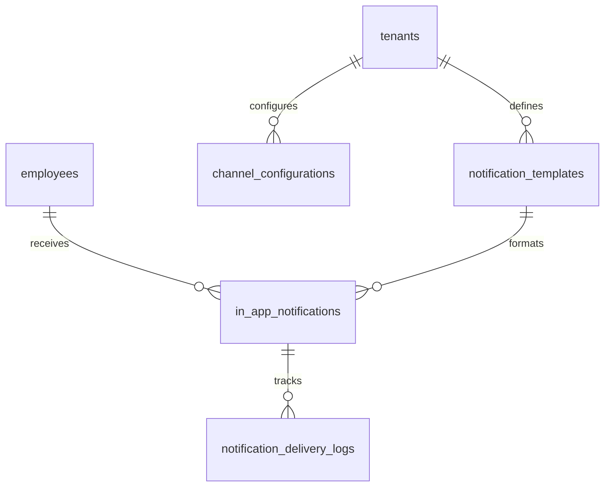
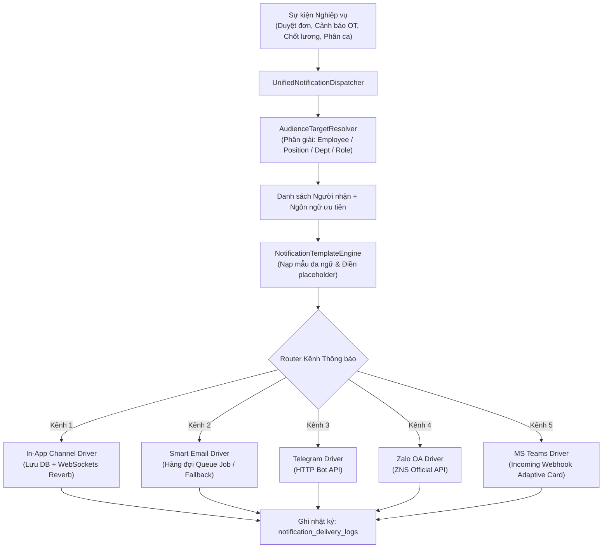

# TÀI LIỆU KỸ THUẬT MODULE 09: NOTIFICATIONS & MULTI-CHANNEL DISPATCHER (HỆ THỐNG THÔNG BÁO ĐA KÊNH & HƯỚNG ĐỐI TƯỢNG)

> **Tên phân hệ:** `Notification`  
> **Namespace Backend:** `App\Modules\Notification`  
> **Trách nhiệm chính:** Cung cấp hạ tầng phân phối thông báo tập trung theo đối tượng (Nhân viên, Chức vụ, Phòng ban, Chi nhánh, Vai trò), hỗ trợ kênh thông báo nội bộ (In-app Bell qua WebSockets/SSE), kênh Email thông minh kèm hàng đợi, và kiến trúc Driver mở rộng sẵn sàng kết nối các kênh bên thứ 3 (Telegram, Zalo OA/ZNS, Microsoft Teams, Slack).

---

## 1. Ranh giới Nghiệp vụ & Trách nhiệm (Domain Boundaries)

Module `Notification` là trung tâm truyền thông số (Communication Hub) kết nối toàn bộ 8 module nghiệp vụ khác trong Smart-HR với người dùng cuối:
1. **Động cơ Phân phối theo Phân khúc Đối tượng (Audience Targeting Engine)**:
   - *Gửi đích danh cá nhân*: Gửi trực tiếp đến 1 hoặc một danh sách `employee_id`.
   - *Gửi theo Vị trí / Chức danh (`position_id`)*: Gửi thông báo đồng loạt tới tất cả "Quản lý Cửa hàng", "Trưởng ca", "Kế toán tiền lương"...
   - *Gửi theo Phòng ban / Chi nhánh (`department_id`, `branch_id`)*: Gửi thông báo nội bộ đến "Khối Công nghệ", "Chi nhánh Miền Nam"...
   - *Gửi theo Vai trò Phê duyệt (`role`)*: Gửi tới các Approver có đơn đang chờ xử lý quá 24h.
2. **Kênh Thông báo Nội bộ (In-App Bell & Realtime Push)**:
   - Hiển thị chuông thông báo trên giao diện web kèm số đếm chưa đọc (Unread Badge).
   - Đẩy thông báo thời gian thực (Realtime Notification) qua WebSockets (Laravel Reverb) hoặc Server-Sent Events (SSE) khi có sự kiện mới (được duyệt đơn, có ca làm mới, cảnh báo OT).
3. **Kênh Email Thông minh (Smart Queued Email Dispatcher)**:
   - Tự động phát hiện trạng thái Worker: Ưu tiên đẩy Job vào hàng đợi Redis (`SendQueuedMailJob`); nếu hàng đợi bị gián đoạn, tự động chuyển đổi sang cơ chế xử lý dự phòng an toàn.
   - Quản lý mẫu Email HTML chuẩn hóa (Responsive Email Templates) đa ngôn ngữ.
4. **Kiến trúc Driver Cắm rút Bên thứ 3 (Pluggable 3rd-Party Drivers)**:
   - Thiết kế chuẩn Interface `NotificationChannelDriverInterface` cho phép cắm/rút linh hoạt:
     - **Telegram Bot Driver**: Gửi thông báo trực tiếp tới Chat ID cá nhân hoặc Group Telegram của chi nhánh/phòng ban.
     - **Zalo OA / ZNS Driver**: Gửi thông báo biến động lương, chốt công, duyệt phép qua Zalo Notification Service API.
     - **Microsoft Teams Driver**: Bắn thẻ thông báo (Adaptive Cards) vào kênh MS Teams qua Incoming Webhook.
     - **Slack Driver**: Gửi tin nhắn định dạng Block Kit vào Workspace Slack.
   - Cung cấp giao diện quản trị bật/tắt kênh và cấu hình khóa API/Token cho từng chi nhánh/công ty mà không cần sửa code.
5. **Mẫu Thông báo Động & Đa ngôn ngữ (Notification Templates Engine)**:
   - Quản lý template theo mã (`TIMESHEET_EDIT_PENDING`, `LEAVE_APPROVED`, `OT_CAP_WARNING_RED`).
   - Hỗ trợ biến nội suy: `{employee_name}`, `{request_code}`, `{hours}`, `{approver_name}`...
   - Tự động dịch tiêu đề và nội dung theo ngôn ngữ ưa thích (`preferred_locale`) của từng nhân viên nhận tin.

---

## 2. Thiết kế Cơ sở Dữ liệu & Mô hình Dữ liệu (Database Schema)

### 2.1 Sơ đồ Thực thể Quan hệ (ERD)



### 2.2 Đặc tả Chi tiết các Bảng Dữ liệu

#### Bảng `notification_templates` (Mẫu Thông báo Đa Ngôn Ngữ)
- `id` (BIGINT UNSIGNED, PK, Auto Increment)
- `tenant_id` (BIGINT UNSIGNED, Nullable) — NULL: Mẫu mặc định hệ thống; Khác NULL: Mẫu tùy biến của công ty
- `code` (VARCHAR(100)) — Mã định danh mẫu (VD: `LEAVE_REQUEST_SUBMITTED`, `PAYROLL_READY`, `OT_WARNING_RED`)
- `category` (ENUM: `ATTENDANCE`, `LEAVE`, `ROSTERING`, `PAYROLL`, `COMPLIANCE`, `SYSTEM`)
- `default_channels_json` (JSON) — Kênh gửi mặc định: `["IN_APP", "EMAIL", "TELEGRAM"]`
- `title_translations_json` (JSON) — Tiêu đề đa ngữ: `{"vi": "Đơn nghỉ phép đã được duyệt", "en": "Leave request approved"}`
- `body_translations_json` (JSON) — Nội dung đa ngữ có placeholder: `{"vi": "Chào {name}, đơn {code} của bạn đã được duyệt bởi {approver}.", "en": "Hi {name}, your request {code} was approved by {approver}."}`
- `is_active` (BOOLEAN, Default: TRUE)
- `created_at`, `updated_at` (TIMESTAMP)
- Unique Index: `(tenant_id, code)`

#### Bảng `in_app_notifications` (Thông báo Chuông Website)
- `id` (UUID, PK) — Sử dụng UUID tương thích chuẩn Laravel Notifications
- `tenant_id` (BIGINT UNSIGNED)
- `notifiable_type` (VARCHAR(100)) — `App\Modules\CoreHR\Models\Employee`
- `notifiable_id` (BIGINT UNSIGNED) — `employee_id`
- `type` (VARCHAR(255)) — Tên lớp Notification
- `data_json` (JSON) — Chứa: `title`, `message`, `action_url`, `icon`, `severity` (`INFO`, `WARNING`, `SUCCESS`, `DANGER`)
- `read_at` (TIMESTAMP, Nullable) — Thời điểm đánh dấu đã đọc
- `created_at`, `updated_at` (TIMESTAMP)
- Index: `(notifiable_type, notifiable_id, read_at)`

#### Bảng `channel_configurations` (Cấu hình Kênh Thông báo Chi nhánh/Tổ chức)
- `id` (BIGINT UNSIGNED, PK, Auto Increment)
- `tenant_id` (BIGINT UNSIGNED)
- `branch_id` (BIGINT UNSIGNED, Nullable) — Cấu hình riêng cho từng chi nhánh (nếu có)
- `channel_name` (ENUM: `IN_APP`, `EMAIL`, `TELEGRAM`, `ZALO_OA`, `MS_TEAMS`, `SLACK`)
- `credentials_json` (JSON) — Thông số xác thực (Mã hóa Encrypted):
  - *Telegram*: `{"bot_token": "...", "chat_id": "...", "group_chat_id": "..."}`
  - *Zalo*: `{"oa_id": "...", "app_id": "...", "secret_key": "...", "template_ids": {...}}`
  - *MS Teams*: `{"webhook_url": "https://outlook.office.com/webhook/..."}`
- `is_enabled` (BOOLEAN, Default: FALSE)
- `created_at`, `updated_at` (TIMESTAMP)
- Unique Index: `(tenant_id, branch_id, channel_name)`

#### Bảng `notification_delivery_logs` (Nhật ký Phân phối & Lịch sử Gửi)
- `id` (BIGINT UNSIGNED, PK, Auto Increment)
- `tenant_id` (BIGINT UNSIGNED)
- `notification_id` (UUID, Nullable)
- `recipient_employee_id` (BIGINT UNSIGNED, FK $\to$ `employees.id`)
- `channel` (VARCHAR(50)) — `EMAIL`, `TELEGRAM`, `ZALO`, `MS_TEAMS`
- `target_destination` (VARCHAR(255)) — Email, Phone, Chat ID hoặc Webhook URL
- `status` (ENUM: `PENDING`, `SENT`, `FAILED`, `RETRYING`)
- `attempt_count` (INT, Default: 1)
- `response_payload` (TEXT, Nullable) — Phản hồi từ máy chủ bên thứ 3
- `error_message` (TEXT, Nullable)
- `sent_at` (TIMESTAMP, Nullable)
- `created_at` (TIMESTAMP, Default: CURRENT_TIMESTAMP)
- Index: `(recipient_employee_id, status)`, `(created_at)`

---

## 3. Kiến trúc Động cơ Phân phối Thông báo (Unified Notification Engine)

### 3.1 Sơ đồ Luồng Phân phối Đa kênh (Multi-Channel Flow)



---

### 3.2 Thiết kế Hướng Đối tượng & Cắm rút Driver (Pluggable Driver Pattern)

```php
namespace App\Modules\Notification\Contracts;

interface NotificationChannelDriverInterface
{
    /**
     * Tên định danh kênh (vd: TELEGRAM, ZALO_OA, MS_TEAMS)
     */
    public function getChannelName(): string;

    /**
     * Gửi payload thông báo đến người nhận
     */
    public function send(NotificationPayloadDTO $payload): ChannelDeliveryResultDTO;

    /**
     * Kiểm tra kênh có đang được kích hoạt cho tenant/branch không
     */
    public function isAvailable(int $tenantId, ?int $branchId = null): bool;
}
```

#### Ví dụ Driver Telegram Bot (`TelegramChannelDriver`):
```php
namespace App\Modules\Notification\Drivers;

use App\Modules\Notification\Contracts\NotificationChannelDriverInterface;
use Illuminate\Support\Facades\Http;

class TelegramChannelDriver implements NotificationChannelDriverInterface
{
    public function getChannelName(): string
    {
        return 'TELEGRAM';
    }

    public function send(NotificationPayloadDTO $payload): ChannelDeliveryResultDTO
    {
        $config = $this->resolveConfig($payload->tenantId, $payload->branchId);
        if (!$config || !$config->isEnabled()) {
            return ChannelDeliveryResultDTO::skipped('Telegram channel disabled');
        }

        $chatId = $payload->recipientTelegramChatId ?? $config->defaultGroupChatId;

        $response = Http::timeout(5)->post("https://api.telegram.org/bot{$config->botToken}/sendMessage", [
            'chat_id' => $chatId,
            'text' => "<b>{$payload->title}</b>\n\n{$payload->body}\n\n🔗 <a href='{$payload->actionUrl}'>Xem chi tiết trên Smart-HR</a>",
            'parse_mode' => 'HTML',
        ]);

        return $response->successful()
            ? ChannelDeliveryResultDTO::success($response->json())
            : ChannelDeliveryResultDTO::failure($response->body());
    }
}
```

---

### 3.3 Phân giải Nhóm Đối tượng Động (`AudienceTargetResolver`)

Cho phép các module khác gửi thông báo mà không cần tự truy vấn cơ sở dữ liệu:
```php
// Gửi tới đích danh cá nhân
$dispatcher->sendToEmployee($employeeId, 'LEAVE_APPROVED', ['code' => 'REQ001']);

// Gửi tới toàn bộ nhân sự giữ chức vụ Quản lý Cửa hàng
$dispatcher->sendToPosition($positionId, 'STORE_AUDIT_ANNOUNCEMENT', ['date' => '2026-09-10']);

// Gửi tới toàn bộ nhân viên thuộc Phòng Kỹ thuật & Chi nhánh Miền Nam
$dispatcher->sendToDepartment($departmentId, 'POLICY_UPDATE_ALERT', ['version' => 'POL_2026']);

// Gửi tới toàn bộ Approver đang có đơn chờ duyệt > 24h
$dispatcher->sendToApproversWithPendingRequests('APPROVAL_REMINDER', []);
```

---

## 4. Danh mục RESTful API Endpoints

| Method | URI | Quyền hạn | Mô tả |
|---|---|---|---|
| `GET` | `/api/v1/notifications/me` | `user.self` | Lấy danh sách thông báo chuông của cá nhân (kèm phân trang, lọc chưa đọc) |
| `POST` | `/api/v1/notifications/{id}/read` | `user.self` | Đánh dấu 1 thông báo là đã đọc |
| `POST` | `/api/v1/notifications/read-all` | `user.self` | Đánh dấu tất cả thông báo chuông là đã đọc |
| `GET` | `/api/v1/notifications/unread-count`| `user.self` | Lấy số lượng thông báo chuông chưa đọc (phục vụ Realtime Badge) |
| `GET` | `/api/v1/notification-templates` | `notif.admin`| Danh sách mẫu thông báo trong hệ thống |
| `PUT` | `/api/v1/notification-templates/{id}`| `notif.admin`| Tùy chỉnh nội dung tiêu đề/thân thông báo đa ngôn ngữ |
| `GET` | `/api/v1/notification-channels` | `notif.admin`| Cấu hình các kênh thông báo (In-app, Email, Telegram, Zalo, Teams) |
| `PUT` | `/api/v1/notification-channels/{name}`| `notif.admin`| Bật/tắt và cập nhật Token/Credentials cho kênh bên thứ 3 |
| `POST` | `/api/v1/notification-channels/test`| `notif.admin`| Bắn thử nghiệm một thông báo qua kênh chỉ định để kiểm tra kết nối |

---

## 5. Kịch bản Kiểm thử Tích hợp (Test Scenarios)

1. **Test `TargetingByDepartmentAndPosition`**:
   - Phát thông báo đến chức vụ "Trưởng ca" của "Phòng Vận hành".
   - Hệ thống tự động phân giải đúng 5 nhân viên đang giữ chức vụ này theo `employee_career_timelines` tại ngày hiện tại.
   - Kết quả: Tạo đúng 5 bản ghi thông báo chuông và gửi 5 email.
2. **Test `PluggableChannelCircuitBreaker`**:
   - Cấu hình Telegram Bot Token bị sai khiến API Telegram trả về mã `401 Unauthorized`.
   - Kết quả: Kênh Telegram ghi nhận log `FAILED`, thông báo nội bộ In-App và Email vẫn gửi thành công, không làm crash luồng chính của ứng dụng.
3. **Test `MultiLanguageNotificationResolution`**:
   - Nhân viên A chọn ngôn ngữ ưa thích là Tiếng Nhật (`ja`).
   - Kích hoạt sự kiện duyệt đơn `LEAVE_APPROVED`.
   - Kết quả: Thông báo gửi tới Nhân viên A được điền nội dung tiếng Nhật tương ứng từ bảng template.
