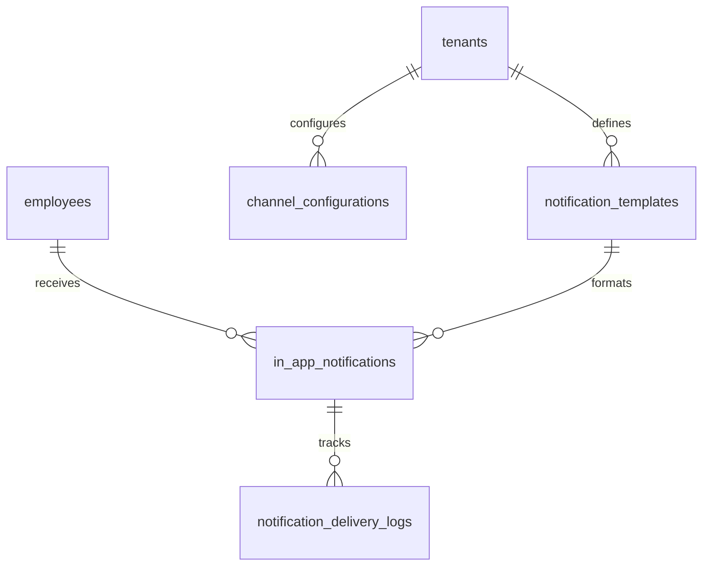

# TÀI LIỆU KỸ THUẬT MODULE 09: NOTIFICATIONS & MULTI-CHANNEL DISPATCHER (HỆ THỐNG THÔNG BÁO ĐA KÊNH & HƯỚNG ĐỐI TƯỢNG)

> **Tên phân hệ:** `Notification`  
> **Namespace Backend:** `App\Modules\Notification`  
> **Trách nhiệm chính:** Cung cấp hạ tầng phân phối thông báo tập trung theo đối tượng (Nhân viên, Chức vụ, Phòng ban, Chi nhánh, Vai trò), hỗ trợ kênh thông báo nội bộ (In-app Bell qua WebSockets/SSE), kênh Email thông minh kèm hàng đợi, và kiến trúc Driver mở rộng sẵn sàng kết nối các kênh bên thứ 3 (Telegram, Zalo OA/ZNS, Microsoft Teams, Slack), tích hợp các mẫu thông báo về phúc lợi, con nhỏ và cảnh báo tuân thủ.

---

## 1. Ranh giới Nghiệp vụ & Trách nhiệm (Domain Boundaries)

Module `Notification` là trung tâm truyền thông số (Communication Hub) kết nối toàn bộ các module nghiệp vụ trong Smart-HR với người dùng cuối:
1. **Động cơ Phân phối theo Phân khúc Đối tượng (Audience Targeting Engine)**:
   - *Gửi đích danh cá nhân*: Gửi trực tiếp đến 1 hoặc một danh sách `employee_id`.
   - *Gửi theo Vị trí / Chức danh (`position_id`)*: Gửi thông báo đồng loạt tới tất cả "Quản lý Cửa hàng", "Trưởng ca", "Kế toán tiền lương"...
   - *Gửi theo Phòng ban / Chi nhánh (`department_id`, `branch_id`)*: Gửi thông báo nội bộ đến các khối bộ phận.
   - *Gửi theo Quyền hạn Ma trận*: Gửi tới các nhân sự có quyền `can_approve` khi có đơn từ mới cần xử lý.
2. **Kênh Thông báo Nội bộ (In-App Bell & Popover List)**:
   - Nút chuông thông báo trên Header tích hợp popover hiển thị trạng thái và danh sách thông báo hệ thống (đồng bộ thiết bị, cảnh báo BLLĐ, đơn từ mới), có nút "Đánh dấu đã đọc" và empty state tinh tế.
3. **Kênh Email Thông minh (Smart Queued Email Dispatcher)**:
   - Tự động phát hiện trạng thái Worker: Ưu tiên đẩy Job vào hàng đợi Redis (`SendQueuedMailJob`); nếu hàng đợi bị gián đoạn, tự động chuyển đổi sang cơ chế xử lý dự phòng an toàn.
4. **Kiến trúc Driver Cắm rút Bên thứ 3 (Pluggable 3rd-Party Drivers)**:
   - Telegram Bot Driver, Zalo OA / ZNS Driver, Microsoft Teams Driver, Slack Driver.
5. **Mẫu Thông báo Động & Đa ngôn ngữ (Notification Templates Engine)**:
   - Bổ sung các mẫu sự kiện mới: Đăng ký con nhỏ thành công (`CHILD_REGISTERED_SUCCESS`), Phê duyệt đơn thỏa thuận tự nguyện ca đêm/OT (`CONSENT_NIGHT_OT_APPROVED`), Cảnh báo rủi ro kiệt sức cận trần (`BURNOUT_RISK_WARNING`).

---

## 2. Thiết kế Cơ sở Dữ liệu & Mô hình Dữ liệu (Database Schema)

### 2.1 Sơ đồ Thực thể Quan hệ (ERD)

### 2.2 Đặc tả Chi tiết các Bảng Dữ liệu

#### Bảng `notification_templates` (Mẫu Thông báo Đa Ngôn Ngữ)
- `id` (BIGINT UNSIGNED, PK, Auto Increment)
- `tenant_id` (BIGINT UNSIGNED, Nullable)
- `code` (VARCHAR(100)) — Mã định danh mẫu
- `category` (ENUM: `ATTENDANCE`, `LEAVE`, `ROSTERING`, `PAYROLL`, `COMPLIANCE`, `CORE_HR`, `SYSTEM`)
- `default_channels_json` (JSON) — Kênh gửi: `["IN_APP", "EMAIL", "TELEGRAM"]`
- `title_translations_json` (JSON) — Tiêu đề đa ngữ
- `body_translations_json` (JSON) — Nội dung đa ngữ có placeholder: `{name}`, `{child_name}`, `{cap_hours}`...
- `is_active` (BOOLEAN, Default: TRUE)

#### Bảng `in_app_notifications` (Thông báo Chuông In-App)
- `id` (BIGINT UNSIGNED, PK, Auto Increment)
- `tenant_id` (BIGINT UNSIGNED)
- `employee_id` (BIGINT UNSIGNED, FK $\to$ `employees.id`)
- `template_id` (BIGINT UNSIGNED, Nullable, FK $\to$ `notification_templates.id`)
- `title` (VARCHAR(255))
- `body` (TEXT)
- `action_url` (VARCHAR(255), Nullable)
- `is_read` (BOOLEAN, Default: FALSE)
- `read_at` (TIMESTAMP, Nullable)
- `created_at` (TIMESTAMP, Default: CURRENT_TIMESTAMP)
- Index: `(employee_id, is_read, created_at)`

---

## 3. Danh mục RESTful / Inertia Endpoints

| Method | URI | Quyền hạn | Mô tả |
|---|---|---|---|
| `GET` | `/notifications` | Public User | Lấy danh sách thông báo cá nhân (cho Bell popover) |
| `POST` | `/notifications/{id}/read` | Public User | Đánh dấu một thông báo đã đọc |
| `POST` | `/notifications/read-all` | Public User | Đánh dấu đã đọc toàn bộ thông báo |

---

## 4. Kịch bản Kiểm thử Tích hợp (Test Scenarios)

1. **Test `ConsentNightOTNotificationDispatched`**:
   - Khi đơn thỏa thuận ca đêm tự nguyện được duyệt.
   - Hệ thống tự động tạo 1 bản ghi `in_app_notifications` gửi đến nhân viên tạo đơn kèm nội dung thông báo thỏa thuận đã có hiệu lực pháp lý.
